# Retro Dev Kit Apple 1 — The Original Sin

*[Version française : README.md](README.md)*

*Retro Dev Kit Apple 1* (**Retro Dev Kit** family): an Apple-1 (1976)
emulator and development workshop, with ACI tapes in WAV and AIFF. The
technical names do not change: commands `apple1-emu` and `apple1-emu-gui`,
`run.sh`, `install.sh`, settings in `~/.config/apple1-emu`.
Repository: <https://github.com/Old-Wirehead/rdk-apple1>.

**Version 1.0** (November 2026): first public release. It matches the former
test version 7.9.3 and its fixes (pull request #56); the 7.x numbers were the
test versions, when the repository was private.


An emulator of Steve Wozniak's Apple-1, written in Rust, that runs in a
**graphical window** (`apple1-emu-gui`, zoom, buttons, program library) or in
a **terminal** (`apple1-emu`). Above all, it lets you **export your programs
as WAV or AIFF files** compatible with the Apple Cassette Interface (ACI), to
play them into a **real Apple-1** (from a PC or a smartphone), and **import**
WAV/AIFF files recorded from a real machine.

- NMOS 6502 processor emulated cycle for cycle: documented opcodes, flags and
  NMOS decimal mode. It passes Klaus Dormann's functional test.
- Apple-1 memory map:
  - configurable RAM (by default 8 KB at `$0000-$1FFF`, plus 4 KB at
    `$E000-$EFFF`);
  - PIA 6821 at `$D010-$D013`;
  - Woz Monitor at `$FF00`.
- 40×24 upper-case video terminal, with scrolling and a blinking `@`
  cursor. It accepts at most one character per frame, about 60 chars/s, like
  the real one.
- ACI card: I/O at `$C000-$C0FF`, Woz ROM at `$C100-$C1FF`. The virtual tape
  is a WAV or AIFF file.
- Real speed by default: 1.022727 MHz, that is 0.960 MHz effective with the
  DRAM refresh. A fast mode is available.
- The `apple1-core` core is a library with no dependencies, separate from
  the front ends: `apple1-emu` (terminal: crossterm and clap) and
  `apple1-gui` (window: eframe/egui).

## Graphical interface: `apple1-emu-gui`

The simplest way: unzip `apple1-emu.zip`, then double-click `run.sh` (choose
“Run” if the file manager asks, for example under Linux Mint). `./install.sh`
adds the emulator to the applications menu (Games section). The former
`lancer.sh` and `installer.sh` are now called `run.sh` and `install.sh`;
running `./install.sh` again updates an older installation (menu, desktop
icon).

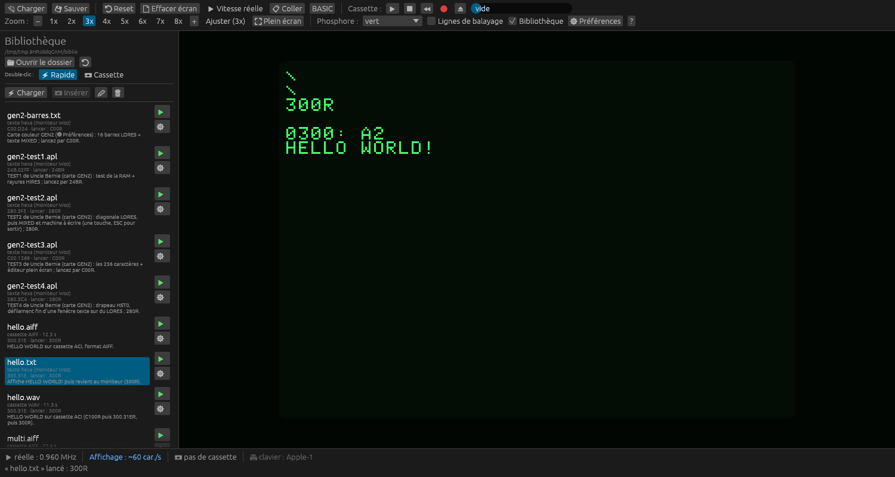

**Screen.** The 40 × 24 characters are drawn dot by dot with the ROM of the
**Signetics 2513** character generator (`assets/2513.bin`, a copy of
`hardware/roms/2513.bin`): 5 × 7 dots in a 7 × 8 cell (row 0 of the ROM is
empty, bit 4 is the leftmost dot), that is 280 × 192 dots. The `@` cursor
blinks at 2.18 Hz (`--cursor-hz`, as in the terminal). **Green**, **white**
or **amber** phosphor, and an optional “scan lines” effect.

**Vintage screen (screening).** The **Vintage screen (screening)** box
(toolbar and Preferences) imitates a 1970s tube monitor. The main effect is
the thin dark line that separates the scan lines: each row of dots of a
character becomes a horizontal band, as on the photo of a real Apple-1. This
line has a thickness in real screen pixels (about a fifth of the line, at
least one pixel), so it stays thin and sharp at every zoom and in full
screen. The dots are only barely softened, and only horizontally: the blur
of a photo comes from the camera, not from the tube. In the Preferences you
set the **intensity** and choose the effects:
- separation of the scan lines (on);
- dots softened horizontally (on);
- **phosphor persistence**, with its own slider (all the way left: none);
  by default it is short: the dots fade in less than a tenth of a second in
  green, a little faster in white, a little more slowly in amber;
- glow, discreet (on): the dots stay sharp;
- curved tube and darkened corners (off), with a **Curvature** slider
  (slight by default);
- flicker (off).

If your `gui.json` comes from v5.3, it receives the new default settings at
the first launch (shorter persistence, glow on, slight curvature). If you
had turned persistence off, it stays off.

The effect also applies to the colour monitor of the GEN2 card. The
computation is done on the processor at the Apple-1 resolution (less than
5 ms for a full screen, and only when the image changes), then the graphics
card enlarges the image. It stays smooth even with software OpenGL rendering
(llvmpipe). The settings are kept in `gui.json`. On the command line:
`--screening`, `--sans-screening`, or for example
`--screening-options intensite=0.7,remanence=0.5,courbure=0.4,sans-halo`
(values from 0 to 1; the option names are French).

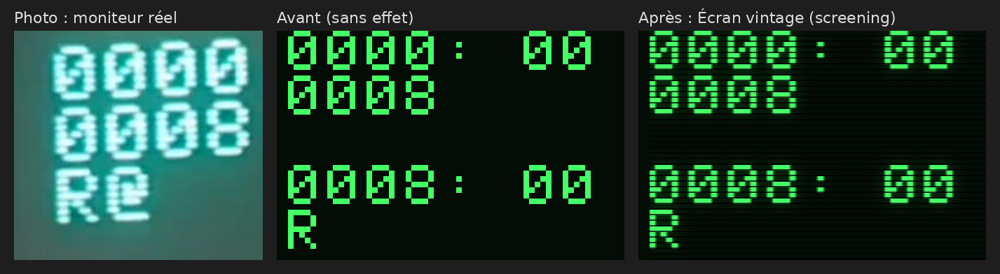

**Zoom.** Buttons `1x` to `8x` and **Fit** (the largest whole zoom that fits
in the window: the dots stay sharp). Shortcuts **Ctrl+plus**,
**Ctrl+minus**, **Ctrl+0** (fit), **F11** full screen. The window can be
resized freely. At the first launch it takes 80 % of the screen; the zoom,
the colour, the window size and the library folder are then kept in
`~/.config/apple1-emu/gui.json`.

**Toolbar.**

| Button | Effect |
|---|---|
| 📂 Load | `.wav`, `.aiff`: either **into memory** (direct decoding) or **as a virtual tape**; `.txt` (Woz dump) into memory; `.bin`: the address is asked |
| 💾 Save | asks for the ranges (`0300.03FF`, `004A.00FF 0300.0FFF`, `004A.00FFW800.FFFW`…), then the file: the extension chooses the format (`.wav`, `.aiff`, `.txt`, `.bin`) |
| RESET (red), 🗋 Clear screen | RESET and CLEAR SCREEN buttons (Ctrl+R, Ctrl+L) |
| Gauge: real / fast speed | toggle (F3); blue when fast speed is on |
| Graphics cards: 🎨 GEN2, P-LAB | named group: GEN2 plugs in the colour card; P-LAB, greyed out (“Soon”), is not emulated yet |
| EPROM (UV window chip) | EPROM programmer, at the right of the bar |
| ⊞ Layout ▾ | menu: Default, Game, BASIC, Assembler, Debugging, “Save the current layout…” and your layouts (right click: Rename, Delete) |
| 📋 Paste | types the clipboard on the Apple-1 keyboard (Ctrl+V too) |
| BASIC | loads your Integer BASIC at `$E000`: a **tape** (`.wav`, `.aiff`, like the `BASIC.wav` of the archive.org tapes), a `.txt` dump or a 4096-byte `.bin`. It is looked for in the library by itself (`BASIC.wav`, `integer_basic.bin`…, then any file whose name contains “basic”), otherwise asked; the choice is kept. Right click: another file |
| 📝 Editor | Integer BASIC and 6502 assembler editor in tabs: colours, errors, ▶ Run, 📼 Export WAV (see “Integer BASIC editor” and “6502 assembler”) |
| ⚙ Preferences | language, library folder, double-click mode, display, BASIC file, GEN2 colour card (see below) |
| Tape ▶ ⏹ ⏪ ⏺ ⏏ | play, stop, rewind, record (ACI output to `.wav`/`.aiff`, written 1.5 s after the end or at stop), eject; the bar shows the name, the position and the length |

**Library** (left panel, “Library” box to hide it). Default folder
`~/apple1/programmes`, created at the first launch with the examples sorted
into five folders (**BASIC**, **6502**, **GEN2 COLOR**, **WAV**,
**Art ASCII**); to choose another one: **⚙ Preferences → Library folder →
Browse…** (“Default” goes back to `~/apple1/programmes`). For each `.wav`,
`.aiff`, `.txt`, `.bin` file: name, type, address ranges (read from the
`APPLE1 ACI` comment of exported files, or decoded, or the size for a
`.bin`), tape length, run command and notes. To the right of each program,
two small buttons:

- **▶** loads the program if that is not already done, then **runs** it:
  RESET, then the run command typed on the keyboard (`300R`, or `E2B3R`
  then `RUN` for a BASIC program, BASIC warm-started). If the program needs
  Integer BASIC and it is not at `$E000`, the emulator first loads it
  (instantly) from the chosen file (BASIC button or Preferences) or, failing
  that, from the library (`BASIC.wav`…, see the BASIC button), then loads
  the program (zero page `004A.00FF` then the program) and types `E2B3R`
  and `RUN`. Without BASIC, a clear message asks for it;
- **⚙** opens the **program parameters**, which you can change: ranges
  (written as for the ACI, e.g. `0300.031E` or `004A.00FF 0800.0FFF`;
  `4A.FF` is refused because the real ACI would read `$004A-$4AFF`), load
  address of a `.bin`, run address and command (`\n` = RETURN between two
  lines), type (machine language or BASIC), “needs Integer BASIC”, notes.
  The values are pre-filled from the file, checked when saved (“Values from
  the file” reads them again), and stored in `programs.json`, in the library
  folder. An older `descriptions.json` is taken over automatically (its
  descriptions become the notes; the file is left in place).

**Double-click: two modes**, above the list (and in the Preferences), kept
from one session to the next:

- **⚡ Fast** (default): **instant** loading into memory, according to the
  ranges of the ⚙ parameters;
- **📼 Tape**: as on the real machine. The emulator does RESET, types
  `C100R` then the ACI read command (`0300.031ER`), and the tape plays at
  real speed; a **progress bar** appears under the program name. `.txt` and
  `.bin` files are first converted into a tape
  (`~/.cache/apple1-emu/cassettes/`). With ▶, the program is run as soon as
  the reading ends.

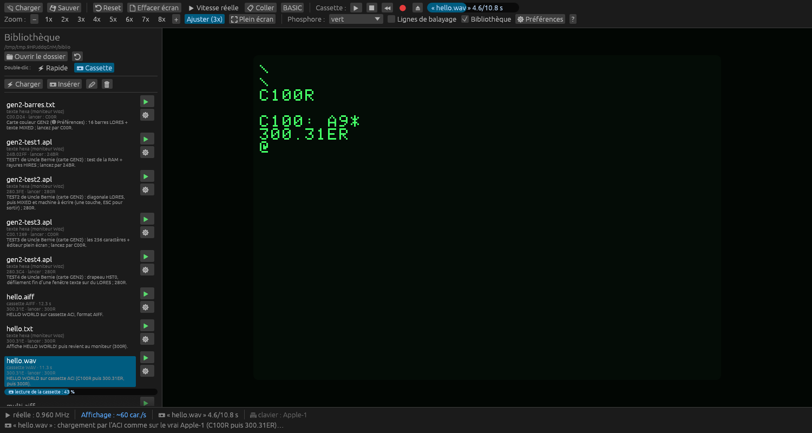

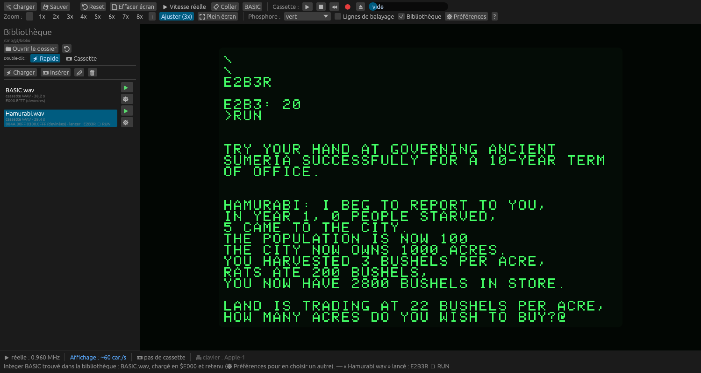

#### Several folders, GitHub projects, help (v6)

- **Several folders**: “**+ Folder**” at the top of the library (or
  ⚙ Preferences → Library) adds a folder; the main folder always stays. The
  library is a **tree**: folders and subfolders fold up (the state is
  remembered). Each folder keeps its own `programs.json`; ⚙, ▶, double-click
  and recognition work everywhere. Files shown:
  `.wav .aiff .bin .hex .txt .apl .bas .s .asm`. Right click on an added
  folder: open it, or remove it (nothing is erased on disk).
- **GitHub projects**: “**+ GitHub project**” accepts an address
  (`https://github.com/jefftranter/6502/tree/master/asm/jmon`) or
  `owner/repository`. The useful files are copied into
  `~/.cache/apple1-emu/github/<owner>/<repository>/<commit>/` and the
  project becomes a node of the tree, with its commit (7 characters), its
  date and its message. **Update** fetches the latest commit; 🌐 opens the
  page. All the network work is done in the background, with a progress
  bar. Public repositories: no token. A token is optional (`GITHUB_TOKEN`
  variable, or Preferences; `gui.json` is then in mode 0600); it is never
  shown nor written in the messages. It is used for the request limit,
  private repositories and GitHub Actions artifacts.
- **Test the latest build** tries, in this order: the files of the latest
  **Release** (`.wav/.aiff`, then `.bin`, then `.hex/.txt`), then the latest
  **GitHub Actions artifact** (token needed), then **building the sources**:
  a BASIC listing is typed into Integer BASIC (loaded first) then `RUN`; a
  6502 source (`.s/.asm`) is assembled with **ca65/ld65** (`cc65` package;
  clear message if they are missing), with `-D APPLE1` by default; a Woz
  dump (`.txt/.hex`) is loaded. An `apple1.toml` file (or `apple1.cfg`) at
  the root says what to build:

  ```text
  file    = "src/jeu.s"     # program to run
  load    = $0300           # load address (otherwise the .org of the source)
  run     = $0300           # run address (otherwise the load address)
  ld65    = "apple1.cfg"    # ld65 configuration (otherwise -t none)
  defines = "APPLE1"        # -D symbols for ca65
  ```

  Checked on `jefftranter/6502` (`asm/jmon`, 8 files, `jmon.s` chosen);
  this source needs a recent ca65 (2.19 or later, `cpu.mac`): with an older
  ca65, the ca65 error is shown as it is.
- **Position**: ⚙ Preferences → “Library position: left / right” (**right**
  by default), applied at once; the width of the panel (drag its edge) is
  remembered.
- **Help mode**: the **?** button (or **F1**) turns detailed explanation
  bubbles on or off, in the 7 languages, on every control; the setting is
  remembered. When it is off, only the usual small tooltips remain. ℹ opens
  “About”.

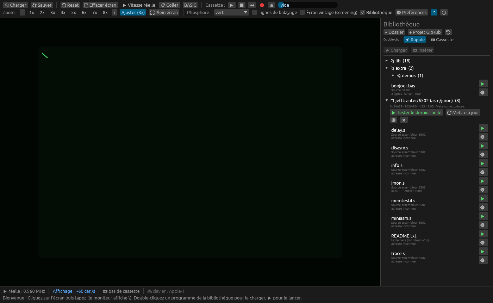

#### Tape sound and oscilloscope (v6.1)

During a reading (📼 Tape mode, or ▶ of the player) or a recording (⏺), the
tape signal can be **heard** and **seen**:

- **🔊 / 🔇** (toolbar, to the right of the tape): the sound of the signal,
  played at the pace of the emulation, **low volume** by default (slider in
  the oscilloscope or ⚙ Preferences → Tape). Muted at maximum speed. The
  sound goes through ALSA (`libasound`, loaded at launch only if it exists):
  without a sound card, it is simply off.
- **📈**: the **Tape oscilloscope** window (green trace on a dark grid, 1 ms
  per division) appears by itself during reading or writing; it shows 10 ms
  around the playback head (orange line), or the last 10 ms written by the
  Apple-1. The signal is rebuilt from the edges the ACI sees (header
  ≈ 870 Hz, 0 bits ≈ 2 kHz, 1 bits ≈ 1 kHz). It can be moved and closed
  (✖); the settings are remembered.

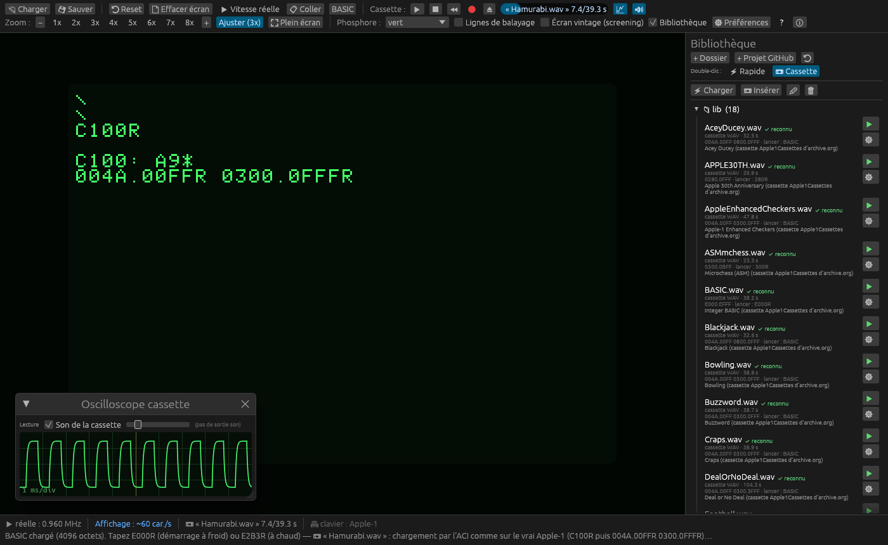

#### Integer BASIC editor (v7.0)

**📝 Editor** (toolbar) opens the **editor** (on the left, see v7.2):

- **Tabs.** 🗋 New, 📂 Open (`.bas`, `.txt`), 💾 Save (**Ctrl+S**), Save
  as… A dot • marks a modified tab; × closes it (a second click is asked if
  it is not saved). The tabs, including unsaved text, come back at the next
  launch.
- **Colours**: line numbers, keywords, numbers, strings, `REM`, operators.
  Lines that BASIC would refuse have a red background.
- **Text size**: A− / A+, **Ctrl+wheel** on the text, or
  **Ctrl+plus / Ctrl+minus / Ctrl+0** when the text has the keyboard
  (otherwise these keys keep controlling the screen zoom).
- **Native checking and tokenization** (`apple1_core::intbasic`): the
  program is put into the exact form it has in memory in Integer BASIC
  (lines `[length][number][tokens…][$01]` below HIMEM, zero page `$4A-$FF`
  with LOMEM, HIMEM, PP and PV). Errors give the text line, the BASIC line
  number and the column (click = cursor on the line): syntax, variable name
  (one letter and one digit at most, `A$` for a string), number > 32767,
  direct-mode command (`LIST`, `RUN`…), unclosed string, line longer than
  255 bytes, memory full.
- **Memory**: auto (8 KB with LOMEM `$0800`, or `$0300` if the program is
  large, otherwise 12, 16 or 32 KB), or forced.
- **▶ Run**: loads Integer BASIC if it is missing (`BASIC.wav` from the
  library, like the BASIC button), puts the tokenized program into memory,
  adds RAM if needed, then types `E2B3R` and `RUN`.
- **📼 Export WAV**: ACI tape (`.wav`, or `.aiff` for the smartphone) with
  two records, and its ⚙ parameters in the library. The bottom of the
  window shows what to type on the real Apple-1, with 4 digits on each side:
  `C100R` then for example `004A.00FFR 0C3B.0FFFR`, reading, then `E2B3R`
  and `RUN` (📋 Copy).
- Help mode (**?** / F1): each button has its bubble, in the 7 languages.

The tokenization was compared **byte for byte** with that of the real
Integer BASIC (program typed into the emulator, memory read back) on the 8
games of `ports/basic` and on `ports/aventure-js29/aventure.bas` (12 KB):
identical blocks, identical `LIST` and games (`RUN` with the answers from
`tests/`), and reading of the exported tape by the ACI checked. On the
command line: `apple1-emu basic jeu.bas -o jeu.wav [--ram 8|12|16|32]`
(also `.aiff`, or `.txt` for a Woz dump).

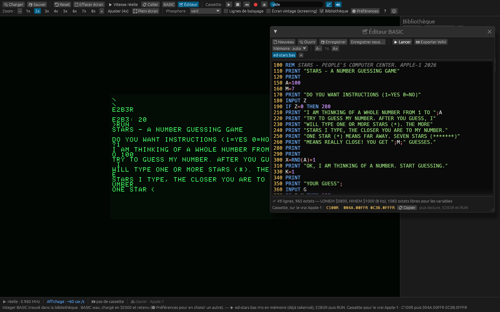

#### Editor on the left, or in its own window (v7.2)

The editor now opens **docked on the left** of the main window (the library
stays on the right by default); drag its edge to set its width.
**🗗 Detach** (at the top of the panel) puts it in a **real separate system
window**, which you can move to a second monitor and resize; **⊟ Dock**
puts it back on the left. The choice, the width of the panel, and the size
and position of the separate window are kept. Closing the separate window
closes the editor; 📝 Editor reopens it in the same place. Keys typed in the
separate window go to the editor, never to the Apple-1. The dialog boxes
(Open, Save as, Export) open in the main window.

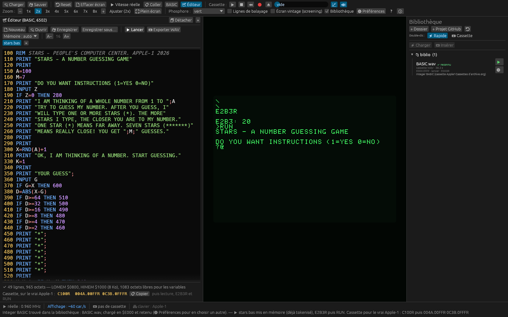

#### BASIC and 6502 debugger (v7.3)

**🐛 Debugger** (toolbar) opens a panel, docked on the right or
**🗗 detachable** into its own window like the editor. It stops the Apple-1
and runs it step by step:

- **⏸ Pause / ▶ Continue**, **⬇ Step** (one instruction), **↪ Over** (a
  `JSR` in one go), **⤴ Out** (up to the `RTS` of the subroutine), and, in
  the editor, **⏩ To cursor**;
- **breakpoints**: **⏺ Breakpoint** in the editor on the cursor line (`.s`
  source thanks to the address table, or BASIC line), click in the margin of
  the 📃 Listing or on a line of the disassembly, or typing an address
  (`$0368`, `ASK`, `PUTS+3`);
- **processor**: A X Y S PC and the flags N V B D I Z C, editable;
  **disassembly** around PC with the labels of the assembled program;
- **Integer BASIC**: **⏭ BASIC line** advances by one line of the program;
  the current line is highlighted in green in the editor, breakpoints in
  purple; breakpoints on line numbers; **watched variables**: integers
  (`A`, `B1`), array elements (`D(2)`), whole array (`D`), strings (`C$`),
  plus the list of all the variables. The current line is read from the
  interpreter's zero-page pointers (`$DC`/`$DD`) at the moment it starts a
  line; this was checked with the real Apple-1 BASIC (it must be loaded at
  `$E000`);
- **watched memory**: byte, word or ASCII (`$30`, `$30 w`, `0200.020F`, a
  label), editable, in yellow when the value changes;
- **hex/ASCII dump**: 16 bytes per line, ASCII with bit 7 removed, go to an
  address (or ZP, `$0200`, `$0300`, PC, `$E000`), changed bytes in yellow,
  the byte at PC on a green background; **Write** stores bytes
  (`0300 = A9 00`), a click on a byte fills the write line.

The variables, the watched memory and (since v7.5) the breakpoints are kept
from one session to the next. Beware: as on the real machine, a key pressed
while the BASIC program is running stops it (`STOPPED AT`). On the command
line: `--debogueur`, `--ecran-separe`, `--dbg-arret ASK,L190` (address,
label or `L` + BASIC line), `--dbg-surveiller 'A,C$,$30 w'`,
`--dbg-commande 5:pas` (pause, continuer, pas, dessus, sortir, basic). These
option names and keywords are French.

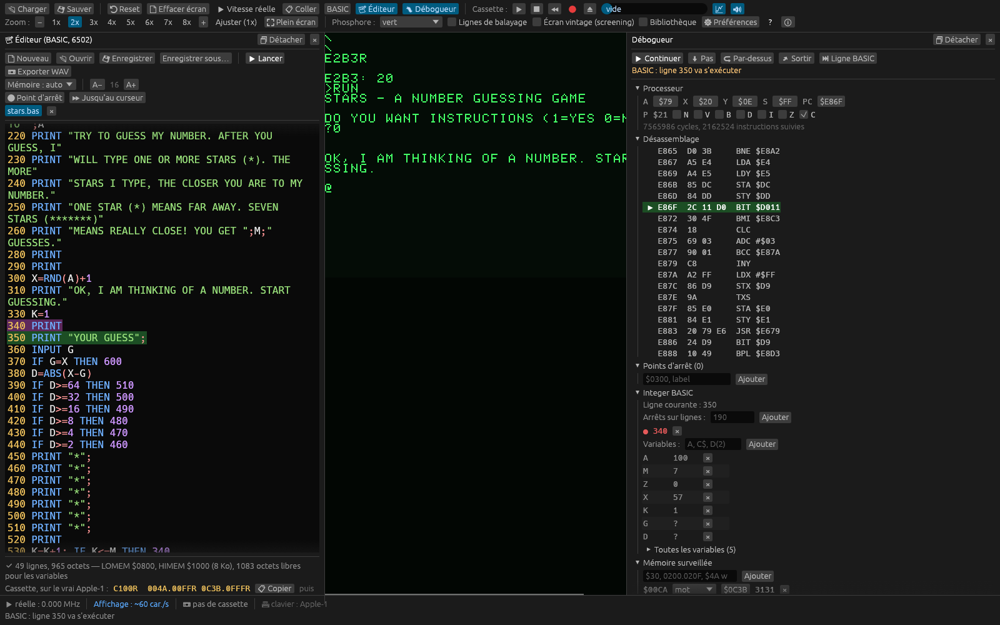

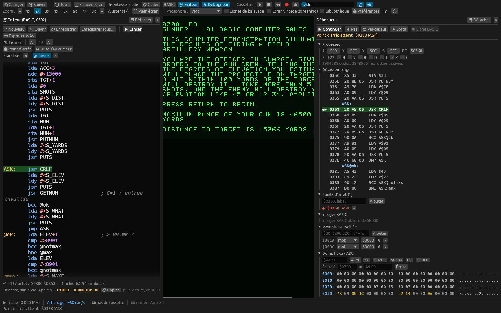

#### 6502 assembler (v7.1)

The same **📝 Editor** also opens 6502 assembly sources (`.s`, `.asm`,
`.a65`, `.inc`; 🗋 New → “6502 assembly source”). They are assembled at
every change by a native two-pass assembler (`apple1_core::asm6502`), which
accepts the ca65 syntax of the ports:

- **Colours**: instructions, directives, labels, numbers (`$7F`, `%1010`,
  `'A'`), strings and `;` comments.
- **Syntax**: labels `NAME:`, local labels `@loop:` (between two normal
  labels), unnamed labels `:` with `:+`, `:++`, `:-`; constants
  `NAME = expression`; expressions with `< > ^` (low, high, bank byte),
  `+ - * / & | ^ << >> ~ !`, comparisons, `&& ||`, `*` (current address);
  directives `.org .byte .word .res .asciiz .include .macro .endmacro .local
  .ifblank .ifnblank .else .endif .segment`; the 151 official opcodes of the
  NMOS 6502 and all the addressing modes (zero page chosen when the value is
  already known, like ca65).
- **Errors** with file, line and column (click = cursor on the line, and
  opening of the included file if needed): syntax, unknown instruction,
  impossible addressing mode, undefined or duplicate symbol, value out of
  range, branch too far, `.include` not found, badly closed block, division
  by zero, unclosed string.
- **📃 Listing**: address, bytes and source of each line, included files in
  their place; a click takes you back to the line in the text.
- **▶ Run**: puts the bytes into memory at the origin (`.org`, `$0300` by
  default), adds RAM if needed, then types for example `300R`.
- **📼 Export WAV** (`.wav` or `.aiff`): ACI tape and ⚙ parameters in the
  library (`300R`). The bottom of the window shows the range to type on the
  real Apple-1, with 4 digits: `C100R` then for example `0300.0B58R`,
  reading, then `300R` (📋 Copy).
- `.include` files are looked for in the folder of the file that contains
  them, then in that of the source, its two parent folders and their `lib`
  subfolders (which covers `ports/asm/lib`).

Validation: the 6 assembly games (`gunner`, `guner1`, `splat`, `rockt1`,
`orbit`, `target`) give **exactly the same bytes** as ca65 + ld65 (2137,
5136, 7140, 5635, 6069 and 5712 bytes at `$0300`), as does a test source
that uses every opcode and every mode. The tape written by 📼 Export WAV is
identical to the one from the command line. On the command line:
`apple1-emu asm jeu.s -o jeu.wav` (also `.aiff`, `.bin`, `.txt`/`.hex`;
`-I folder` for `.include` files, `-l` for the listing).

Limits: a single contiguous image (`.segment` is accepted but ignored, like
an ld65 with a single memory area); official opcodes only (the 65C02 is
added in v7.4, below).

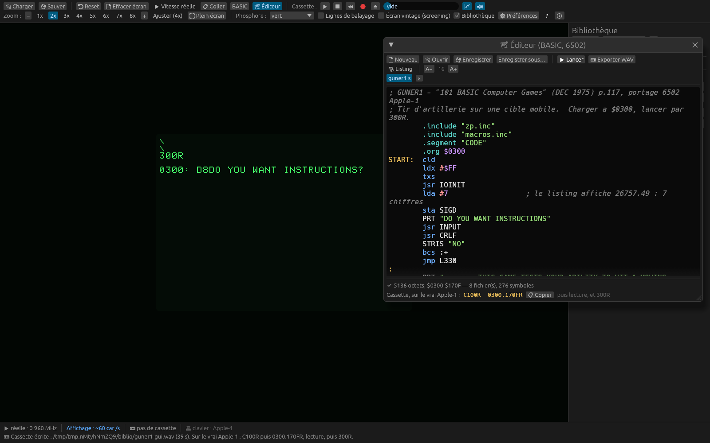

#### Advanced assembler (v7.4)

- **Conditional assembly**: `.if expression` / `.elseif` / `.else` /
  `.endif` (nested), `.ifdef NAME` / `.ifndef NAME`, `.defined(NAME)` in an
  expression. As with ca65, the value must be known at that point:
  constants defined higher up (otherwise the error “value unknown at this
  point”).
- **Repetition**: `.repeat 4, I` … `.endrep` (or `.endrepeat`), with an
  optional counter that takes the values 0, 1, 2…, nestable and usable in a
  macro.
- **`.define NAME text`** (text replacement, like ca65 without parameters)
  and `.undefine NAME`.
- **Size prefixes**: `lda a:ZP` forces absolute addressing (2 bytes),
  `lda z:VAR` zero page.
- **Escapes in strings** after `.feature string_escapes`, like ca65:
  `\n \t \r \\ \" \' \xHH` (without this line, `\` is an ordinary
  character, as in ca65).
- **65C02**: `.setcpu "65C02"` (or `.pc02`; back with `.setcpu "6502"` or
  `.p02`) adds `bra phx phy plx ply stz trb tsb stp wai`, the `(zp)` mode,
  `jmp (abs,x)`, `bit #`/`bit zp,x`/`bit abs,x`, `inc a`/`dec a`, and the
  Rockwell instructions `rmb0-7 smb0-7 bbr0-7 bbs0-7` (`bbr0 $12, loop`),
  exactly like `ca65 --cpu 65C02`. Without `.setcpu`, `stz` is refused with
  the hint “65C02: .setcpu "65C02"”. Beware: the Apple-1 has an NMOS 6502
  (and so does the emulator); this code only runs on a board modified with
  a 65C02, and the debugger's disassembler stays NMOS.
- **Macro expansion in the 📃 Listing**: under the calling line, each line
  produced by the macro, with its parameters replaced, and its bytes
  (`0300  A9 41      + lda #$41`).
- **Symbol table** at the end of the listing (📃 Listing view and `-l` file
  of the command line): name and value, sorted by name.
- **Zero-page / absolute warning**: an address that would fit in zero page
  but is coded on 2 bytes because its symbol is defined further down (like
  ca65's “Didn't use zeropage addressing”); the program is assembled
  anyway, and the warning is shown in yellow at the bottom of the editor
  (click = line) and on the error output of `apple1-emu asm`.

Validation: the 6 games still give exactly the same bytes as ca65 + ld65;
each new feature has its test, whose expected bytes come from ca65 V2.18 on
the same sources; and each instruction in each of the 16 operand forms, in
6502 and in 65C02 (3136 trials), is either accepted with the same bytes as
ca65 (445), or refused by both. Known differences: `.define` without
parameters only; `.if` on a label is not possible (its value is only known
at assembly time; ca65 refuses it too, except in special cases).

#### Photo → ASCII and ASCII art library (v7.7)

- **🎨 ASCII** (toolbar) opens the **Photo → ASCII** tool, a panel that can
  be docked and detached like the others (at first, a tab next to the
  editor). **Drag and drop** a jpg or png photo onto the window, or use
  **📂 Open…** (a photo, or ready-made ASCII art in `.txt`).
- **Cropping**: the green frame on the photo shows the part that is
  converted; drag it to move it, the wheel zooms. Settings: **columns** (40
  at most) and **rows** (24 at most, **23 rows** button to leave the last
  one for the prompt), **zoom**, **centre**, **brightness**, **contrast**,
  **gamma**, **invert**, **auto levels** (2-98 % stretch), Floyd-Steinberg
  **dithering**.
- **Characters**: only those of the Apple-1's 2513 (capitals, digits,
  symbols; no lower case, no `"`, no `_`), ranked by the number of dots lit
  in the 2513 font: **full** ramp (26 levels), **simple** (10), the one from
  **Schmenk's slideshow**, or **custom** (sorted and de-duplicated
  automatically).
- **Preview** drawn with the Apple-1 font, in the colour of the chosen
  phosphor.
- **Program**: **BASIC** (one `PRINT "…"` line per line of the art; a full
  40-character line ends with `;`, because the screen goes to the next line
  by itself) or **6502** (ca65 source at `$0300`: a loop sends a compressed
  table to ECHO `$FFEF`, runs of identical characters coded as “count +
  character”; the screen is cleared first; run with `300R`). With 24 rows,
  the program waits for a key before giving back control; with 23, the
  prompt comes on the 24th row and the picture stays whole.
- **Buttons**: **✎ Insert into the editor** (new BASIC or 6502 tab),
  **▶ Run** (inserts then runs, like ▶ in the editor), **📼 Export WAV…**
  (tape for a real Apple-1), **💾 Save to the library** (`.txt` in the
  “Art ASCII” folder), **📋 Copy the text**, **Show the code**.
- **“Art ASCII” library**: a folder added to the library with original
  drawings in the screen format (apple, Apple-1 board, 6502 chip, tape,
  rocket, cat, skull, computer, “HELLO WOZ”) and the **portraits of Steve
  Wozniak and Steve Jobs**, converted by the tool from free photos (see
  `Art ASCII/LICENCES.md`). An ASCII art `.txt` there shows a **preview**
  when selected, with **→ BASIC**, **→ 6502** and **🎨 Open in the tool**;
  double-click: in the tool; **▶**: the 6502 program is run at once.
- **Dave Schmenk's slideshow** (2014, with his portraits of Woz and Jobs):
  added as a **GitHub project** of the library
  (`dschmenk/Apple1-Slideshow`). It is downloaded from GitHub, not supplied
  (the repository has no licence). **▶ Test the latest build** assembles it
  (`slideshow.a65`, xa syntax, translated automatically; the same 3456 bytes
  as xa 2.4.1) and runs it with `280R`.
- **Migration**: a configuration from v7.6 or earlier receives the
  “Art ASCII” folder and the GitHub project once.
- On the command line: `apple1-emu ascii PHOTO` (see section 3).

Scripting (captures, tests): `--ascii FILE`, `--ascii-reglages
"zoom=1.3;cx=0.45;cy=0.32;contraste=1.3;gamma=0.45;lignes=23;asm=1"`,
`--ascii-lancer S`.

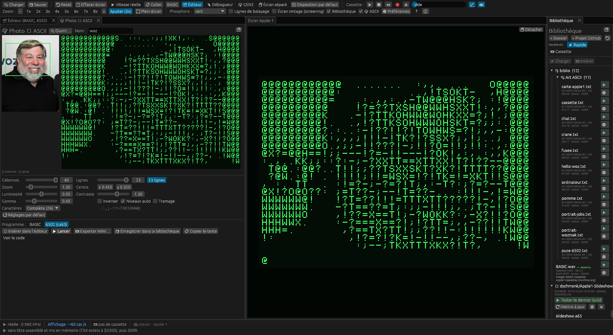

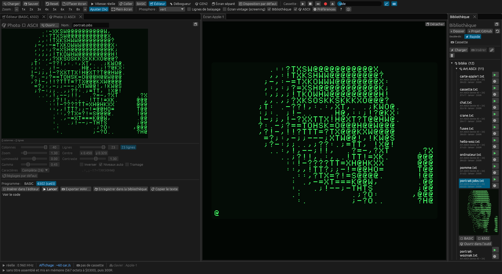

#### Dockable layout: panels side by side, detachable (v7.6)

- **Each panel is a dockable tab**: editor, Apple-1 screen, GEN2 colour
  screen, debugger, disassembly, dump and library. Drag a tab by its title:
  markers appear and you drop it **to the left, to the right, above, below**
  another panel, or **into the same tab group**. The separators can be
  dragged to resize. The layout is kept in `gui.json`.
- **Starting layout**: the editor open on the left; in the centre the
  Apple-1 screen, with the GEN2 colour screen below when the card is plugged
  in; on the right the debugger with the disassembly below, then the dump,
  then the library at the far right. It is designed for a 1920-pixel screen
  (Apple-1 screen at zoom 2); everything can be resized. The
  **⊞ Layout ▾** menu (toolbar) restores it at any time (**Default**, all
  panels open and docked) and offers **Game**, **BASIC**, **Assembler** and
  **Debugging**; **Save the current layout…** keeps yours under a name
  (right click: Rename, Delete).
- **🗗 Detach**: each panel has a button at the top right (full text on the
  two screens, 🗗 icon on the others; also by right-clicking the tab) that
  opens it in **its own system window**, which can be moved to a 2nd
  monitor, with its size and place kept. **⊟ Dock** puts it back in its
  starting place. The Apple-1 screen and the colour screen detach
  **separately**; the keyboard goes to the Apple-1 from either of their
  windows (and from the main window). Closing a screen's window docks it
  again; closing a tool's window closes it.
- **Dump**: 16 bytes per line, or 8 when the panel is narrow, with
  horizontal scrolling if needed.
- **Migration**: a configuration from v7.5 or earlier takes the starting
  layout at the first launch (all panels docked and open).
- The tape oscilloscope stays a small floating window inside the main
  window.

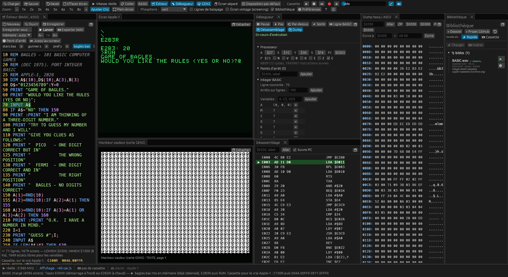

#### Windows: disassembly, dump, screen; GEN2 card in one click (v7.5)

- **No more jumping**: when BASIC waits for a key, PC loops in a small loop
  and the disassembly, recomputed at every frame, changed its number of
  lines (a label appeared or disappeared depending on the instruction PC
  was on), which made the whole panel move. Now the disassembly **always
  has 24 lines**, with the labels in their own column, and it **only
  re-centres when PC leaves the visible area** (or nears the bottom). The
  status and message lines of the debugger keep their place even when
  empty, and the scroll bar stays visible.
- **🗐 Disassembly** and **🗐 Dump** (debugger buttons) each have **their own
  window**, separate by default (can be moved to a 2nd monitor) or
  **⊟ docked** on the right like the debugger; size, place and open/closed
  state are kept. The disassembly has **Go** (address or label; the list
  then stays fixed) and **Follow PC**. The debugger panel keeps the
  controls, the registers, the breakpoints, the BASIC variables and the
  watched memory.
- **Breakpoints kept** from one session to the next (addresses and BASIC
  lines, in `gui.json`).
- **🗗 Separate screen** (toolbar): the Apple-1 screen (and the GEN2 colour
  screen if it is plugged in) moves to its own window, **which can be moved
  and resized**; with the “Fit” zoom, the image follows the size of the
  window while keeping its proportions, in whole steps (**Integer scale**,
  the sharpest) or filling everything. The vintage screen (CRT) works at
  every size. The keyboard goes to the Apple-1 when this window has the
  focus (and also from the main window). **⊟ Dock**, or closing the window,
  puts it back in its place. On the command line: `--ecran-separe`.
- **🎨 GEN2** (toolbar, lit when the card is plugged in) plugs in or
  unplugs Uncle Bernie's colour card without going through the Preferences:
  it is the same setting (kept), applied at once like the Preferences box;
  the running program continues (do a Reset if it was using the card).

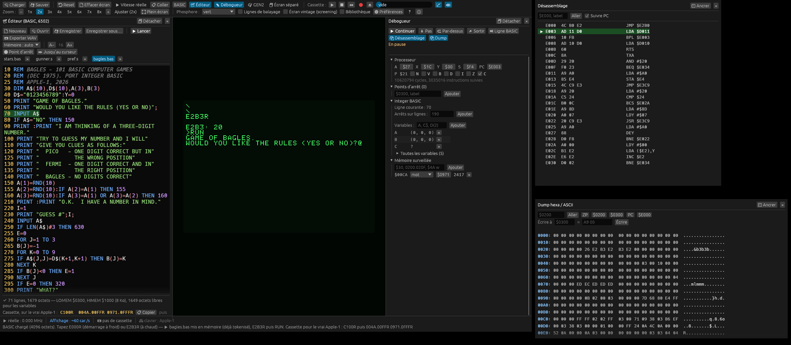

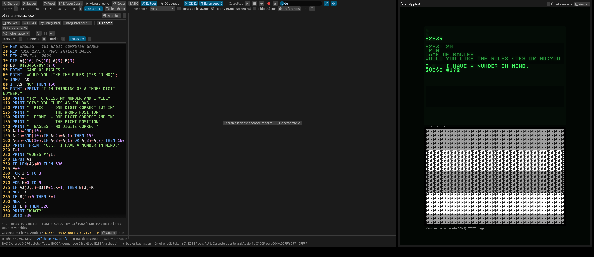

#### Recognised tapes: preset parameters

When a library file is **recognised**, its ⚙ parameters are filled in by
themselves and the list shows **✔ recognised** next to the name (the help
bubble says how, and whether the parameters are automatic or yours).

- **By content**: the emulator decodes the records of the tape and compares
  their size and their SHA-256 fingerprint with a table built into the
  program (the 24 tapes of the “Apple1Cassettes” collection on
  archive.org). The file name then does not matter at all: a renamed copy
  is recognised.
- **By name**, failing that: same file name (capitals, spaces and hyphens
  ignored: `HAMURABI.WAV`, `Apple Enhanced Checkers.wav`) **and** same
  record sizes. The content differs (another recording): the help bubble
  says so; check it.
- **Your settings are never overwritten**: a program that you have set up
  yourself in ⚙ (including with an earlier version) keeps its parameters;
  only the “recognised” mark appears. As soon as you change and save preset
  parameters, they become yours.
- The table contains **only** sizes, fingerprints and parameters: no data
  from the programs or from the BASIC ROM is shipped.
- The programs that go beyond the basic 8 KB (Football up to `$2FFF`, Deal
  or No Deal and Star Trek 2003 up to `$3FFF`, Life at `$2000`)
  automatically receive the RAM they need when run (“RAM raised to 12 KB”,
  like a memory expansion card).

| Tape (archive.org) | Recognised title | Ranges | Type | Run |
|---|---|---|---|---|
| `AceyDucey.wav` | Acey Ducey | `004A.00FF 0800.0FFF` | BASIC | `E2B3R ⏎ RUN` |
| `APPLE30TH.wav` | Apple 30th Anniversary | `0280.0FFF` | machine language | `280R` |
| `AppleiEnhancedCheckers.wav` | Apple-1 Enhanced Checkers | `004A.00FF 0300.0FFF` | BASIC | `E2B3R ⏎ RUN` |
| `ASMmchess.wav` | Microchess (ASM) | `0300.0BFF` | machine language | `300R` |
| `BASIC.wav` | Integer BASIC | `E000.EFFF` | machine language | `E000R` |
| `Blackjack.wav` | Blackjack | `004A.00FF 0800.0FFF` | BASIC | `E2B3R ⏎ RUN` |
| `Bowling.wav` | Bowling | `004A.00FF 0300.0FFF` | BASIC | `E2B3R ⏎ RUN` |
| `Buzzword.wav` | Buzzword | `004A.00FF 0300.0FFF` | BASIC | `E2B3R ⏎ RUN` |
| `Craps.wav` | Craps | `004A.00FF 0300.0FFF` | BASIC | `E2B3R ⏎ RUN` |
| `DealOrNoDeal.wav` | Deal or No Deal | `004A.00FF 0300.3FFF` | BASIC | `E2B3R ⏎ RUN` |
| `Football.wav` | Football | `004A.00FF 0400.2FFF` | BASIC | `E2B3R ⏎ RUN` |
| `Hamurabi.wav` | Hamurabi | `004A.00FF 0300.0FFF` | BASIC | `E2B3R ⏎ RUN` |
| `HiLo.wav` | Hi-Lo | `004A.00FF 0800.0FFF` | BASIC | `E2B3R ⏎ RUN` |
| `Life.wav` | Life | `2000.21FF` | machine language | `2000R` |
| `LunarLander.wav` | Lunar Lander | `0300.09FF` | machine language | `300R` |
| `LunarlanderasciiGraphics.wav` | Lunar Lander (ASCII graphics) | `004A.00FF 0300.0FFF` | BASIC | `E2B3R ⏎ RUN` |
| `Mastermind.wav` | Mastermind | `0300.03FF` | machine language | `300R` |
| `Microchess.wav` | Microchess | `1000.18FF` | machine language | `1000R` |
| `Pasart.wav` | Pasart | `0300.05FF` | machine language | `300R` |
| `Slots.wav` | Slots | `004A.00FF 0300.0FFF` | BASIC | `E2B3R ⏎ RUN` |
| `StarTrek.wav` | Star Trek | `004A.00FF 0300.0FFF` | BASIC | `E2B3R ⏎ RUN` |
| `StarTrek2003.wav` | Star Trek 2003 | `004A.00FF 0300.3FFF` | BASIC | `E2B3R ⏎ RUN` |
| `WordCross.wav` | WordCross | `004A.00FF 0300.0FFF` | BASIC | `E2B3R ⏎ RUN` |
| `Wumpus.wav` | Wumpus | `004A.00FF 0300.0FFF` | BASIC | `E2B3R ⏎ RUN` |

Each tape in the table was checked: loaded with these parameters (and the
real `BASIC.wav` tape for the BASIC programs), it starts and shows its
welcome text (`TRY YOUR HAND AT GOVERNING ANCIENT` for Hamurabi,
`HAPPY 30TH BIRTHDAY APPLE!` for APPLE30TH…). Remarks: `LunarLander.wav` is
read at `0300.09FF` (1792 bytes; the archive.org Readme gives `0300.0A00`,
one byte too many), and its “CONTROL TO LUNAR” line is followed by
meaningless characters that are in the data of the tape itself (the game
works). `Football.wav` loads at `$0400` although its LOMEM pointer says
`$0800`: the recorded block always ends at HIMEM, which is what the
emulator uses to guess.

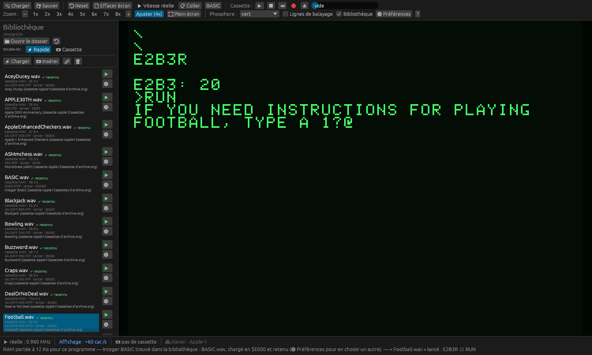

**Right click** on a program (or buttons above the list): load, load and
run, insert as a tape (without typing anything), parameters, rename, delete
(with confirmation), open the folder. The list updates by itself (every
2 s).

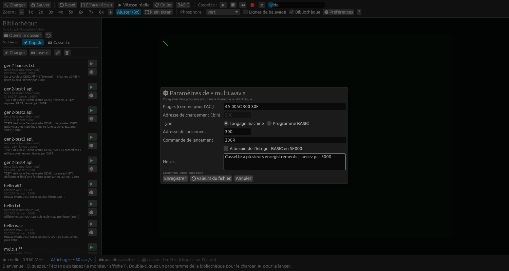

**Preferences** (⚙ Preferences in the toolbar): language, library folder
(Browse… / Default / Open the folder), double-click mode, phosphor, scan
lines, library display, ~60 chars/s display limit, fast speed, Integer BASIC
file (Choose… / Forget) and GEN2 colour card. Everything is kept in
`~/.config/apple1-emu/gui.json`.

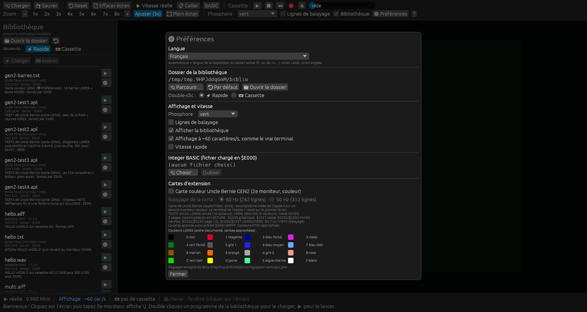

**Languages.** The interface exists in **French, English, German, Russian,
Spanish, Italian and Portuguese**. By default (“Automatic”), the language
follows the **active keyboard layout**: `fr` → French, `us`/`gb` → English,
`de`/`ch`/`at` → German, `ru` → Russian, `es`, `it`, `pt`/`br`… The emulator
queries, in this order: GNOME's `gsettings` (`mru-sources`),
`setxkbmap -query`, the Cinnamon layout
(`org.gnome.libgnomekbd.keyboard layouts`, the case of Linux Mint), GNOME's
`sources`, `localectl status`, `/etc/default/keyboard`; otherwise `LC_ALL`,
`LC_MESSAGES`, `LANG`, `LANGUAGE`; otherwise English. The Preferences show
the detected language and its source, and let you force another one (also
`--langue fr|en|de|ru|es|it|pt|auto`). Cyrillic is drawn by the built-in
font (nothing to install). The notes of the examples are written in the
language that is active when the library is created.

| English (`us` keyboard) | Russian (`ru` keyboard) |
|---|---|
| 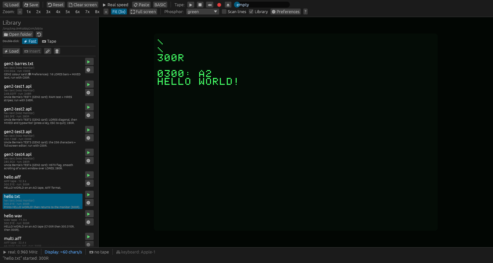 | 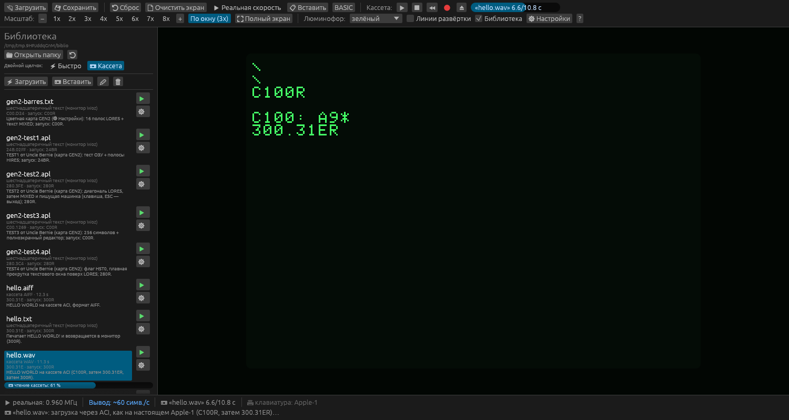 |

**Keyboard.** Click the screen: the keys go to the Apple-1 (lower case
converted, Enter = RETURN, Backspace = `_`, Esc = ESC, Ctrl+letter = control
character). When a dialog window or a text field is active, the keyboard
goes to that field; the status bar says so.

**Status bar**: measured speed (0.960 MHz effective at real speed), display
limit (click to toggle ~60 chars/s ⇄ instant), tape state, last message.

The “Open / Save” boxes are built into the window (in the interface
language): nothing to install. Useful options: `--zoom 3`,
`--phosphore ambre`, `--balayage`, `--screening`, `--bibliotheque FOLDER`,
`--basic FILE`, `--langue CODE`, `--mode-cassette` / `--mode-rapide`,
`--cassette FILE`, a file to load at start-up; for demonstrations,
`--lancer-biblio S:NAME`, `--charger-biblio S:NAME`, `--parametres S:NAME`,
`--preferences S`; `--help` for the list. These option names are French.

**OpenGL rendering.** If the window does not open (missing graphics driver,
virtual machine), `run.sh` automatically restarts with Mesa's software
rendering: `LIBGL_ALWAYS_SOFTWARE=1 ./apple1-emu-gui`.

## Uncle Bernie's GEN2 colour card (option)

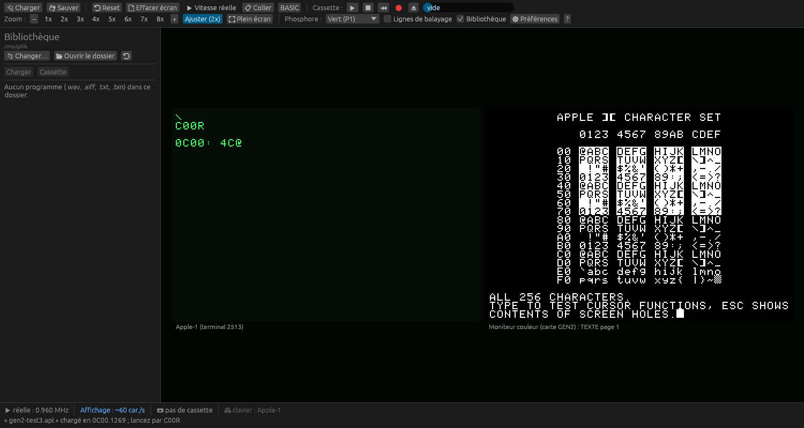

The emulator can simulate **Uncle Bernie's “GEN2” colour graphics card**
for the Apple-1 (2026). It is **off by default**. To turn it on:

- in the window, **⚙ Preferences**, then tick “Uncle Bernie GEN2 colour
  card” (you can also choose 60 or 50 Hz); the setting is kept;
- or start `apple1-emu-gui --carte-couleur` (`--couleur-50hz` for 50 Hz,
  `--sans-carte-couleur` to remove it);
- in the terminal, `apple1-emu --carte-couleur` emulates the registers and
  the memory, but the colour image is only shown in the graphical window.

**Two screens.** On the real machine, the card has its own video output
(“Port 2”) for a second, colour monitor. The Apple-1 terminal stays on its
original output (“Port 1”) and keeps working normally. The window therefore
shows both screens, side by side or one above the other depending on the
shape of the window. The “Fit” zoom takes both into account. The caption
under the colour screen gives the current mode.

**Test programs** (in `exemples/`, and in the library if you create it from
scratch):

| File | Run | Content |
|---|---|---|
| `gen2-barres.txt` | `C00R` | demo written for the emulator: the 16 LORES colours as bars, plus a line of text in MIXED mode |
| `gen2-test1.apl` | `24BR` | Uncle Bernie's TEST1: test of the card's RAM, with alternating HIRES stripes |
| `gen2-test2.apl` | `280R` | TEST2: LORES diagonal then MIXED mode and “typewriter” (a key to start, ESC to leave) |
| `gen2-test3.apl` | `C00R` | TEST3: the 256 character codes, then the full-screen editor |
| `gen2-test4.apl` | `280R` | TEST4: measurement of the HST0 flag, then a 4-line text window that scrolls smoothly over LORES |

The four tests are those of Uncle Bernie's “Early test software suite”
message (file `A1_Graphics_Card_Tests_1to4.zip`). Its instructions are in
`GEN2_TESTS_HOWTO`. These files are his: their redistribution terms are not
stated. They are supplied here for your personal use.

The `.apl` format is a Woz Monitor dump (including continued `: xx` lines).
The emulator reads it like a `.txt`.

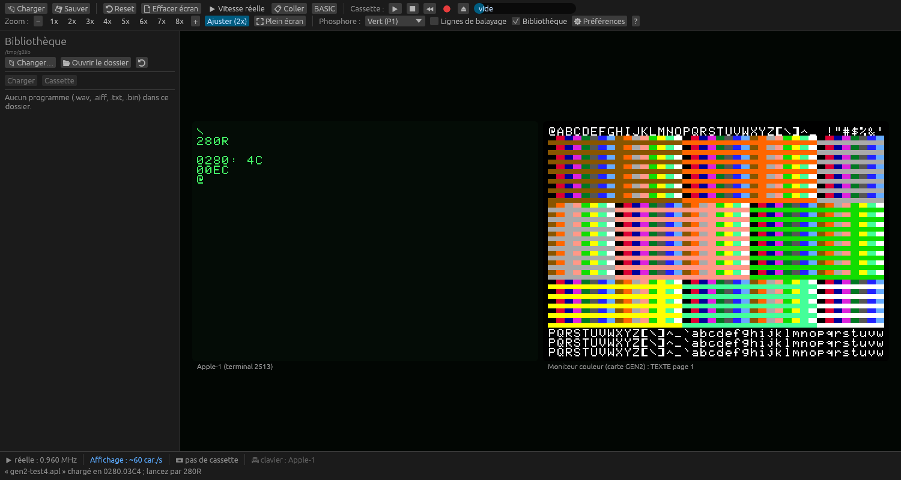

### What is emulated

The card is presented by its author in the Applefritter thread “Uncle
Bernie's GEN2 color graphics card for the Apple-1”. What follows describes
the behaviour of the emulator.

- **Switches $C250-$C257**, a 1:1 copy of the Apple II's $C050-$C057:
  - `$C250` graphics, `$C251` text;
  - `$C252` / `$C253` MIXED off / on;
  - `$C254` / `$C255` page 1 / page 2;
  - `$C256` / `$C257` LORES / HIRES.
- **Access.** The switches react **only to reads**. A write has no effect.
- **Decoding** `SEL = $Cxxx · /A11 · A9 · A4`: the card also answers on its
  mirrors (`$C258`, `$C3F1`, `$C6D4`…). It leaves `$C0xx` and `$C1xx` free
  for the ACI.
- **Bit 7 read = HST0**:
  - 1 during horizontal and vertical retrace;
  - 0 during the visible part and during the 3 cycles of the colour burst.
- **Bits 0 to 6 read**: floating bus, returned at random.
- **Scanning.** 65 cycles per line, 262 lines (60 Hz) or 312 lines (50 Hz,
  solder option). The 4 refresh cycles out of 65 are taken into account.
  - TEST4 does find HST0: it shows a vertical retrace duration (`00EC`)
    instead of “HST0 ?”.
  - Without the card, it shows “HST0 ?”, as expected.
- **Colour screen.**
  - Apple II modes and memory: TEXT 40 × 24 (`$0400` / `$0800`), LORES
    40 × 48 in 16 colours, HIRES 280 × 192 in 6 colours (`$2000` /
    `$4000`), MIXED (the last 4 lines in text).
  - Same data, same image and same colours as on an Apple II.
- **Order of the LORES colours** (that of the Apple II):

  | 0 | 1 | 2 | 3 | 4 | 5 | 6 | 7 |
  |---|---|---|---|---|---|---|---|
  | black | magenta | dark blue | purple | dark green | grey | medium blue | light blue |

  | 8 | 9 | 10 | 11 | 12 | 13 | 14 | 15 |
  |---|---|---|---|---|---|---|---|
  | brown | orange | grey | pink | light green | yellow | aquamarine | white |

- **HIRES.** NTSC artifact colours:
  - bit 7 at 0: purple on even columns, green on odd ones;
  - bit 7 at 1: blue and orange;
  - two neighbouring dots give white.

  TEST1 shows magenta and green stripes separated by thin white lines.
- **Characters.**
  - Codes `$00-$3F` inverse, `$40-$7F` flashing, `$80-$FF` normal.
  - The 6 low bits follow the 2513 coding.
  - `$E0-$FE` are lower case, and `$FF` is a checkerboard.
- **Memory.** The card is also the memory expansion: with it, the RAM
  covers `$0000-$BFFF` (plus `$E000-$EFFF`).
- **RESET** does not touch the switches. At power-on, the emulator starts
  in HIRES, page 1, with random content at `$2000-$3FFF`.
- **Split screens.** Mode changes are recorded with the scan line on which
  they happen. A screen split synchronised on HST0 is therefore shown
  correctly (TEST4).

### What is approximated or missing

- **Exact hues.** They depend on NTSC, on the monitor and on the card's
  trimmer capacitor. Values close to the Apple IIgs are used. The order of
  the colours is that of the Apple II.
- **Character shapes**: the card's glyphs supplied by Uncle Bernie (MIT
  licence, see `NOTICE`), in two variants of braces.
- **Flashing speed**: 1.5 Hz.
- **Simplified HIRES model** at 280 dots: the half-dot shift when bit 7 is
  at 1 is ignored.
- **Changes in mid-line**: they count from the next line.
- **Memory writes during scanning**: not reproduced. The image is drawn
  with the memory as it is at display time.
- **Phase between the two scans**: it is free, and not reproduced. The
  terminal and the card are not synchronised.
- **Memory at start-up.** Only the main HIRES page is filled at random; the
  rest is zero, which in text mode gives a screen of inverse `@` until the
  program has filled it.
- **2023 GEN1 card**: it used `$C050-$C057`. It is not emulated.

## 1. Linux: quick installation

The `dist/apple1-emu-linux-x86_64` binary is **static** (musl). It works on
most x86_64 Linux distributions without installing anything.

```sh
# get the binary (dist/ folder or apple1-emu.tar.gz archive), then:
chmod +x apple1-emu-linux-x86_64
./apple1-emu-linux-x86_64                 # starts the emulator in the terminal
./apple1-emu-linux-x86_64 --help          # all the options
```

The graphical interface `dist/apple1-emu-gui-linux-x86_64` is not static
(it loads the system's X11/Wayland and OpenGL libraries), but it is built
for glibc 2.30 and therefore works on most recent Linux distributions. It
uses libraries that are always present on a Linux desktop: `libX11`,
`libXcursor`, `libXi`, `libxkbcommon`, `libEGL`/`libGL` (Mesa) and, under
Wayland, `libwayland-client`/`libwayland-egl`.

Run the terminal version in a terminal of at least 42 columns × 28 lines.
The usual terminal (gnome-terminal, xfce4-terminal…) is fine. You can copy
the binary to `~/.local/bin/apple1-emu` to have it in the PATH.

### Building from the sources (rustup)

```sh
sudo apt install build-essential curl          # C compiler / linker
curl --proto '=https' --tlsv1.2 -sSf https://sh.rustup.rs | sh
source "$HOME/.cargo/env"
cd apple1-emu
cargo build --release                          # -> target/release/apple1-emu and apple1-emu-gui
cargo test --release                           # all the tests (see §7)
# portable static binary:
rustup target add x86_64-unknown-linux-musl
cargo build --release --target x86_64-unknown-linux-musl
```

Do not use the `rustc` package from apt: it is too old. Use rustup.

## 2. Using the emulator

```sh
apple1-emu                                  # 8 KB + E000, ACI, real speed
apple1-emu --fast                           # start in fast mode
apple1-emu --load samples/hello.txt --run 300
apple1-emu --tape samples/hello.wav         # tape inserted in the virtual player
apple1-emu --tape samples/multi.aiff        # AIFF accepted too
apple1-emu --basic ~/apple1/integer_basic.bin   # your copy of Integer BASIC
apple1-emu --ram 32 --no-e000               # 32 KB, no RAM at E000
apple1-emu --cursor-hz 1.7                  # slower cursor (C7 out of tolerance)
apple1-emu --aci-rom ma_prom_512.bin --aci-page 1   # another PROM image (§9)
```

**Cursor.** The `@` blinks like that of the NE555 D13 wired as an astable
(R10 = R11 = 10 kΩ, C7 = 22 µF): **2.18 Hz**, visible 305 ms then off
152 ms (visible 2/3 of the time). `--cursor-hz` changes the frequency while
keeping this ratio; `--cursor-duty` changes the visible share (0 to 1). The
value of 1.7 Hz measured on a board (see `INTERFACES.md`) is explained by
the tolerance of the electrolytic capacitor C7: `--cursor-hz 1.7`
reproduces it.

At start-up, the Woz Monitor shows `\`. Examples: `FF00.FF3F` (examine
memory), `300: A9 C1 20 EF FF 4C 1F FF` (deposit), `300R` (run).

### Keys

| Key | Action |
|---|---|
| letters, digits | Apple-1 keyboard (lower case is converted to upper case) |
| Enter | RETURN (CR) |
| Backspace | `_` (Woz Monitor rub-out) |
| Esc | ESC (cancels the line in the Woz Monitor) |
| **Ctrl+R** | **RESET** button |
| **Ctrl+L** | **CLEAR SCREEN** button |
| F1 | help |
| F2 | emulator command line (see below) |
| F3 | real ⇄ fast speed (real by default) |
| F4 | 60 chars/s display limit on ⇄ off |
| F5 / F6 | tape: play from the start / stop |
| F10 or Ctrl+Q | quit |
| paste (Ctrl+Shift+V) | the text is typed on the Apple-1 keyboard (Woz hex dumps, for example) |

### Commands (F2)

The command names are French.

| Command | Effect |
|---|---|
| `charger FILE[@ADDR]` | loads directly into memory a `.txt` (Woz dump), a `.bin` (`@ADDR` required), a `.wav` or an `.aif`/`.aiff` |
| `sauver FILE START.END [START.END…]` | saves memory; `.wav` = ACI tape as WAV, `.aif`/`.aiff` = ACI tape as AIFF (smartphone profile, §4), `.txt` = hex dump, `.bin` = binary. The ranges can be copied as they are from the ACI line: `sauver st.aiff 004A.00FFR 0300.0FFFR` |
| `cassette FILE` | inserts a `.wav` or `.aif` tape; it starts by itself at the first ACI read |
| `lecture`, `stop`, `rembobiner`, `ejecter` | player controls (play, stop, rewind, eject) |
| `enregistrer FILE.wav` or `.aif` | arms the recorder; then type `C100R` then `0300.03FFW`; the file is written 1.5 s after the end, or at `stop` |
| `basic FILE` | loads your Integer BASIC at `$E000` (then `E000R`) |
| `taper FILE` | types a text file on the keyboard |
| `reset`, `effacer`, `rapide`, `reel`, `debit`, `aide`, `quitter` | reset, clear, fast, real, rate, help, quit |

The tape follows **emulated** time. Loading through the ACI therefore also
works in fast mode, and it is then much shorter than the 10 s of header.

## 3. WAV and AIFF export / import on the command line

The output format is chosen by the **extension**: `.aif` / `.aiff` gives an
AIFF, anything else a WAV. `export` and `import` are synonyms of
`export-wav` and `import-wav`.

```sh
# program -> tape
apple1-emu export samples/hello.txt -o hello.aiff             # AIFF, smartphone profile
apple1-emu export samples/hello.txt -o hello.wav              # WAV 44.1 kHz mono
apple1-emu export prog.bin@300 -o prog.wav --rate 48000 --bits 16
apple1-emu export startrek.txt --range "004A.00FFR 0300.0FFFR" -o startrek.aiff
# tape -> program
apple1-emu import enregistrement.wav -o prog.txt              # Woz dump
apple1-emu import enregistrement.aiff --addr 300 -o prog.bin
apple1-emu info enregistrement.aiff                           # diagnosis
apple1-emu info startrek.aiff --aci-input stock               # simulates the ACI input (§4)
apple1-emu convert prog.txt prog.aiff                         # hex <-> bin <-> wav <-> aiff
apple1-emu basic jeu.bas -o jeu.wav --ram 8                  # tokenized Integer BASIC listing -> tape (v7.0)
apple1-emu asm jeu.s -o jeu.wav                               # 6502 source (ca65 syntax) assembled -> tape (v7.1)
```

- **Export.** The signal is **produced by the real ACI ROM** running in the
  emulated 6502, which parses the `START.ENDW …` line itself. The bit times
  are therefore exactly those of an Apple-1 doing `W`, including the gap
  between two ranges. The addresses are written into the file
  (`LIST/INFO/ICMT` chunk in WAV, `ANNO` in AIFF, “`APPLE1 ACI 0300.031E`”),
  which audio players ignore. The exact command to type on the Apple-1 is
  shown.

  | Parameter | WAV (default) | AIFF (default, smartphone profile) | Option |
  |---|---|---|---|
  | sample rate | 44,100 Hz | 48,000 Hz | `--rate` |
  | resolution | 16 bits | 16 bits | `--bits 8\|16` |
  | channels | 1 (mono) | 2, **identical** | `--channels 1\|2` |
  | amplitude | 0.8 | 0.89 (−1 dBFS) | `--amplitude` |
  | silence before / after | 0.5 s | 1.0 s | `--silence S` |

  The reasons for these choices are given in §4.
- **Ranges.** `--range` accepts a range (`0300.03FF`) or a whole ACI line
  copied as it is (`"004A.00FFR 0300.0FFFR"`), and can be repeated. Each
  range becomes a record with its own 10 s header, exactly like
  `004A.00FFW 0300.0FFFW` on the real machine.
- **Import.** The accepted formats are WAV and AIFF / AIFF-C (`NONE`,
  `sowt`, float), in 8, 16, 24 or 32-bit PCM or float, mono or stereo (the
  loudest channel is chosen), at any sample rate (22,050, 44,100,
  48,000 Hz…). The decoding goes through:
  - a high-pass and a low-pass filter;
  - an adaptive threshold with hysteresis and a glitch filter;
  - a measurement of the tape speed on the bits themselves.

  It tolerates noise, low levels, inverted polarity, a speed of ±10 % and
  several records in one file. Without a written address (file from another
  tool or from a real Apple-1), give it with `--addr ADDR` or
  `FILE.wav@ADDR` (a single range).
- **Compatibility.** WAVs from the independent tool **c2t** (Egan Ford,
  `c2t -1`) are decoded and loaded by the emulated ACI ROM. This is checked
  by the tests.

### Photo → ASCII art (v7.7)

```sh
# the art alone, on screen
apple1-emu ascii photo.jpg
# settings: cropping, image, characters
apple1-emu ascii woz.jpg --zoom 1.3 --cx 0.45 --cy 0.32 --contrast 1.3 --gamma 0.45 --rows 23 -o woz.txt
# BASIC program, 6502 source (ca65), or a tape directly
apple1-emu ascii woz.jpg -o woz.bas
apple1-emu ascii woz.jpg -o woz.s
apple1-emu ascii woz.jpg -o woz.wav             # 6502, run with 300R
apple1-emu ascii woz.jpg -o woz.wav --format basic
```

Options: `--cols`, `--rows`, `--zoom`, `--cx`, `--cy`, `--brightness`,
`--contrast`, `--gamma`, `--invert`, `--dither`, `--no-auto-level`,
`--ramp simple|full|slideshow|LIST`, `--title`. An ASCII art `.txt` can also
be used as input.

## 4. Playing the file into a real Apple-1

### 4.1 Wirehead's smartphone set-up (reference)

The original set-up is described by Wirehead in his Applefritter thread
“French-ie, Newb-ie, Apple One-ie...” (posts #47 and #48 of 3 February
2024): the phone at the time was a **Samsung Galaxy S7 Edge** (“Galaxy Edge
7” in the post), with a 4-contact (TRRS) jack plug taken from an old headset
and two pieces of stereo cable (diagram below). Today, according to
`note_lecteur_smartphone.txt`, the **AIFF** files are played from a
**Xiaomi Redmi Note 7** (built-in player of Solid Explorer), and post #52
says that VLC solved the AIFF playback difficulties under Android.

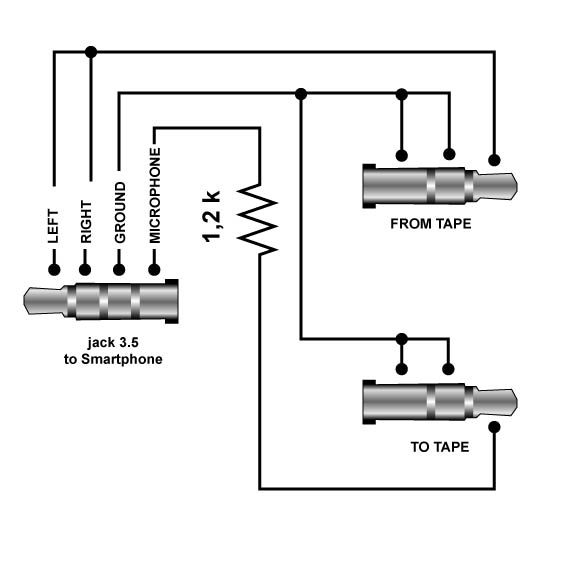

*Wiring diagram published by Wirehead on Applefritter.*

| Plug contact | Connected to | Role |
|---|---|---|
| left **and** right (joined together) | ACI “FROM TAPE” | playback into the Apple-1 |
| microphone, **through a 1.2 kΩ series resistor** | ACI “TO TAPE” | recording from the Apple-1 |
| ground | ACI ground | common |

Role of the 1.2 kΩ, according to post #47: it is an impedance problem.
Without it, the Galaxy **did not detect that the jack was inserted**; with
about 1.2 kΩ in series on the microphone output, it does detect a headset
with a microphone. Probable technical explanation (an assumption): seen from
the phone, the TO TAPE output is a 100 Ω bridge to ground, which Android
takes for a pressed headset button rather than for a microphone.

Other findings from post #48: the phone **automatically lowers the volume**
each time the jack is unplugged and plugged back in, and it has to be **at
maximum volume** for the red LED of the ACI to light up. Recording from the
Apple-1 was done with the “Easy Voice Recorder” app. The emulator does not
depend on these choices.

The cable joins left and right together: this is safe **because** both
channels carry exactly the same signal (§4.2). With a file whose channels
differ, the phone's two amplifiers would “fight” through the link.

### 4.2 AIFF parameters chosen, and why

- **16-bit PCM AIFF, uncompressed.** This is the format Mike Willegal uses
  on an iPod (Mimeo guide to the ACI). AIFF goes through no lossy codec (an
  MP3 or an AAC would round off the edges and shift the bits).
- **48,000 Hz.** This is the native rate of Android's audio output: the
  phone does not have to resample (a 44.1 → 48 kHz resampling adds ringing
  around the edges). The shortest period (“0” bit, 248 µs) then lasts about
  12 samples.
- **Two strictly identical channels.** Your cable joins left and right
  together on FROM TAPE. Some players may play a mono file on one channel
  only, and two different or phase-inverted channels would cancel each
  other out. With two identical channels, both outputs push in the same
  direction.
- **Square wave, amplitude 0.89 (−1 dBFS).** The input of the original ACI
  goes through a 0.01 µF capacitor to the LM311 comparator biased at 2.5 V
  by 10k/10k (5 kΩ): this is a high-pass at about 3.2 kHz. The comparator
  therefore mostly sees the **edges** of the signal; a square wave with
  steep edges suits it best, whereas a filtered 1 to 2 kHz sine wave would
  be attenuated by a factor of 2 to 3. The edges are rendered with
  sub-sample precision (“box” filter). The −1 dBFS leaves headroom for the
  overshoot of the converter's reconstruction filter (≈ 9 %), without
  clipping.
- **No DC component.** The two half-periods of the header are identical
  (592 cycles each) and the silence is exactly 0.
- **1 s of silence at the start and at the end.** The phone takes a moment
  to “wake up” its output and sometimes cuts the start of a sound; the
  second of silence protects the 10 s header, which in any case remains much
  longer than necessary.

### 4.3 Procedure, step by step

1. **Prepare the file** on the PC: `apple1-emu export prog.txt -o
   prog.aiff`, then copy it to the phone. Write down the command shown, for
   example `C100R` then `0300.031ER`.
2. **Set up the phone.**
   - **Volume at maximum**, as in your Applefritter trial. If Android shows
     the “high volume” warning, accept it, otherwise the volume stays
     limited.
   - **Turn off all effects**: Mi Sound / Dolby / equaliser / “audio
     enhancement” for the headset.
   - Airplane mode or “Do not disturb”, so that no notification mixes with
     the signal. No Bluetooth: the sound must come out of the socket.
   - Play the file with a simple player. On Applefritter, you had had
     difficulties with AIFF under Android, solved with **VLC**.
3. **On the Apple-1**, type `C100R`. The monitor answers `C100: A9*`, and
   the `*` is the ACI prompt.
4. Type the line shown by the export, for example `0300.031ER`, but **do
   not press RETURN yet**.
5. Start playback, then press **RETURN during the header**.
   - The ACI manual asks you to press it within 5 s of starting the tape.
     The header lasts about 10 s, plus the second of silence at the start.
   - The ROM waits about 3.5 s, then watches for the start bit.
6. At the end, the ACI returns to the monitor (`\`). Run the program with
   `300R`. For the supplied example, it shows `HELLO WORLD!`.

**The ACI LED.** The 1976 manual asks for a level at which the LED is “just
fully lit”. Mike Willegal's guide points out that this LED only lights at
about 1.2 V, which is more than the comparator needs: **do not rely on the
LED**. An unlit LED does not mean the signal is too weak.

**What level is needed?** The `info --aci-input` command simulates the
card's input (capacitor, 5 kΩ bias, LM311 hysteresis) for several peak
voltages:

```sh
apple1-emu info prog.aiff --aci-input stock            # 1976 board, 0.01 µF
apple1-emu info prog.aiff --aci-input mimeo            # 0.1 µF (advice from the Mimeo guide)
apple1-emu info prog.aiff --aci-input gen2             # Uncle Bernie's ACI Gen2
```

With the “stock” model, our files are read from **about 0.25 V peak** at
the socket. A smartphone headphone output at maximum usually gives 0.5 to
1 V peak, hence the point of maximum volume. These figures come from a
simplified model of the schematic: the hysteresis (≈ ±0.22 V) is computed
from the 3k/47k resistors, and the voltage of your phone (Galaxy S7 Edge or
Redmi Note 7) has not been measured.

### 4.4 Reference example: Star Trek (several ranges)

The Integer BASIC Star Trek from your trial loads like this:

```
C100R
004A.00FFR 0300.0FFFR        (RETURN during the header of the first record)
E2B3R                    (once back at the \)
```

- `004A.00FF` is the Integer BASIC zero page (program and variable
  pointers); `0300.0FFF` holds the program. These are two successive
  records, each with its own 10 s header.
- `E2B3R` is the **warm entry** of Integer BASIC: it keeps the loaded
  program, whereas `E000R` (cold start) would erase it. BASIC must
  therefore **already be at `$E000`**, loaded from its own tape
  (`E000.EFFFR`); the motherboard needs the “W → E” jumper (RAM at
  `$E000`). The emulator does **not** supply Integer BASIC: load your copy
  with `--basic` or the `basic` command, then `charger startrek.aiff` or
  `cassette startrek.aiff`.
- **Tapes without addresses** (for example those of archive.org's
  “Apple1Cassettes”: `BASIC.wav`, `Hamurabi.wav`, `StarTrek.wav`…). In the
  graphical interface, each record goes into **its own** range of the ⚙
  parameters, in order (`004A.00FF 0300.0FFF`: the first at `$004A`, the
  second at `$0300`). Without parameters, the emulator guesses: a
  4096-byte record starting with `JMP` is Integer BASIC (`E000.EFFF`,
  without running it); two records of which the first is 182 bytes long
  (`$4A-$FF`) are a BASIC program, placed according to the LOMEM/HIMEM
  pointers (`$4A`, `$4C`) it contains (`Hamurabi.wav`: LOMEM `$0300`, HIMEM
  `$1000`, hence `0300.0FFF`). The list shows “(guessed)”; check with ⚙.
  Machine-language programs without addresses are not guessed: give their
  range in ⚙.
- To create such a file from the emulator:
  `sauver startrek.aiff 004A.00FFR 0300.0FFFR` (F2), or
  `apple1-emu export startrek.txt --range "004A.00FFR 0300.0FFFR" -o startrek.aiff`.

**Beware of the zeros in `004A.00FF`: they are required.** The ACI ROM's
parser does not clear its hexadecimal accumulator at the dot (SEP routine at
`$C166`, “Doesn't clear HEX1!!!” in the listing). The digits at the end are
added behind those at the start: `4A.FF` would mean `$004A-$4AFF`!
`0300.0FFF` works, because the three digits push the 3 of `0300` out. The
emulator always shows the correct form (`004A.00FFR 0300.0FFFR`), and it
reproduces this behaviour since it runs the real ROM.

The example `samples/multi.txt` / `multi.aiff` / `multi.wav` has the same
layout (zero page + `$0300`): `C100R`, `004A.005CR 0300.030ER`, then `300R`
shows `MULTI-PLAGES OK !`.

### 4.5 From a PC, and recording from the Apple-1

- **PC.** Headphone or line output to FROM TAPE, audio effects turned off.
  A WAV or an AIFF both work.
- **Never MP3 or AAC**: a lossless format (WAV, AIFF; FLAC if the player
  decodes it).
- **Recording from the Apple-1.** TO TAPE only gives about 50 mV peak to
  peak (10k/100 Ω divider after the 74LS74 flip-flop): this is a microphone
  level. On the phone, use a recording app that turns off automatic gain and
  noise reduction (“raw” or “unprocessed” mode, uncompressed WAV) and look
  at the waveform (Audacity): no clipping and no level jump during the
  header. The emulator's import tolerates any gain and a DC offset; a level
  jump during the header has no effect if it does not cut a half-period.
  Record through the microphone input (on the phone, through the microphone
  contact and the 1.2 kΩ; on a PC, Audacity at 44.1 or 48 kHz), type
  `C100R` then `0300.03FFW` and RETURN, stop a few seconds after the `\`
  comes back, then `apple1-emu import fichier.aiff --addr 300 -o
  prog.txt`. For several ranges, give them as for reading:
  `apple1-emu import startrek.aiff --range "004A.00FFR 0300.0FFFR" -o
  startrek.txt` (`--addr` would put the records end to end).

## 5. ACI tape format and timing parameters

The export runs the `WRITE` routine of the ACI ROM (`$C170`). Each access
to `$C000-$C0FF` toggles the output flip-flop. Here are the times measured
in the emulator:

| Element | 6502 cycles | Duration (default model) |
|---|---:|---:|
| header half-period (long “1”) | 592 | ≈ 618 µs (≈ 809 Hz) |
| header length | — | ≈ 10.1 s (≈ 16,400 half-periods) |
| start bit, 1st / 2nd half-period | 180 / 238 | ≈ 186 / 248 µs |
| “0” bit (half-period) | 238 | ≈ 248 µs (≈ 2.0 kHz) |
| “1” bit (half-period) | 473 | ≈ 494 µs (≈ 1.0 kHz) |

- Bytes are sent most significant bit first, with no parity and no
  checksum.
- The exact length of the header depends on the position of the `W` in the
  typed line, because X is used as a counter. The export puts the whole
  line (`004A.00FFW 0300.0FFFW`) into the input buffer and has the ROM parse
  it: the result is identical, to the cycle, to typing it on the keyboard
  (checked by the tests, one and two ranges).
- **Cycles → seconds conversion.** The seconds come from 1.022727 MHz
  (14.31818 MHz / 14). On top of that, the 6502 is suspended 4 cycles out of
  65 for the DRAM refresh, that is 0.9598 MHz effective.
  - With this model, you get almost exactly the manual's “2 kHz = 0,
    1 kHz = 1” and “10 seconds of header”, which confirms it.
  - `--no-refresh` exports without this model: the bits are then about 6 %
    shorter.
  - The ACI reader easily tolerates both, since its threshold is about
    740 µs per full period (476 against 946 µs).
- **Reading (ROM `$C18D`).** A 12-cycle loop measures each half-period by
  reading `$C081`. The level of the tape input acts on the A0 line of the
  PROM: at `$C080-$C0FF`, A0' = A0 AND NOT(input). The same instruction
  therefore reads `$D0` or `$FA` depending on the level, as in the
  emulator.

### What the ACI documents say (`/workspace/apple1/hardware/aci/`)

Comparison between your documents and the emulator's model:

| Point | Documents | Emulator |
|---|---|---|
| ROM content | listing in appendix D of the Mimeo guide | identical byte for byte (checked) |
| PROM | two 82S129 (or 6301) of 256 × 4 bits, one per nibble, at A3/A4 | 256 bytes, visible at `$C000` and `$C100` |
| Tape input | PROM A0 modified by the comparator when A7 = 1 (74LS02/74LS10 gates) | A0' = A0 AND NOT(input) at `$C080-$C0FF` |
| Output flip-flop | 74LS74 (A2), toggled by each access to `$C0xx` | same |
| Header | listing comment: “565/455 µs, ~1 kHz”, asymmetric | the **code** gives two half-periods of 592 cycles (≈ 618 µs, ≈ 809 Hz); the emulator follows the code |
| Bits | manual: 1 kHz = “1”, 2 kHz = “0”; the listing comment `BCC WRITE1 ; Write a '1' (2kHz)` is wrong | the code and the emulator follow the manual |
| Start bit | comment: 385 then 455 µs | the code gives 180 then 238 cycles (≈ 186 / 248 µs) |
| End of reading | manual: `\`; the Mimeo reproduction shows `/` | the ROM jumps to `ESCAPE` ($FF1A), which shows `\` |
| `S.E` parsing | listing: HEX1 is not cleared at the `.` | reproduced (real ROM); the export writes `004A.00FF` |
| Several ranges | manual: one header per range; read back with the same ranges; the 1976 BASIC manual runs the ranges together: `004A.00FFW800.FFFW` | same; `--range` and `sauver` accept ranges run together or separate |
| Comparator | LM311, input through 0.01 µF, 2.5 V bias (10k/10k), 3k/47k feedback | ideal by default (the ROM only looks at state **changes**, so polarity has no effect); optional analogue model `info --aci-input` |
| Variants | Mimeo: 0.1 µF more reliable than 0.01 µF; Gen2: matched 100 nF, 300k instead of 47k (less hysteresis), 5.1 MΩ instead of 100k for the LED, 180 Ω instead of 100 Ω for more signal on TO TAPE, bias point at 2.45–2.55 V | `mimeo` and `gen2` models of `info --aci-input` |
| Playback level | manual: LED “just lit”; Willegal: LED at ≈ 1.2 V, too high, not to be used; Applefritter: max volume | see §4.3 |
| TO TAPE output | ≈ 50 mV peak to peak (microphone level) | the files recorded by the emulator are full scale (digital capture) |

Sources:
- your ACI documents (`/workspace/apple1/hardware/aci/`): 1976 manual,
  schematic, Mike Willegal's Mimeo guide (EN/FR), Uncle Bernie's ACI Gen2;
- the 1976 Apple ACI manual (`/workspace/apple1/docs/apple1cassette.pdf`);
- San Bergmans' hardware analysis and ACI ROM listing (sbprojects.net);
- the Woz Monitor and ACI listings disassembled by Jeff Tranter;
- the POM1 dump (apple1.chez.com);
- Egan Ford's c2t (github.com/datajerk/c2t), as an independent checking
  tool;
- the MAME `apple1.cpp` driver;
- the Applefritter discussion on refresh cycles
  (`web/ram-refresh-cycle-details.txt`);
- the hardware notes `/workspace/apple1/hardware/INTERFACES.md`.

## 6. Emulation details

- **Display.** `STA $D012` sets PB7 (DA) to 1, that is “busy”.
  - The character is taken when the scan reaches the cursor position. The
    frame is 65 × 262 CHAR periods, that is 60.05 Hz; text line r starts at
    scan line 8·r, and column c at H state $C0+c.
  - PB7 then goes back to 0. You get at most 1 character per frame.
  - The Woz Monitor waits with `BIT DSP / BMI`.
- **Characters.** Only CR is interpreted; the other control codes are
  ignored.
  - Lower case ($60-$7F) is shown like upper case ($40-$5F), because bit 5
    is not stored when bit 6 is present.
  - Automatic line wrap at 40 columns, scrolling at the bottom of the
    screen.
- **Keyboard.** Bit 7 of CRA goes to 1 at each keystroke and reading
  `$D010` clears it. PA7 is at 1, so the codes are $80 + ASCII.
- **Bus.** The PIAs are visible everywhere in `$D000-$DFFF` as soon as
  A4 = 1 (mirrors, like MAME). Unwired areas read `$FF`.
- **RESET.** Resets the 6502 and the PIA, but not the screen. CLEAR SCREEN
  clears the screen.

## 7. Tests

```sh
cargo test --release
```

The tests cover:
- ASCII art (v7.7): ramp sorted according to the 2513 font, conversion,
  dithering, `;` on full lines, compressed table; the 6502 program and the
  BASIC program (typed into the real Integer BASIC if
  `test-fixtures/BASIC.wav` is present) show exactly the art, in 24 and in
  23 lines; Schmenk's slideshow (if `$SLIDESHOW` or `/tmp/sl`) is assembled
  and shows “WOZ”;
- the 6502: cycles, decimal mode, the `JMP ($xxFF)` bug;
- the PIA, the display, the 60 chars/s rate;
- WAV, AIFF / AIFF-C (8/16 bits, mono/stereo, 22 to 96 kHz, 80-bit
  floating-point sample rate) and hex dumps;
- the smartphone AIFF profile: 48 kHz, identical channels, peak 0.89, no DC
  component, 1 s of silence;
- tape recognition: valid table (ranges = record sizes), recognition by
  content then by name, user settings never replaced, RAM added for large
  programs; with the archive.org tapes copied into `test-fixtures/` (folder
  ignored by git, never shipped; tests skipped without them), the 24 tapes
  are recognised and **start** with their preset parameters;
- a **synthetic** “Star Trek” layout (pseudo-random data at `$4A-$FF` and
  `$300-$FFF`, for lack of a real Star Trek file in the shared folders): AIFF
  export, import as two records, reading by the emulated ROM with
  `004A.00FFR 0300.0FFFR`, then `E2B3R` into a small stand-in program (not
  the real BASIC);
- the writing by the ROM of `004A.00FFW 0300.0FFFW`, identical to the cycle
  to the export;
- the simulated analogue input (0.01 µF, 0.1 µF, Gen2, with and without
  1.2 kΩ in series, from 0.3 to 2 V peak);
- `samples/multi.aiff` read by the emulated ROM, then run;
- the export → import round trip at 22/44/48 kHz in 8 and 16 bits, with
  noise, gain, DC offset, inverted polarity, stereo, speed ±10 %, filtering
  and several segments;
- the emulated ACI ROM reading our WAV/AIFF files and those of c2t;
- the ACI ROM writing, compared with the export and decoded;
- the interface commands;
- the graphical interface: 2513 ROM (row 0 empty, bit 4 on the left, 7-dot
  cells), cursor rendering, loading / saving / tape through the button
  functions, library (examples, ranges, lengths, renaming, deleting, notes);
- the ⚙ program parameters: pre-filling from the file, checking (ranges in
  the ACI manner, `4A.FF` refused, run address outside the ranges, `.bin`
  too long, ranges of a BASIC program), takeover of `descriptions.json` into
  `programs.json`;
- the languages: complete table in the 7 languages (same `{0}`, `{1}`
  everywhere), every key used in the code exists, mapping between keyboard
  layouts and languages (`fr`, `us`, `de`, `ru`, `ch(fr)`, `br`…) and
  locales, detection order (GNOME, `setxkbmap`, Cinnamon, `localectl`,
  `/etc/default/keyboard`, `LANG`) with simulated command outputs;
- the cursor (2.18 Hz, visible 2/3);
- the GEN2 colour card:
  - decoding and mirrors, read-only switching, HST0 model;
  - RAM `$0000-$BFFF`, addresses of the TEXT and HIRES lines;
  - screen split line by line;
  - LORES, HIRES (artifact colours), TEXT (inverse, flashing, lower case)
    rendering;
  - Uncle Bernie's TEST2 and TEST4 run on the emulated card (TEST4 finds
    HST0, and without the card it shows “HST0 ?”);
  - the `gen2-barres.txt` demo;
- the comparison of the built-in ROMs with your PROM dumps (test skipped if
  the `hardware/roms/dumps/` folder is absent), the split into nibbles, the
  crossing of address lines 1/7 and the loading of a page of a 512 × 4
  PROM;
- the run-together range line of the BASIC manual (`004A.00FFW800.FFFW`);
- BASIC from a tape without addresses (`E000`, 4096 bytes, `JMP` checked),
  the search for `BASIC.wav` in the library, the guessed layout of a BASIC
  program, and ▶ end to end with a stand-in BASIC (`JMP` at `$E000`, small
  program at `$E2B3` that shows HIMEM) and a synthetic 2-record Hamurabi
  tape;
- **with the real recordings** `BASIC.wav` and `Hamurabi.wav` from
  archive.org, if they are in `test-fixtures/` (folder ignored by git: they
  are neither published nor supplied, copyright): ▶ must show “TRY YOUR HAND
  AT GOVERNING ANCIENT”. Without these files, the test is skipped.

**Klaus Dormann's test.** `tests/dormann.rs` downloads the GPL binary
`6502_functional_test.bin` into `target/dormann/`. It is not included in the
project. You can also fetch it with `scripts/fetch_dormann.sh` or supply it
with `DORMANN_BIN=/path`. Without a network, the test is skipped with a
message.

## 8. Limits

- **ASCII art**: 40 × 24 characters is not much; a portrait is easier to
  recognise when cropped on the face (zoom 1.3 to 1.6). The grey levels
  come from the number of dots lit in each character, not from their shape.
  The BASIC program is slow to type (about 2 s per line); the 6502 one is
  instant. There is no copy of Schmenk's slideshow: without a licence, it
  is only downloaded from GitHub.

- **Nothing has been checked on a real Apple-1 yet.**
  - The bit times are those of the real ROM, and the files are decoded by
    the emulated ROM as well as by c2t and our decoder.
  - But the audio level, the cable and the state of the ACI card
    (comparator alignment, LED) can only be adjusted by you.
  - If reading fails, first check that the phone's audio effects are off
    and that the volume is at maximum, then try VLC, `--rate 44100`,
    `--channels 1`, or the `--no-refresh` export.
- The AIFF format has been checked by our own tests (writing and reading
  back) and by the structure of the file; it has not been played on your
  Redmi Note 7.
- No real Star Trek file was available: the multi-range example is tested
  on synthetic data with the same layout.
- The undocumented 6502 opcodes are not emulated (approximate NOPs; JAM
  stops the CPU). Apple-1 software does not use them.
- The DRAM refresh is an average model (+4 cycles every 61 CPU cycles). The
  exact phase relative to the scan is not reproduced.
- The cursor blinks in PC real time (the NE555 is independent of the 6502
  clock), even in fast mode; its starting phase is arbitrary. There is
  neither snow on the screen nor video artifacts.
- The /RDA → CB1 pulse is rounded: PB7 goes back to 0 one CHAR period
  (≈ 0.98 µs) after the scan passes, instead of the 3.5 µs of the 74123.
  Software cannot see the difference (the Woz Monitor's wait loop takes at
  least 7 µs). The loss of characters of a badly adjusted 74123 is a
  hardware fault that is not emulated.
- 512-byte PROM images (two pages) are not supplied: only loading an image
  you might have is provided for (§9).
- The ACI comparator is ideal during emulation. The analogue model
  (`info --aci-input`) is simplified: hysteresis computed from the
  schematic, no noise, no drift of the bias point.
- No sound or live audio output: the tape is always a WAV or AIFF file.
- Integer BASIC (and any Apple ROM other than the Woz Monitor and the ACI
  ROM) is not supplied. For ▶ on a BASIC program, the presence of BASIC at
  `$E000` is guessed (`JMP` instruction at `$E000` and code around
  `$E2B3`): other content at these addresses would fool the test.
- Interface: language detection has only been tried under Xvfb
  (`setxkbmap` in `us` and in `ru`) and with simulated outputs of
  `gsettings` (GNOME, Cinnamon) and `localectl`; not yet on a real Cinnamon
  desktop of Linux Mint. The translations other than French and English
  have not been reviewed by a native speaker. The error messages that come
  from the emulator core (file decoding) remain in French.

Licence: GNU GPL 3.0 (`LICENSE` file) for this code; the third-party
elements under the MIT licence (RDK G2 Basic, Uncle Bernie's GEN2 tests and
glyphs) are credited in `NOTICE`. The Woz Monitor and the ACI ROM (256 bytes
each, © Apple 1976) are included for emulation, as in other emulators (MAME,
POM1…).

## 9. ROM and PROM: your dumps, programming real PROMs

### Comparison with your dumps (`hardware/roms/dumps/`)

Byte-for-byte comparison with the ROMs built into the emulator:

| File | Compared with | Result |
|---|---|---|
| `APPLE-A2.BIN` (high nibble) + `APPLE-A1.BIN` (low nibble) | Woz Monitor (`roms/wozmon.bin`) | **identical** (256 bytes) |
| `emulateur_2001/apple1.rom` | Woz Monitor | **identical** |
| `APPLE-A3.BIN` (high) + `APPLE-A4.BIN` (low) | ACI ROM (`roms/aci.bin`) | **identical** |
| `ACI_C100_reconstitue_A3hi_A4lo.bin` | ACI ROM | **identical** |

The four files A1-A4 have their 4 high bits at zero (a value from 0 to F
per byte) and are in the logical order of the addresses. The test
`tests/rom_dumps.rs` repeats this comparison at every `cargo test`.

### Files for programming real 256 × 4 PROMs (82S129, 3601, 6301)

```sh
apple1-emu prom split woz -o proms/     # PROM-A2.bin (D7-D4) and PROM-A1.bin (D3-D0)
apple1-emu prom split aci -o proms/     # PROM-A3.bin (D7-D4) and PROM-A4.bin (D3-D0)
apple1-emu prom join A2.bin A1.bin      # reassemble a read-out and compare it
```

The files produced have the same format as your dumps (and are identical to
them byte for byte). Your programmer must write the 4 low bits of each byte.

**Mike Willegal's erratum** (`wirehead_notes/erreurs_schemas_Apple_Willegal_FR.txt`):
on the real board, address line 7 arrives at pin 15 of PROM A2 and line 1 at
pin 6, as on PROM A1 (normal 82S129 pin-out: A1 = pin 6, A7 = pin 15). The
1976 Apple schematic draws these two lines **crossed** on A2 (A1 to 15, A7
to 6; readable on `hardware/docs/schema_processeur_1976.jpg`, to be
confirmed on a better scan). Consequences:
- on an original board, or a replica faithful to the board, the ordinary
  images are suitable (`prom split woz`);
- on a board drawn **from the schematic** (lines 1 and 7 crossed on A2),
  PROM A2 must contain an image with swapped addresses:
  `apple1-emu prom split woz --swap-a1-a7` produces
  `PROM-A2_A1-A7-croisees.bin` (A1 is unchanged). The simplest is still to
  fix the printed circuit board;
- to read back an A2 on such a board: `prom join --swap-a1-a7`.

This only concerns programming real PROMs: the emulator works on the
logical bytes.

### 512-byte PROM images

The emulator also accepts a 512-byte image for the monitor or for the ACI,
and uses one of its two 256-byte pages:

```sh
apple1-emu --monitor-rom A2A1_512.bin --monitor-page 1   # page 1 of the monitor
apple1-emu --aci-rom A3A4_512.bin --aci-page 1           # page 1 of the ACI
```

A 256-byte file is also accepted (a modified ROM, for example). The ACI
image is visible at `$C000` and `$C100`, with the same effect of the tape
input on A0.

## 10. Notes from the 1976 BASIC manual

- **1976 BASIC manual** (`docs/Apple_BASIC_Users_Manual_1976_*`): `C100R`,
  then `E000.EFFFR` (BASIC in “about 30 seconds”; a 4 KB export by the
  emulator lasts 34 s, including the 10 s header); entry `E000R` (program
  erased) or `E2B3R` (program kept); BASIC programs saved with
  `004A.00FFW800.FFFW`. This form **confirms** the emulator's `004A.00FF`
  notation. Beware: the restored (text) version prints `C00R`; the original
  scan does show `C1ØØR`.
- **V. Moya del Barrio's thesis (2001)**: general emulation techniques
  (interpretation, recompilation, synchronisation). The emulator follows the
  simplest and most exact method it describes for a small processor: a
  cycle-accurate interpreter, with the peripherals synchronised on the cycle
  counter.
