# Retro Dev Kit Apple 1 — Le péché originel

*Retro Dev Kit Apple 1* (famille **Retro Dev Kit**) : émulateur et atelier de
développement Apple-1 (1976), avec cassette ACI en WAV et AIFF. Les noms
techniques ne changent pas : commandes `apple1-emu` et `apple1-emu-gui`,
`run.sh`, `install.sh`, réglages dans `~/.config/apple1-emu`.
Dépôt : <https://github.com/Old-Wirehead/rdk-apple1>.

**Version 1.0** (novembre 2026) : première version publique. Elle correspond à
l'ancienne version de test 7.9.3 et à ses corrections (demande de fusion #56) ;
les numéros 7.x désignaient les versions de test, quand le dépôt était privé.


Émulateur de l'Apple-1 de Steve Wozniak, écrit en Rust, qui tourne dans une
**fenêtre graphique** (`apple1-emu-gui`, zoom, boutons, bibliothèque de
programmes) ou dans un **terminal** (`apple1-emu`). Il permet surtout d'**exporter vos programmes en fichiers WAV ou AIFF**
compatibles avec l'interface cassette Apple (ACI), pour les jouer dans une
**véritable Apple-1** (depuis un PC ou un smartphone), et d'**importer** les
WAV/AIFF enregistrés depuis une vraie machine.

- Processeur NMOS 6502 émulé au cycle près : opcodes documentés, drapeaux et
  mode décimal NMOS. Il passe le test fonctionnel de Klaus Dormann.
- Cartographie mémoire de l'Apple-1 :
  - RAM configurable (par défaut 8 Ko en `$0000-$1FFF`, plus 4 Ko en
    `$E000-$EFFF`) ;
  - PIA 6821 en `$D010-$D013` ;
  - Woz Monitor en `$FF00`.
- Terminal vidéo de 40×24 caractères en majuscules, avec défilement et curseur
  `@` clignotant. Il accepte au plus un caractère par image, soit environ
  60 car./s, comme le vrai.
- Carte ACI : E/S en `$C000-$C0FF`, ROM Woz en `$C100-$C1FF`. La cassette
  virtuelle est un fichier WAV ou AIFF.
- Vitesse réelle par défaut : 1,022727 MHz, soit 0,960 MHz effectifs avec le
  rafraîchissement de la DRAM. Un mode rapide est disponible.
- Le noyau `apple1-core` est une bibliothèque sans dépendances, séparée des
  interfaces : `apple1-emu` (terminal : crossterm et clap) et `apple1-gui`
  (fenêtre : eframe/egui).

## Interface graphique : `apple1-emu-gui`

Le plus simple : décompressez `apple1-emu.zip`, puis double-cliquez sur
`run.sh` (choisissez « Lancer » si le gestionnaire de fichiers le demande, par exemple sous Linux Mint). `./install.sh`
ajoute l'émulateur au menu des applications (rubrique Jeux). Les anciens `lancer.sh`
et `installer.sh` s'appellent maintenant `run.sh` et `install.sh` ; relancer
`./install.sh` met à jour une ancienne installation (menu, icône du bureau).

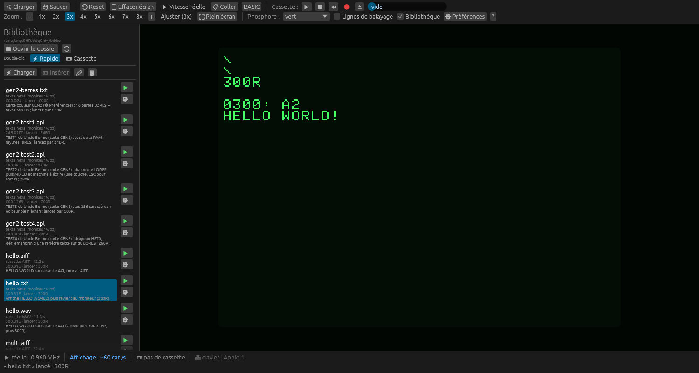

**Écran.** Les 40 × 24 caractères sont dessinés point par point avec la ROM du
générateur de caractères **Signetics 2513** (`assets/2513.bin`, copie de
`hardware/roms/2513.bin`) : 5 × 7 points dans une case de 7 × 8 (la ligne 0
de la ROM est vide, le bit 4 est le point de gauche), soit 280 × 192 points.
Le curseur `@` clignote à 2,18 Hz (`--cursor-hz` comme en terminal).
Phosphore **vert**, **blanc** ou **ambre**, et effet « lignes de balayage »
en option.

**Écran vintage (screening).** La case **Écran vintage (screening)** (barre
d'outils et Préférences) imite un moniteur à tube des années 1970. L'effet
principal est la fine ligne sombre qui sépare les lignes de balayage : chaque
rangée de points d'un caractère devient une bande horizontale, comme sur la
photo d'un vrai Apple-1. Cette ligne a une épaisseur en pixels réels de
l'écran (environ un cinquième de la ligne, au moins un pixel), si bien qu'elle
reste fine et nette à tous les zooms et en plein écran. Les points ne sont
qu'à peine adoucis, et seulement horizontalement : le flou d'une photo vient
de l'appareil, pas du tube. Dans les Préférences, vous réglez l'**intensité**
et choisissez les effets :
- séparation des lignes de balayage (activée) ;
- points adoucis horizontalement (activé) ;
- **rémanence du phosphore**, avec son propre curseur (tout à gauche : aucune) ;
  par défaut elle est courte : les points s'éteignent en moins d'un dixième de
  seconde en vert, un peu plus vite en blanc, un peu plus lentement en ambre ;
- halo lumineux, discret (activé) : les points restent nets ;
- tube bombé et coins assombris (désactivé), avec un curseur **Courbure**
  (légère par défaut) ;
- scintillement (désactivé).

Si votre `gui.json` vient de la v5.3, il reçoit les nouveaux réglages par
défaut au premier lancement (rémanence plus courte, halo activé, courbure
légère). Si vous aviez désactivé la rémanence, elle reste désactivée.

L'effet s'applique aussi au moniteur couleur de la carte GEN2. Le calcul se
fait sur le processeur à la résolution de l'Apple-1 (moins de 5 ms pour un
écran plein, et seulement quand l'image change), puis la carte graphique
agrandit l'image. Il reste fluide même avec le rendu OpenGL logiciel
(llvmpipe). Les réglages sont retenus dans `gui.json`. En ligne de commande :
`--screening`, `--sans-screening`, ou par exemple
`--screening-options intensite=0.7,remanence=0.5,courbure=0.4,sans-halo`
(valeurs de 0 à 1).

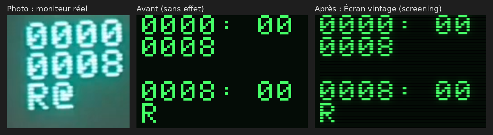

**Zoom.** Boutons `1x` à `8x` et **Ajuster** (le plus grand zoom entier qui
tient dans la fenêtre : les points restent nets). Raccourcis **Ctrl+plus**,
**Ctrl+moins**, **Ctrl+0** (ajuster), **F11** plein écran. La fenêtre se
redimensionne librement. Au premier lancement, elle occupe 80 % de l'écran ;
le zoom, la couleur, la taille de la fenêtre et le dossier de la bibliothèque
sont ensuite retenus dans `~/.config/apple1-emu/gui.json`.

**Barre d'outils.**

| Bouton | Effet |
|---|---|
| 📂 Charger | `.wav`, `.aiff` : au choix **en mémoire** (décodage direct) ou **comme cassette virtuelle** ; `.txt` (vidage Woz) en mémoire ; `.bin` : l'adresse est demandée |
| 💾 Sauver | demande les plages (`0300.03FF`, `004A.00FF 0300.0FFF`, `004A.00FFW800.FFFW`…), puis le fichier : l'extension choisit le format (`.wav`, `.aiff`, `.txt`, `.bin`) |
| RESET (rouge), 🗋 Effacer écran | boutons RESET et CLEAR SCREEN (Ctrl+R, Ctrl+L) |
| Jauge : vitesse réelle / rapide | bascule (F3) ; bleu quand la vitesse rapide est active |
| Cartes graphiques : 🎨 GEN2, P-LAB | groupe nommé : GEN2 branche la carte couleur ; P-LAB, grisé (« Bientôt »), n'est pas encore émulée |
| EPROM (puce à fenêtre UV) | programmateur d'EPROM, à droite de la barre |
| ⊞ Disposition ▾ | menu : Par défaut, Jeu, BASIC, Assembleur, Débogage, « Enregistrer la disposition actuelle… » et vos dispositions (clic droit : Renommer, Supprimer) |
| 📋 Coller | tape le presse-papiers au clavier de l'Apple-1 (Ctrl+V aussi) |
| BASIC | charge votre Integer BASIC en `$E000` : une **cassette** (`.wav`, `.aiff`, comme `BASIC.wav` des cassettes d'archive.org), un vidage `.txt` ou un `.bin` de 4096 octets. Il est cherché seul dans la bibliothèque (`BASIC.wav`, `integer_basic.bin`…, puis tout fichier dont le nom contient « basic »), sinon demandé ; le choix est retenu. Clic droit : autre fichier |
| 📝 Éditeur | éditeur Integer BASIC et assembleur 6502 en onglets : couleurs, erreurs, ▶ Lancer, 📼 Exporter WAV (voir « Éditeur Integer BASIC » et « Assembleur 6502 ») |
| ⚙ Préférences | langue, dossier de la bibliothèque, mode du double-clic, affichage, fichier du BASIC, carte couleur GEN2 (voir plus bas) |
| Cassette ▶ ⏹ ⏪ ⏺ ⏏ | lecture, stop, rembobiner, enregistrer (sortie de l'ACI vers `.wav`/`.aiff`, écrit 1,5 s après la fin ou au stop), éjecter ; la barre montre le nom, la position et la durée |

**Bibliothèque** (panneau de gauche, case « Bibliothèque » pour la masquer).
Dossier par défaut `~/apple1/programmes`, créé au premier lancement avec les
exemples rangés en cinq dossiers (**BASIC**, **6502**, **GEN2 COLOR**, **WAV**, **Art ASCII**) ; pour en choisir un autre : **⚙ Préférences → Dossier de la
bibliothèque → Parcourir…** (« Par défaut » revient à `~/apple1/programmes`).
Pour chaque fichier `.wav`, `.aiff`, `.txt`, `.bin` : nom, type, plages
d'adresses (lues dans le commentaire `APPLE1 ACI` des fichiers exportés, ou
décodées, ou taille pour un `.bin`), durée de la cassette, commande de
lancement et notes. À droite de chaque programme, deux petits boutons :

- **▶** charge le programme si ce n'est pas déjà fait, puis le **lance** :
  RESET, puis la commande de lancement tapée au clavier (`300R`, ou
  `E2B3R` puis `RUN` pour un programme BASIC, BASIC relancé à chaud). Si le
  programme a besoin de l'Integer BASIC et que celui-ci n'est pas en `$E000`,
  l'émulateur le charge d'abord (instantanément) depuis le fichier choisi
  (bouton BASIC ou Préférences) ou, à défaut, depuis la bibliothèque
  (`BASIC.wav`…, voir le bouton BASIC), puis charge le programme (page zéro
  `004A.00FF` puis le programme) et tape `E2B3R` et `RUN`. Sans BASIC, un
  message clair le demande ;
- **⚙** ouvre les **paramètres du programme**, modifiables : plages (écrites
  comme pour l'ACI, ex. `0300.031E` ou `004A.00FF 0800.0FFF` ; `4A.FF` est refusé
  car la vraie ACI lirait `$004A-$4AFF`), adresse de chargement d'un `.bin`,
  adresse et commande de lancement (`\n` = RETURN entre deux lignes), type
  (langage machine ou BASIC), « a besoin de l'Integer BASIC », notes. Les
  valeurs sont préremplies d'après le fichier, vérifiées à l'enregistrement
  (« Valeurs du fichier » les relit), et rangées dans `programs.json`, dans
  le dossier de la bibliothèque. Un ancien `descriptions.json` est repris
  automatiquement (ses descriptions deviennent les notes ; le fichier est
  laissé en place).

**Double-clic : deux modes**, au-dessus de la liste (et dans les
Préférences), retenus d'une fois sur l'autre :

- **⚡ Rapide** (par défaut) : chargement **instantané** en mémoire, selon les
  plages des paramètres ⚙ ;
- **📼 Cassette** : comme sur la vraie machine. L'émulateur fait RESET, tape
  `C100R` puis la commande de lecture de l'ACI (`0300.031ER`), et la cassette
  défile en vitesse réelle ; une **barre de progression** s'affiche sous le
  nom du programme. Les `.txt` et `.bin` sont d'abord convertis en cassette
  (`~/.cache/apple1-emu/cassettes/`). Avec ▶, le programme est lancé dès la
  fin de la lecture.

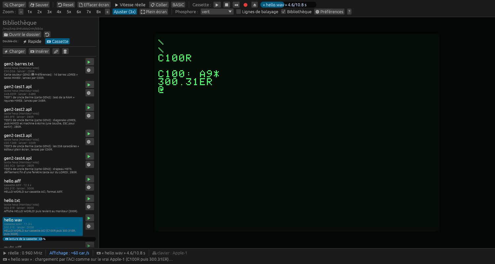

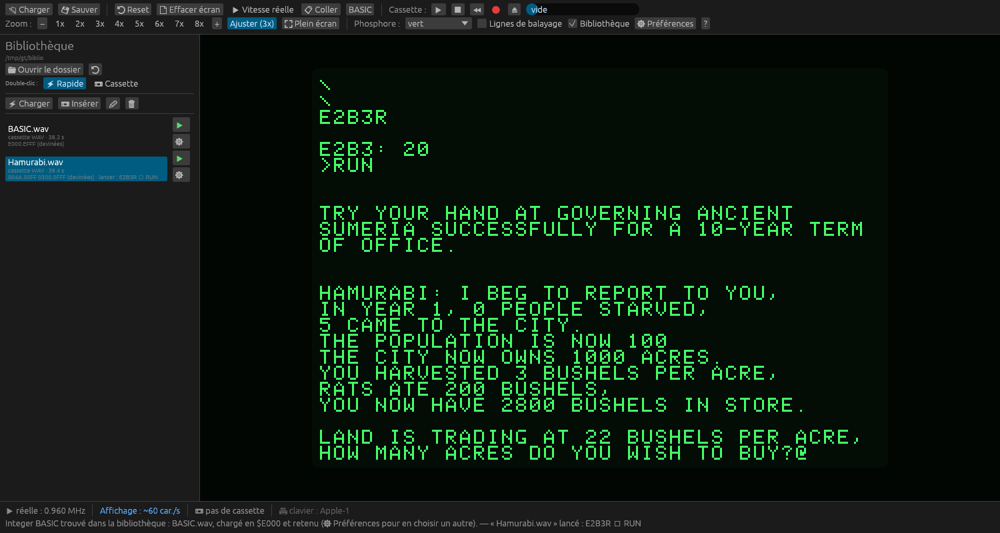

#### Plusieurs dossiers, projets GitHub, aide (v6)

- **Plusieurs dossiers** : « **+ Dossier** » en haut de la bibliothèque (ou
  ⚙ Préférences → Bibliothèque) ajoute un dossier ; le dossier principal
  reste toujours là. La bibliothèque est un **arbre** : dossiers et
  sous-dossiers se replient (l'état est mémorisé). Chaque dossier garde son
  `programs.json` ; ⚙, ▶, double-clic et reconnaissance marchent partout.
  Fichiers montrés : `.wav .aiff .bin .hex .txt .apl .bas .s .asm`.
  Clic droit sur un dossier ajouté : l'ouvrir, ou le retirer (rien n'est
  effacé sur le disque).
- **Projets GitHub** : « **+ Projet GitHub** » accepte une adresse
  (`https://github.com/jefftranter/6502/tree/master/asm/jmon`) ou
  `propriétaire/dépôt`. Les fichiers utiles sont copiés dans
  `~/.cache/apple1-emu/github/<propriétaire>/<dépôt>/<commit>/` et le projet
  devient un nœud de l'arbre, avec son commit (7 caractères), sa date et son
  message. **Mettre à jour** va chercher le dernier commit ; 🌐 ouvre la page.
  Tout le réseau se fait en arrière-plan, avec une barre de progression.
  Dépôts publics : aucun jeton. Un jeton est facultatif (variable
  `GITHUB_TOKEN`, ou Préférences ; `gui.json` est alors en mode 0600) ; il
  n'est jamais affiché ni écrit dans les messages. Il sert pour la limite de
  requêtes, les dépôts privés et les artefacts GitHub Actions.
- **Tester le dernier build** essaie, dans l'ordre : les fichiers de la
  dernière **Release** (`.wav/.aiff`, puis `.bin`, puis `.hex/.txt`), puis le
  dernier **artefact GitHub Actions** (jeton nécessaire), puis la
  **compilation des sources** : un listing BASIC est tapé dans l'Integer
  BASIC (chargé d'abord) puis `RUN` ; un source 6502 (`.s/.asm`) est
  assemblé avec **ca65/ld65** (paquet `cc65` ; message clair s'ils manquent),
  avec `-D APPLE1` par défaut ; un vidage Woz (`.txt/.hex`) est chargé.
  Un fichier `apple1.toml` (ou `apple1.cfg`) à la racine précise ce qu'il
  faut construire :

  ```text
  file    = "src/jeu.s"     # programme à lancer
  load    = $0300           # adresse de chargement (sinon le .org du source)
  run     = $0300           # adresse de lancement (sinon celle de chargement)
  ld65    = "apple1.cfg"    # configuration ld65 (sinon -t none)
  defines = "APPLE1"        # symboles -D pour ca65
  ```

  Vérifié sur `jefftranter/6502` (`asm/jmon`, 8 fichiers, `jmon.s` choisi) ;
  ce source demande un ca65 récent (2.19 ou plus, `cpu.mac`) : avec un ca65
  plus ancien, l'erreur de ca65 s'affiche telle quelle.
- **Position** : ⚙ Préférences → « Position de la bibliothèque : gauche /
  droite » (à **droite** par défaut), appliquée tout de suite ; la largeur
  du panneau (tirez sur son bord) est mémorisée.
- **Mode aide** : le bouton **?** (ou **F1**) allume ou éteint des bulles
  d'explication détaillées, dans les 7 langues, sur chaque commande ; le
  réglage est mémorisé. Éteint, seules les petites infobulles habituelles
  restent. ℹ ouvre « À propos ».

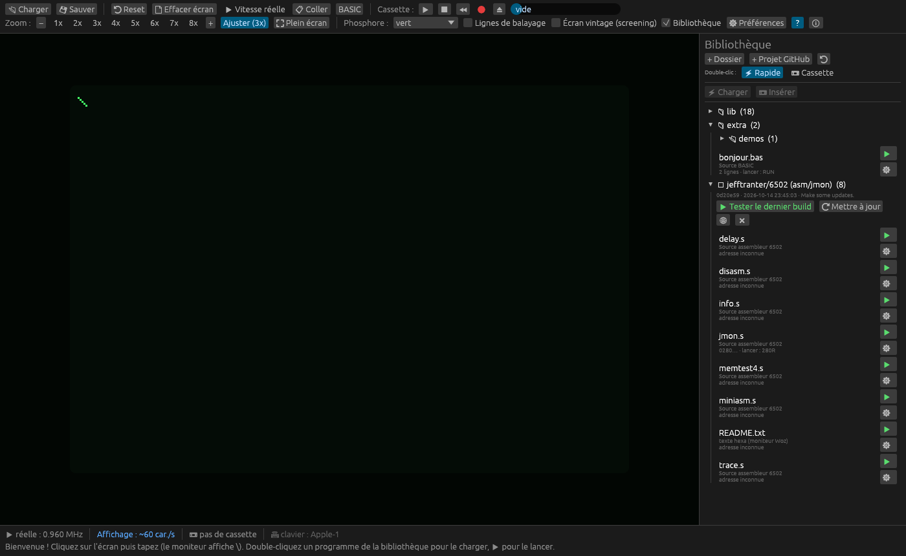

#### Son et oscilloscope de la cassette (v6.1)

Pendant une lecture (mode 📼 Cassette, ou ▶ du lecteur) ou un
enregistrement (⏺), le signal de la cassette peut être **entendu** et
**vu** :

- **🔊 / 🔇** (barre d'outils, à droite de la cassette) : le son du signal,
  joué au rythme de l'émulation, **volume faible** par défaut (curseur dans
  l'oscilloscope ou ⚙ Préférences → Cassette). Muet en vitesse maximale.
  Le son passe par ALSA (`libasound`, chargée au lancement seulement si
  elle existe) : sans carte son, il est simplement coupé.
- **📈** : la fenêtre **Oscilloscope cassette** (trace verte sur grille
  sombre, 1 ms par division) apparaît seule pendant la lecture ou
  l'écriture ; elle montre 10 ms autour de la tête de lecture (trait
  orange), ou les 10 dernières ms écrites par l'Apple-1. Le signal est
  reconstruit à partir des fronts que voit l'ACI (en-tête ≈ 870 Hz, bits 0
  ≈ 2 kHz, bits 1 ≈ 1 kHz). Elle se déplace et se ferme (✖) ; les réglages
  sont mémorisés.

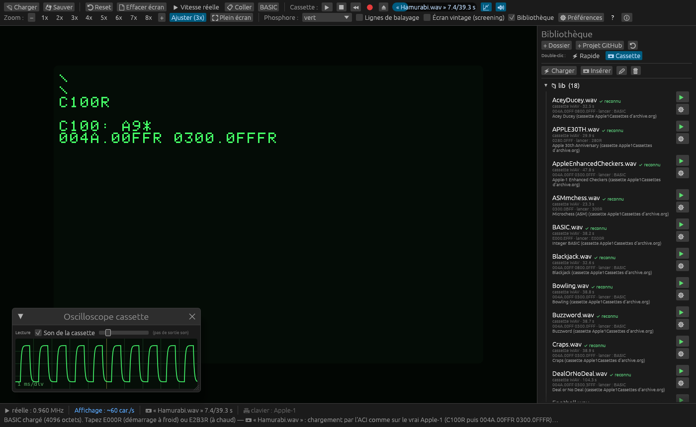

#### Éditeur Integer BASIC (v7.0)

**📝 Éditeur** (barre d'outils) ouvre l'**éditeur** (à gauche, voir v7.2) :

- **Onglets.** 🗋 Nouveau, 📂 Ouvrir (`.bas`, `.txt`), 💾 Enregistrer
  (**Ctrl+S**), Enregistrer sous… Un point • signale un onglet modifié ; ×
  le ferme (un second clic est demandé s'il n'est pas enregistré). Les
  onglets, y compris le texte non enregistré, sont retrouvés au lancement
  suivant.
- **Couleurs** : numéros de ligne, mots-clés, nombres, chaînes, `REM`,
  opérateurs. Les lignes que le BASIC refuserait sont sur fond rouge.
- **Taille du texte** : A− / A+, **Ctrl+molette** sur le texte, ou
  **Ctrl+plus / Ctrl+moins / Ctrl+0** quand le texte a le clavier (sinon ces
  touches gardent le zoom de l'écran).
- **Vérification et tokenisation natives** (`apple1_core::intbasic`) : le
  programme est mis sous la forme exacte qu'il a en mémoire dans l'Integer
  BASIC (lignes `[longueur][numéro][jetons…][$01]` sous HIMEM, page zéro
  `$4A-$FF` avec LOMEM, HIMEM, PP et PV). Les erreurs donnent la ligne du
  texte, le numéro de ligne BASIC et la colonne (clic = curseur sur la
  ligne) : syntaxe, nom de variable (une lettre et un chiffre au plus, `A$`
  pour une chaîne), nombre > 32767, commande du mode direct (`LIST`, `RUN`…),
  chaîne non fermée, ligne de plus de 255 octets, mémoire pleine.
- **Mémoire** : auto (8 Ko avec LOMEM `$0800`, ou `$0300` si le programme
  est grand, sinon 12, 16 ou 32 Ko), ou imposée.
- **▶ Lancer** : charge l'Integer BASIC s'il manque (`BASIC.wav` de la
  bibliothèque, comme le bouton BASIC), met le programme tokenisé en
  mémoire, ajoute de la RAM si besoin, puis tape `E2B3R` et `RUN`.
- **📼 Exporter WAV** : cassette ACI (`.wav`, ou `.aiff` pour le smartphone)
  avec deux enregistrements, et ses paramètres ⚙ dans la bibliothèque. Le
  bas de la fenêtre affiche ce qu'il faut taper sur le vrai Apple-1, avec
  4 chiffres de chaque côté : `C100R` puis par exemple
  `004A.00FFR 0C3B.0FFFR`, lecture, puis `E2B3R` et `RUN` (📋 Copier).
- Mode aide (**?** / F1) : chaque bouton a sa bulle, dans les 7 langues.

La tokenisation a été comparée **octet pour octet** à celle du vrai Integer
BASIC (programme tapé dans l'émulateur, mémoire relue) sur les 8 jeux de
`ports/basic` et sur `ports/aventure-js29/aventure.bas` (12 Ko) : blocs
identiques, `LIST` et parties (`RUN` avec les réponses de `tests/`)
identiques, et lecture de la cassette exportée par l'ACI vérifiée. En ligne
de commande : `apple1-emu basic jeu.bas -o jeu.wav [--ram 8|12|16|32]`
(aussi `.aiff`, ou `.txt` pour un vidage Woz).

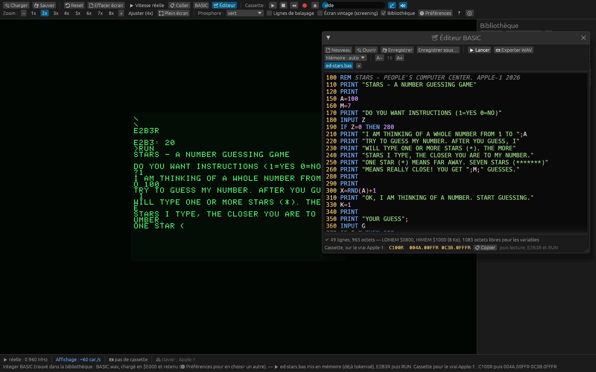

#### Éditeur à gauche, ou dans sa propre fenêtre (v7.2)

L'éditeur s'ouvre maintenant **ancré à gauche** de la fenêtre principale
(la bibliothèque reste à droite par défaut) ; tirez son bord pour régler sa
largeur. **🗗 Détacher** (en haut du panneau) le met dans une **vraie
fenêtre séparée** du système, que vous pouvez déplacer sur un deuxième écran
et redimensionner ; **⊟ Ancrer** le remet à gauche. Le choix, la largeur du
panneau, la taille et la position de la fenêtre séparée sont retenus. Fermer
la fenêtre séparée ferme l'éditeur ; 📝 Éditeur le rouvre au même endroit.
Les touches tapées dans la fenêtre séparée vont à l'éditeur, jamais à
l'Apple-1. Les boîtes de dialogue (Ouvrir, Enregistrer sous, Exporter)
s'ouvrent dans la fenêtre principale.

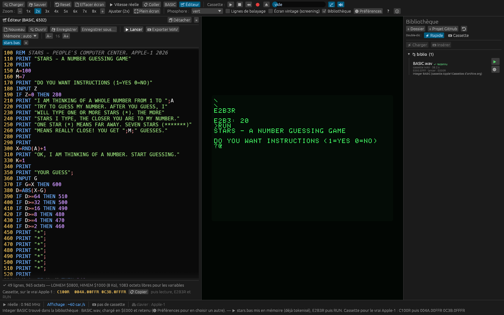

#### Débogueur BASIC et 6502 (v7.3)

**🐛 Débogueur** (barre d'outils) ouvre un panneau, ancré à droite ou
**🗗 détachable** dans sa propre fenêtre comme l'éditeur. Il arrête
l'Apple-1 et l'exécute pas à pas :

- **⏸ Pause / ▶ Continuer**, **⬇ Pas** (une instruction), **↪ Par-dessus**
  (un `JSR` d'un coup), **⤴ Sortir** (jusqu'au `RTS` du sous-programme),
  et, dans l'éditeur, **⏩ Jusqu'au curseur** ;
- **points d'arrêt** : **⏺ Point d'arrêt** dans l'éditeur sur la ligne du
  curseur (source `.s` grâce à la table des adresses, ou ligne BASIC), clic
  dans la marge du 📃 Listing ou sur une ligne du désassemblage, ou saisie
  d'une adresse (`$0368`, `ASK`, `PUTS+3`) ;
- **processeur** : A X Y S PC et les drapeaux N V B D I Z C, modifiables ;
  **désassemblage** autour de PC avec les étiquettes du programme assemblé ;
- **Integer BASIC** : **⏭ Ligne BASIC** avance d'une ligne du programme ;
  la ligne courante est surlignée en vert dans l'éditeur, les points
  d'arrêt en violet ; points d'arrêt sur numéros de ligne ; **variables
  suivies** : entières (`A`, `B1`), éléments de tableau (`D(2)`), tableau
  entier (`D`), chaînes (`C$`), plus la liste de toutes les variables. La
  ligne courante est lue dans les pointeurs de page zéro de l'interpréteur
  (`$DC`/`$DD`) au moment où il commence une ligne ; c'est vérifié avec le
  vrai BASIC de l'Apple-1 (il faut qu'il soit chargé en `$E000`) ;
- **mémoire surveillée** : octet, mot ou ASCII (`$30`, `$30 w`,
  `0200.020F`, une étiquette), modifiable, en jaune quand la valeur change ;
- **dump hexa/ASCII** : 16 octets par ligne, ASCII avec le bit 7 enlevé,
  aller à une adresse (ou ZP, `$0200`, `$0300`, PC, `$E000`), octets changés
  en jaune, l'octet de PC sur fond vert ; **Écrire** pose des octets
  (`0300 = A9 00`), un clic sur un octet remplit la ligne d'écriture.

Les variables, la mémoire surveillée et (depuis la v7.5) les points
d'arrêt sont retenus d'une session à l'autre. Attention : comme sur la vraie machine,
une touche frappée pendant que le programme BASIC tourne l'arrête
(`STOPPED AT`). En ligne de commande : `--debogueur`, `--ecran-separe`, `--dbg-arret
ASK,L190` (adresse, étiquette ou `L` + ligne BASIC), `--dbg-surveiller
'A,C$,$30 w'`, `--dbg-commande 5:pas` (pause, continuer, pas, dessus,
sortir, basic).

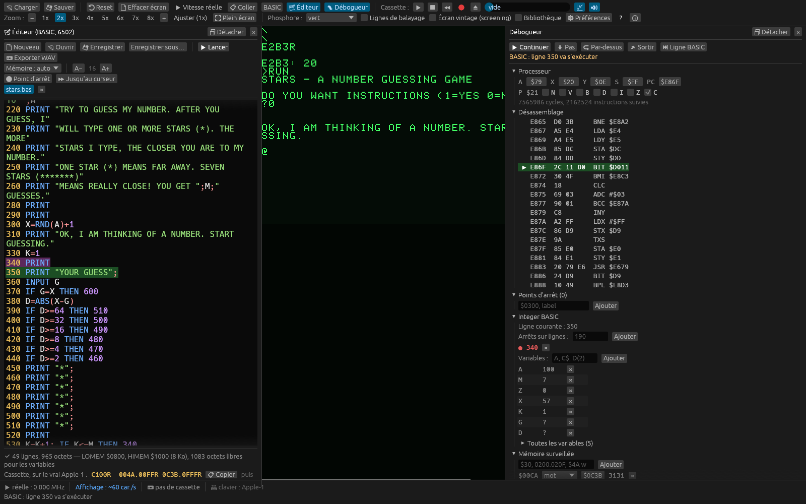

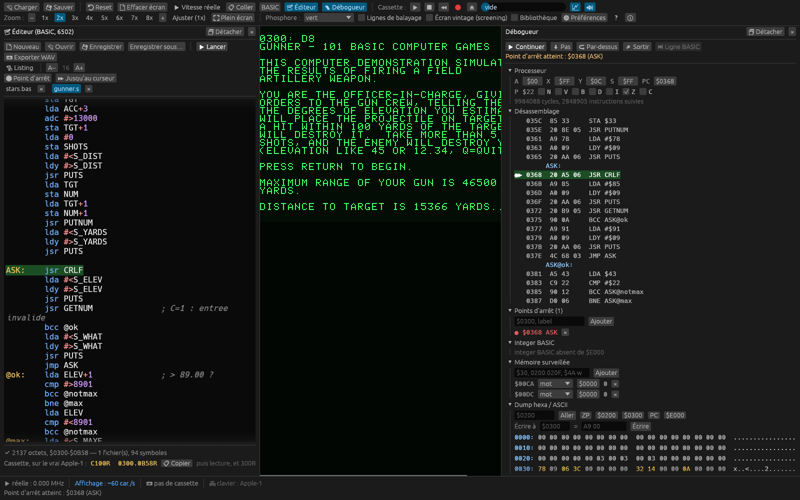

#### Assembleur 6502 (v7.1)

Le même **📝 Éditeur** ouvre aussi les sources en assembleur 6502 (`.s`,
`.asm`, `.a65`, `.inc` ; 🗋 Nouveau → « Source assembleur 6502 »). Elles
sont assemblées à chaque modification par un assembleur natif à deux passes
(`apple1_core::asm6502`), qui accepte la syntaxe ca65 des ports :

- **Couleurs** : instructions, directives, étiquettes, nombres (`$7F`,
  `%1010`, `'A'`), chaînes et commentaires `;`.
- **Syntaxe** : étiquettes `NOM:`, étiquettes locales `@boucle:` (entre deux
  étiquettes normales), étiquettes sans nom `:` avec `:+`, `:++`, `:-` ;
  constantes `NOM = expression` ; expressions avec `< > ^` (octet bas, haut,
  banque), `+ - * / & | ^ << >> ~ !`, comparaisons, `&& ||`, `*` (adresse
  courante) ; directives `.org .byte .word .res .asciiz .include .macro
  .endmacro .local .ifblank .ifnblank .else .endif .segment` ; les
  151 opcodes officiels du NMOS 6502 et tous les modes d'adressage (page
  zéro choisie quand la valeur est déjà connue, comme ca65).
- **Erreurs** avec fichier, ligne et colonne (clic = curseur sur la ligne,
  et ouverture du fichier inclus s'il le faut) : syntaxe, instruction
  inconnue, mode d'adressage impossible, symbole non défini ou en double,
  valeur hors limites, branchement trop loin, `.include` introuvable, bloc
  mal fermé, division par zéro, chaîne non fermée.
- **📃 Listing** : adresse, octets et source de chaque ligne, fichiers inclus
  à leur place ; un clic ramène à la ligne dans le texte.
- **▶ Lancer** : met les octets en mémoire à l'origine (`.org`, `$0300` par
  défaut), ajoute de la RAM si besoin, puis tape par exemple `300R`.
- **📼 Exporter WAV** (`.wav` ou `.aiff`) : cassette ACI et paramètres ⚙
  dans la bibliothèque (`300R`). Le bas de la fenêtre affiche la plage à
  taper sur le vrai Apple-1, sur 4 chiffres : `C100R` puis par exemple
  `0300.0B58R`, lecture, puis `300R` (📋 Copier).
- Les `.include` sont cherchés dans le dossier du fichier qui les contient,
  puis dans celui de la source, ses deux dossiers parents et leurs
  sous-dossiers `lib` (ce qui couvre `ports/asm/lib`).

Validation : les 6 jeux en assembleur (`gunner`, `guner1`, `splat`,
`rockt1`, `orbit`, `target`) donnent **exactement les mêmes octets** que
ca65 + ld65 (2137, 5136, 7140, 5635, 6069 et 5712 octets à `$0300`), ainsi
qu'une source d'essai qui utilise tous les opcodes et tous les modes. La
cassette écrite par 📼 Exporter WAV est identique à celle de la ligne de
commande. En ligne de commande :
`apple1-emu asm jeu.s -o jeu.wav` (aussi `.aiff`, `.bin`, `.txt`/`.hex` ;
`-I dossier` pour les `.include`, `-l` pour le listing).

Limites : une seule image contiguë (les `.segment` sont acceptés mais
ignorés, comme un ld65 à une seule zone mémoire) ; seulement les opcodes
officiels (le 65C02 s'ajoute en v7.4, ci-dessous).

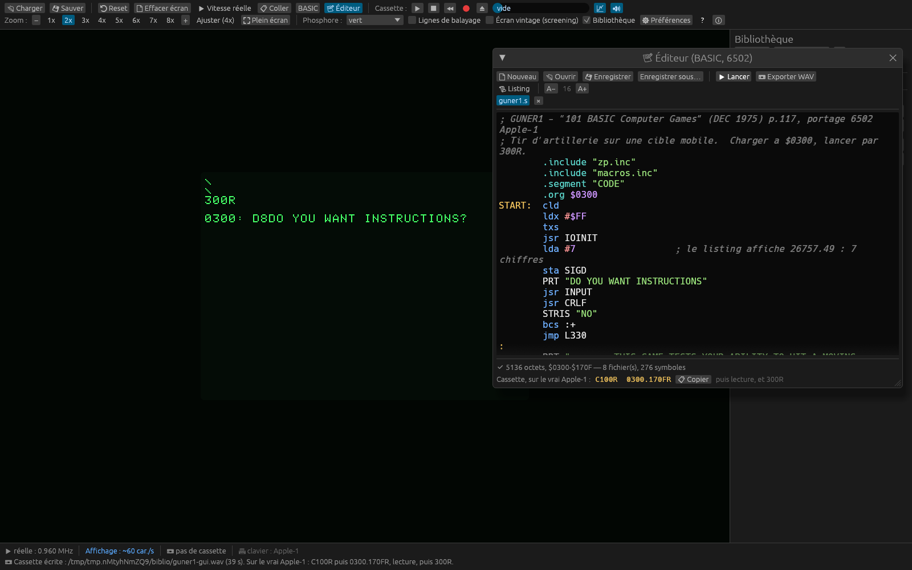

#### Assembleur perfectionné (v7.4)

- **Assemblage conditionnel** : `.if expression` / `.elseif` / `.else` /
  `.endif` (imbriqués), `.ifdef NOM` / `.ifndef NOM`, `.defined(NOM)` dans
  une expression. Comme ca65, la valeur doit être connue à cet endroit :
  constantes définies plus haut (sinon erreur « valeur inconnue à cet
  endroit »).
- **Répétition** : `.repeat 4, I` … `.endrep` (ou `.endrepeat`), avec un
  compteur facultatif qui vaut 0, 1, 2…, imbriquable et utilisable dans une
  macro.
- **`.define NOM texte`** (remplacement de texte, comme ca65 sans
  paramètres) et `.undefine NOM`.
- **Préfixes de taille** : `lda a:ZP` force l'adressage absolu (2 octets),
  `lda z:VAR` la page zéro.
- **Échappements dans les chaînes** après `.feature string_escapes`, comme
  ca65 : `\n \t \r \\ \" \' \xHH` (sans cette ligne, `\` est un caractère
  ordinaire, comme dans ca65).
- **65C02** : `.setcpu "65C02"` (ou `.pc02` ; retour avec `.setcpu "6502"`
  ou `.p02`) ajoute `bra phx phy plx ply stz trb tsb stp wai`, le mode
  `(zp)`, `jmp (abs,x)`, `bit #`/`bit zp,x`/`bit abs,x`, `inc a`/`dec a`, et
  les instructions Rockwell `rmb0-7 smb0-7 bbr0-7 bbs0-7` (`bbr0 $12,
  boucle`), exactement comme `ca65 --cpu 65C02`. Sans `.setcpu`, `stz` est
  refusé avec l'indication « 65C02 : .setcpu "65C02" ». Attention : l'Apple-1
  a un 6502 NMOS (et l'émulateur aussi) ; ce code ne tourne que sur une carte
  modifiée avec un 65C02, et le désassembleur du débogueur reste NMOS.
- **Développement des macros dans le 📃 Listing** : sous la ligne d'appel,
  chaque ligne produite par la macro, paramètres remplacés, avec ses
  octets (`0300  A9 41      + lda #$41`).
- **Table des symboles** à la fin du listing (vue 📃 Listing et fichier
  `-l` de la ligne de commande) : nom et valeur, triés par nom.
- **Avertissement page zéro / absolu** : une adresse qui tiendrait en page
  zéro mais qui est codée sur 2 octets parce que son symbole est défini plus
  bas (comme le « Didn't use zeropage addressing » de ca65) ; le programme
  est assemblé quand même, l'avertissement s'affiche en jaune en bas de
  l'éditeur (clic = ligne) et sur la sortie d'erreur de `apple1-emu asm`.

Validation : les 6 jeux donnent toujours exactement les mêmes octets que
ca65 + ld65 ; chaque nouveauté a son test, dont les octets attendus
viennent de ca65 V2.18 sur les mêmes sources ; et chaque instruction dans
chacune des 16 formes d'opérande, en 6502 et en 65C02 (3136 essais), est
soit acceptée avec les mêmes octets que ca65 (445), soit refusée par les
deux. Différences connues : `.define` sans paramètres seulement ; `.if`
sur une étiquette n'est pas possible (sa valeur n'est connue qu'à
l'assemblage, ca65 la refuse aussi sauf cas particuliers).

#### Photo → ASCII et bibliothèque d'art ASCII (v7.7)

- **🎨 ASCII** (barre d'outils) ouvre l'outil **Photo → ASCII**, un panneau
  ancrable et détachable comme les autres (au départ, un onglet à côté de
  l'éditeur). **Glissez-déposez** une photo jpg ou png sur la fenêtre, ou
  **📂 Ouvrir…** (une photo, ou un art ASCII déjà fait en `.txt`).
- **Recadrage** : le cadre vert sur la photo montre la partie convertie ;
  faites-le glisser pour le déplacer, la molette zoome. Réglages :
  **colonnes** (40 au plus) et **lignes** (24 au plus, bouton **23 lignes**
  pour laisser la dernière à l'invite), **zoom**, **centre**,
  **luminosité**, **contraste**, **gamma**, **inverser**, **niveaux auto**
  (étirement 2-98 %), **tramage** Floyd-Steinberg.
- **Caractères** : seulement ceux du 2513 de l'Apple-1 (majuscules, chiffres,
  symboles ; ni minuscules, ni `"`, ni `_`), rangés selon le nombre de points
  allumés dans la police du 2513 : rampe **complète** (26 niveaux),
  **simple** (10), celle du **diaporama de Schmenk**, ou **personnalisée**
  (triée et dédoublonnée automatiquement).
- **Aperçu** dessiné avec la police de l'Apple-1, dans la couleur du
  phosphore choisi.
- **Programme** : **BASIC** (une ligne `PRINT "…"` par ligne de l'art ; une
  ligne pleine de 40 caractères finit par `;`, car l'écran passe tout seul à
  la ligne) ou **6502** (source ca65 en `$0300` : une boucle envoie à ECHO
  `$FFEF` une table compressée, suites de caractères identiques codées
  « nombre + caractère » ; l'écran est d'abord vidé ; lancé par `300R`).
  Avec 24 lignes, le programme attend une touche avant de rendre la main ;
  avec 23, l'invite arrive sur la 24e ligne et l'image reste entière.
- **Boutons** : **✎ Insérer dans l'éditeur** (nouvel onglet BASIC ou 6502),
  **▶ Lancer** (insère puis lance, comme ▶ de l'éditeur), **📼 Exporter
  WAV…** (cassette pour un vrai Apple-1), **💾 Enregistrer dans la
  bibliothèque** (`.txt` dans le dossier « Art ASCII »), **📋 Copier le
  texte**, **Voir le code**.
- **Bibliothèque « Art ASCII »** : un dossier ajouté à la bibliothèque avec
  des dessins originaux au format de l'écran (pomme, carte Apple-1, puce
  6502, cassette, fusée, chat, crâne, ordinateur, « HELLO WOZ ») et les
  **portraits de Steve Wozniak et Steve Jobs**, convertis par l'outil
  depuis des photos libres (voir `Art ASCII/LICENCES.md`). Un `.txt` d'art
  ASCII y montre un **aperçu** quand il est choisi, avec **→ BASIC**,
  **→ 6502** et **🎨 Ouvrir dans l'outil** ; double-clic : dans l'outil ;
  **▶** : le programme 6502 est lancé tout de suite.
- **Diaporama de Dave Schmenk** (2014, avec ses portraits de Woz et Jobs) :
  ajouté comme **projet GitHub** de la bibliothèque
  (`dschmenk/Apple1-Slideshow`). Il est téléchargé depuis GitHub, pas fourni
  (le dépôt n'a pas de licence). **▶ Tester le dernier build** l'assemble
  (`slideshow.a65`, syntaxe xa, traduite automatiquement ; mêmes 3456 octets
  que xa 2.4.1) et le lance par `280R`.
- **Migration** : une configuration de la v7.6 ou d'avant reçoit une fois le
  dossier « Art ASCII » et le projet GitHub.
- En ligne de commande : `apple1-emu ascii PHOTO` (voir section 3).

Script (captures, tests) : `--ascii FICHIER`, `--ascii-reglages
"zoom=1.3;cx=0.45;cy=0.32;contraste=1.3;gamma=0.45;lignes=23;asm=1"`,
`--ascii-lancer S`.

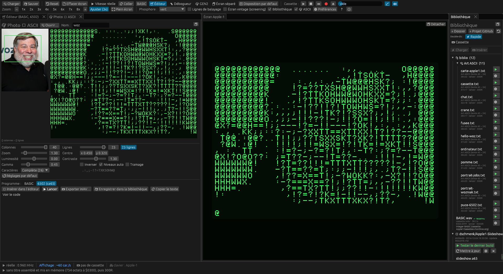

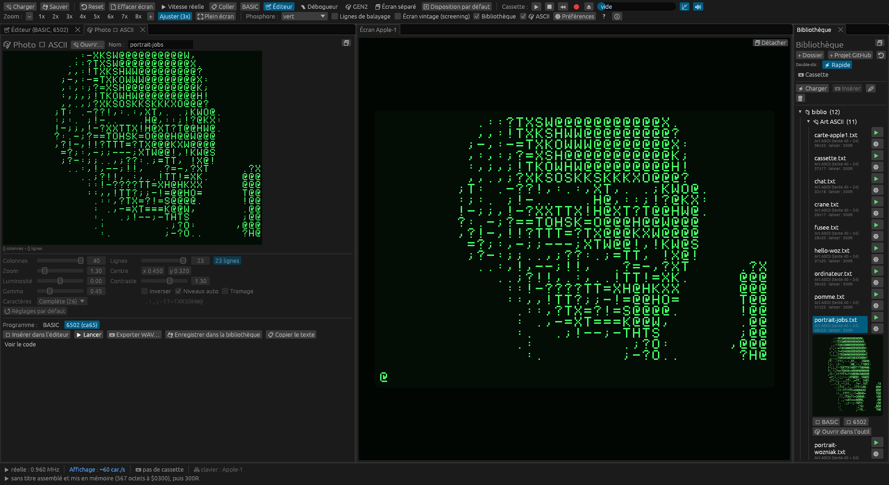

#### Disposition ancrable : panneaux côte à côte, détachables (v7.6)

- **Chaque panneau est un onglet ancrable** : éditeur, écran Apple-1, écran
  couleur GEN2, débogueur, désassemblage, dump et bibliothèque. Faites
  glisser un onglet par son titre : des repères apparaissent et vous le
  déposez **à gauche, à droite, au-dessus, en dessous** d'un autre panneau,
  ou **dans le même groupe d'onglets**. Les séparations se tirent pour
  redimensionner. La disposition est retenue dans `gui.json`.
- **Disposition de départ** : l'éditeur ouvert à gauche ; au centre l'écran
  de l'Apple-1, avec l'écran couleur GEN2 en dessous quand la carte est
  branchée ; à droite le débogueur avec le désassemblage en dessous, puis
  le dump, puis la bibliothèque tout à droite. Elle est prévue pour un écran
  de 1920 points (écran Apple-1 au zoom 2) ; tout se redimensionne.
  Le menu **⊞ Disposition ▾** (barre d'outils) la remet à tout moment
  (**Par défaut**, tous les panneaux ouverts et ancrés) et propose **Jeu**,
  **BASIC**, **Assembleur** et **Débogage** ; **Enregistrer la disposition
  actuelle…** garde la vôtre sous un nom (clic droit : Renommer, Supprimer).
- **🗗 Détacher** : chaque panneau a un bouton en haut à droite (texte
  complet sur les deux écrans, icône 🗗 sur les autres ; aussi par clic
  droit sur l'onglet) qui l'ouvre dans **sa propre fenêtre** du système,
  déplaçable sur un 2e écran, taille et place retenues. **⊟ Ancrer** le
  remet à sa place de départ. L'écran Apple-1 et l'écran couleur se
  détachent **séparément** ; le clavier va à l'Apple-1 depuis l'une ou
  l'autre de leurs fenêtres (et depuis la fenêtre principale). Fermer la
  fenêtre d'un écran le ré-ancre ; fermer celle d'un outil le ferme.
- **Dump** : 16 octets par ligne, ou 8 quand le panneau est étroit, avec
  défilement horizontal si besoin.
- **Migration** : une configuration de la v7.5 ou d'avant prend la
  disposition de départ au premier lancement (tous les panneaux ancrés et
  ouverts).
- L'oscilloscope de la cassette reste une petite fenêtre flottante dans la
  fenêtre principale.

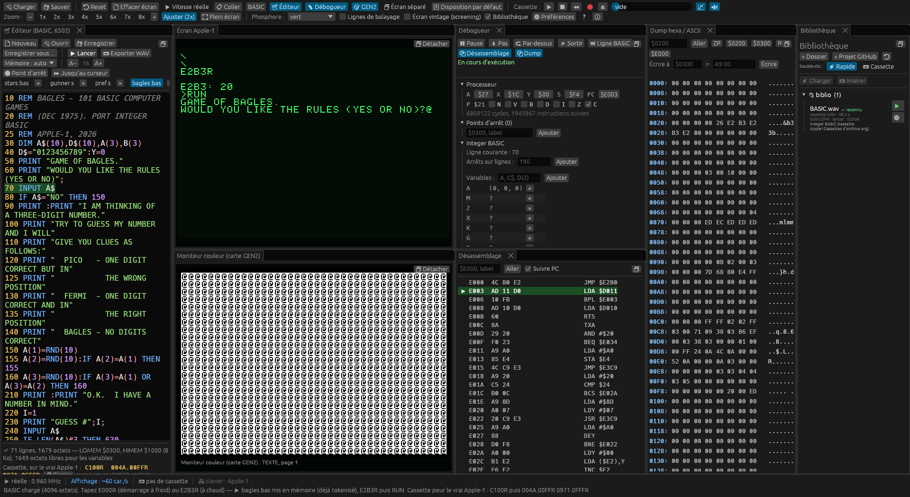

#### Fenêtres : désassemblage, dump, écran ; carte GEN2 en un clic (v7.5)

- **Plus de sautillement** : quand le BASIC attend une touche, PC tourne
  dans une petite boucle et le désassemblage, recalculé à chaque image,
  changeait de nombre de lignes (une étiquette apparaissait ou disparaissait
  selon l'instruction où se trouvait PC), ce qui faisait bouger tout le
  panneau. Désormais le désassemblage a **toujours 24 lignes**, les
  étiquettes dans leur propre colonne, et il **ne se recentre que quand PC
  sort de la zone visible** (ou approche du bas). Les lignes d'état et de
  message du débogueur gardent leur place même vides, et la barre de
  défilement reste affichée.
- **🗐 Désassemblage** et **🗐 Dump** (boutons du débogueur) sont chacun
  dans **leur propre fenêtre**, séparée par défaut (déplaçable sur un 2e
  écran) ou **⊟ ancrée** à droite comme le débogueur ; taille, place et
  état ouvert/fermé sont retenus. Le désassemblage a **Aller** (adresse ou
  étiquette, la liste reste alors fixe) et **Suivre PC**. Le panneau du
  débogueur garde les commandes, les registres, les points d'arrêt, les
  variables BASIC et la mémoire surveillée.
- **Points d'arrêt retenus** d'une session à l'autre (adresses et lignes
  BASIC, dans `gui.json`).
- **🗗 Écran séparé** (barre d'outils) : l'écran de l'Apple-1 (et l'écran
  couleur GEN2 s'il est branché) passe dans sa propre fenêtre,
  **déplaçable et redimensionnable** ; avec le zoom « Ajuster », l'image
  suit la taille de la fenêtre en gardant ses proportions, par pas entiers
  (**Échelle entière**, le plus net) ou en remplissant tout. L'écran
  vintage (CRT) marche à toutes les tailles. Le clavier va à l'Apple-1
  quand cette fenêtre a le focus (et aussi depuis la fenêtre principale).
  **⊟ Ancrer**, ou fermer la fenêtre, le remet à sa place. En ligne de
  commande : `--ecran-separe`.
- **🎨 GEN2** (barre d'outils, allumé quand la carte est branchée) branche
  ou débranche la carte couleur d'Uncle Bernie sans passer par les
  Préférences : c'est le même réglage (retenu), appliqué tout de suite
  comme la case des Préférences ; le programme en cours continue (faites un
  Reset s'il utilisait la carte).

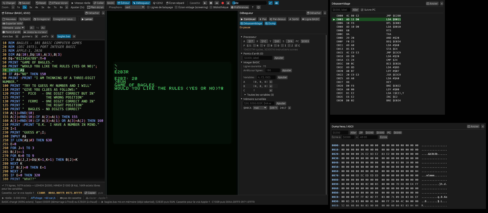

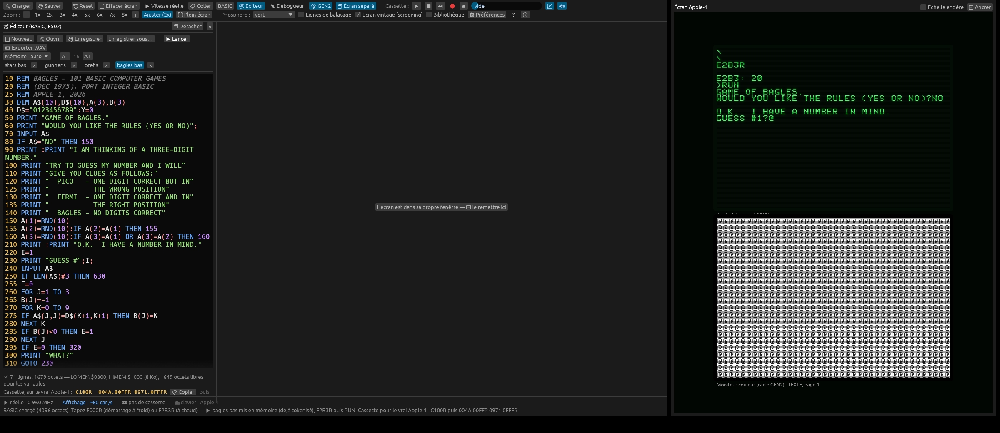

#### Cassettes reconnues : paramètres préréglés

Quand un fichier de la bibliothèque est **reconnu**, ses paramètres ⚙ sont
remplis tout seuls et la liste affiche **✔ reconnu** à côté du nom (la bulle
d'aide dit comment, et si les paramètres sont automatiques ou les vôtres).

- **Par le contenu** : l'émulateur décode les enregistrements de la cassette
  et compare leur taille et leur empreinte SHA-256 à une table intégrée au
  programme (les 24 cassettes de la collection « Apple1Cassettes »
  d'archive.org). Le nom du fichier n'a alors aucune importance : une copie
  renommée est reconnue.
- **Par le nom**, à défaut : même nom de fichier (majuscules, espaces et
  tirets ignorés : `HAMURABI.WAV`, `Apple Enhanced Checkers.wav`) **et**
  mêmes tailles d'enregistrements. Le contenu diffère (autre enregistrement) :
  la bulle d'aide le signale, vérifiez.
- **Vos réglages ne sont jamais écrasés** : un programme que vous avez
  réglé vous-même dans ⚙ (y compris avec une version précédente) garde ses
  paramètres ; seul l'indicateur « reconnu » apparaît. Dès que vous modifiez
  et enregistrez des paramètres préréglés, ils deviennent les vôtres.
- La table ne contient **que** des tailles, des empreintes et des
  paramètres : aucune donnée des programmes ni de la ROM BASIC n'est livrée.
- Les programmes qui dépassent les 8 Ko de base (Football jusqu'à `$2FFF`,
  Deal or No Deal et Star Trek 2003 jusqu'à `$3FFF`, Life en `$2000`)
  reçoivent automatiquement la RAM nécessaire au lancement (« RAM portée à
  12 Ko », comme une carte mémoire d'extension).

| Cassette (archive.org) | Titre reconnu | Plages | Type | Lancement |
|---|---|---|---|---|
| `AceyDucey.wav` | Acey Ducey | `004A.00FF 0800.0FFF` | BASIC | `E2B3R ⏎ RUN` |
| `APPLE30TH.wav` | Apple 30th Anniversary | `0280.0FFF` | langage machine | `280R` |
| `AppleiEnhancedCheckers.wav` | Apple-1 Enhanced Checkers | `004A.00FF 0300.0FFF` | BASIC | `E2B3R ⏎ RUN` |
| `ASMmchess.wav` | Microchess (ASM) | `0300.0BFF` | langage machine | `300R` |
| `BASIC.wav` | Integer BASIC | `E000.EFFF` | langage machine | `E000R` |
| `Blackjack.wav` | Blackjack | `004A.00FF 0800.0FFF` | BASIC | `E2B3R ⏎ RUN` |
| `Bowling.wav` | Bowling | `004A.00FF 0300.0FFF` | BASIC | `E2B3R ⏎ RUN` |
| `Buzzword.wav` | Buzzword | `004A.00FF 0300.0FFF` | BASIC | `E2B3R ⏎ RUN` |
| `Craps.wav` | Craps | `004A.00FF 0300.0FFF` | BASIC | `E2B3R ⏎ RUN` |
| `DealOrNoDeal.wav` | Deal or No Deal | `004A.00FF 0300.3FFF` | BASIC | `E2B3R ⏎ RUN` |
| `Football.wav` | Football | `004A.00FF 0400.2FFF` | BASIC | `E2B3R ⏎ RUN` |
| `Hamurabi.wav` | Hamurabi | `004A.00FF 0300.0FFF` | BASIC | `E2B3R ⏎ RUN` |
| `HiLo.wav` | Hi-Lo | `004A.00FF 0800.0FFF` | BASIC | `E2B3R ⏎ RUN` |
| `Life.wav` | Life | `2000.21FF` | langage machine | `2000R` |
| `LunarLander.wav` | Lunar Lander | `0300.09FF` | langage machine | `300R` |
| `LunarlanderasciiGraphics.wav` | Lunar Lander (ASCII graphics) | `004A.00FF 0300.0FFF` | BASIC | `E2B3R ⏎ RUN` |
| `Mastermind.wav` | Mastermind | `0300.03FF` | langage machine | `300R` |
| `Microchess.wav` | Microchess | `1000.18FF` | langage machine | `1000R` |
| `Pasart.wav` | Pasart | `0300.05FF` | langage machine | `300R` |
| `Slots.wav` | Slots | `004A.00FF 0300.0FFF` | BASIC | `E2B3R ⏎ RUN` |
| `StarTrek.wav` | Star Trek | `004A.00FF 0300.0FFF` | BASIC | `E2B3R ⏎ RUN` |
| `StarTrek2003.wav` | Star Trek 2003 | `004A.00FF 0300.3FFF` | BASIC | `E2B3R ⏎ RUN` |
| `WordCross.wav` | WordCross | `004A.00FF 0300.0FFF` | BASIC | `E2B3R ⏎ RUN` |
| `Wumpus.wav` | Wumpus | `004A.00FF 0300.0FFF` | BASIC | `E2B3R ⏎ RUN` |

Chaque cassette de la table a été vérifiée : chargée avec ces paramètres
(et la vraie cassette `BASIC.wav` pour les programmes BASIC), elle démarre
et affiche son texte d'accueil (`TRY YOUR HAND AT GOVERNING ANCIENT` pour
Hamurabi, `HAPPY 30TH BIRTHDAY APPLE!` pour APPLE30TH…). Remarques :
`LunarLander.wav` se lit en `0300.09FF` (1792 octets ; le Lisez-moi d'archive.org
indique `0300.0A00`, un octet de trop), et sa ligne « CONTROL TO LUNAR »
est suivie de caractères sans signification qui sont dans les données de la
cassette elle-même (le jeu fonctionne). `Football.wav` se charge en `$0400`
bien que son pointeur LOMEM indique `$0800` : le bloc enregistré se termine
toujours à HIMEM, c'est ce que l'émulateur utilise pour deviner.

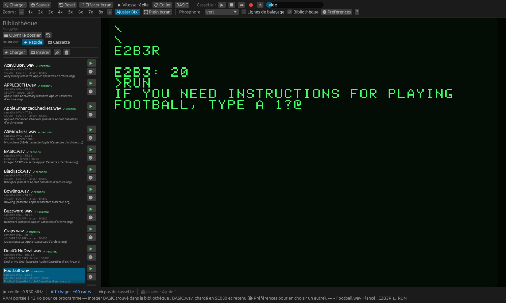

**Clic droit** sur un programme (ou boutons au-dessus de la liste) : charger,
charger et lancer, insérer comme cassette (sans rien taper), paramètres,
renommer, supprimer (avec confirmation), ouvrir le dossier. La liste se met à
jour seule (toutes les 2 s).

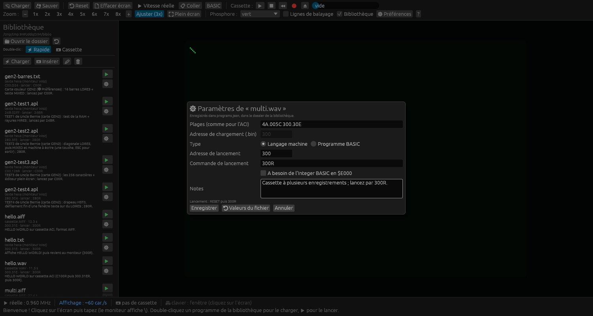

**Préférences** (⚙ Préférences dans la barre d'outils) : langue, dossier de la
bibliothèque (Parcourir… / Par défaut / Ouvrir le dossier), mode du
double-clic, phosphore, lignes de balayage, affichage de la bibliothèque,
limite d'affichage ~60 car./s, vitesse rapide, fichier de l'Integer BASIC
(Choisir… / Oublier) et carte couleur GEN2. Tout est retenu dans
`~/.config/apple1-emu/gui.json`.

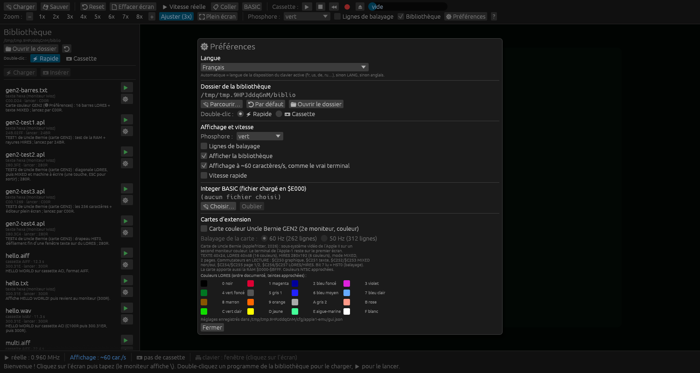

**Langues.** L'interface existe en **français, anglais, allemand, russe,
espagnol, italien et portugais**. Par défaut (« Automatique »), la langue
suit la **disposition du clavier active** : `fr` → français, `us`/`gb` →
anglais, `de`/`ch`/`at` → allemand, `ru` → russe, `es`, `it`, `pt`/`br`…
L'émulateur l'interroge dans cet ordre : `gsettings` de GNOME
(`mru-sources`), `setxkbmap -query`, la disposition de Cinnamon
(`org.gnome.libgnomekbd.keyboard layouts`, cas de Linux Mint), les
`sources` de GNOME, `localectl status`, `/etc/default/keyboard` ; sinon
`LC_ALL`, `LC_MESSAGES`, `LANG`, `LANGUAGE` ; sinon l'anglais. Les
Préférences indiquent la langue détectée et sa source, et permettent d'en
imposer une autre (aussi `--langue fr|en|de|ru|es|it|pt|auto`). Le cyrillique
est dessiné par la police intégrée (rien à installer). Les notes des exemples
sont écrites dans la langue active lors de la création de la bibliothèque.

| Anglais (clavier `us`) | Russe (clavier `ru`) |
|---|---|
| 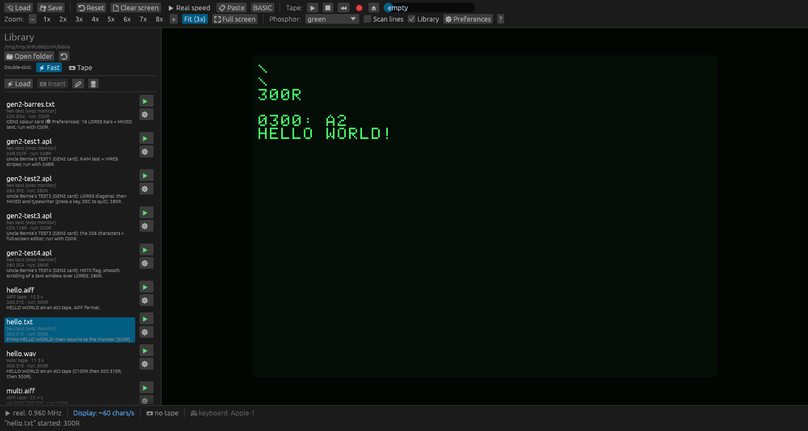 | 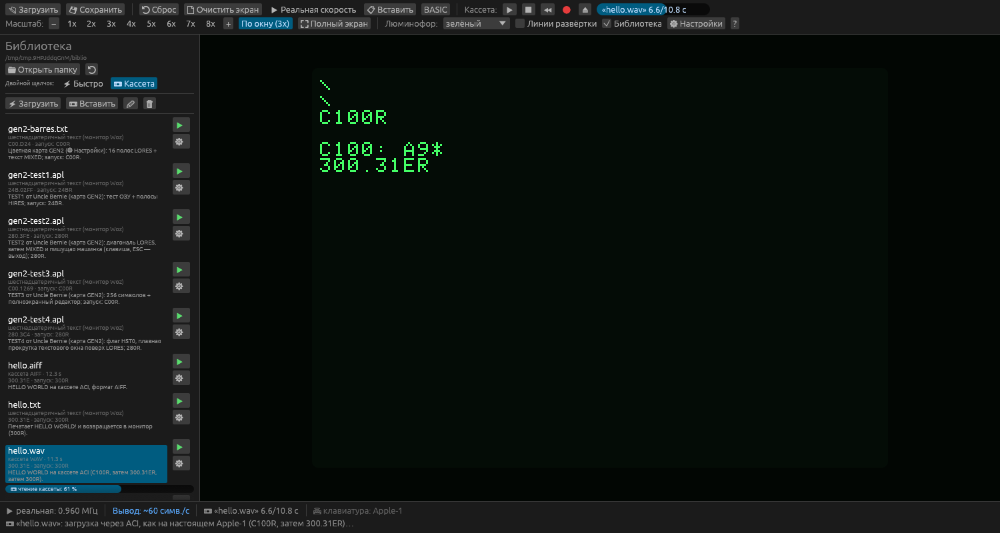 |

**Clavier.** Cliquez sur l'écran : les touches vont à l'Apple-1 (minuscules
converties, Entrée = RETURN, Retour arrière = `_`, Échap = ESC, Ctrl+lettre
= caractère de contrôle). Quand une fenêtre de dialogue ou un champ de texte
est actif, le clavier va à ce champ ; la barre d'état l'indique.

**Barre d'état** : vitesse mesurée (0,960 MHz effectifs en vitesse réelle),
limite d'affichage (cliquez pour basculer ~60 car./s ⇄ instantané), état de
la cassette, dernier message.

Les boîtes « Ouvrir / Enregistrer » sont intégrées à la fenêtre (dans la
langue de l'interface) : rien à installer. Options utiles : `--zoom 3`,
`--phosphore ambre`, `--balayage`, `--screening`, `--bibliotheque DOSSIER`, `--basic
FICHIER`, `--langue CODE`, `--mode-cassette` / `--mode-rapide`, `--cassette
FICHIER`, un fichier à charger au démarrage ; pour les démonstrations,
`--lancer-biblio S:NOM`, `--charger-biblio S:NOM`, `--parametres S:NOM`,
`--preferences S` ; `--help` pour la liste.

**Rendu OpenGL.** Si la fenêtre ne s'ouvre pas (pilote graphique absent,
machine virtuelle), `run.sh` relance automatiquement avec le rendu
logiciel de Mesa : `LIBGL_ALWAYS_SOFTWARE=1 ./apple1-emu-gui`.

## Carte couleur Uncle Bernie GEN2 (option)

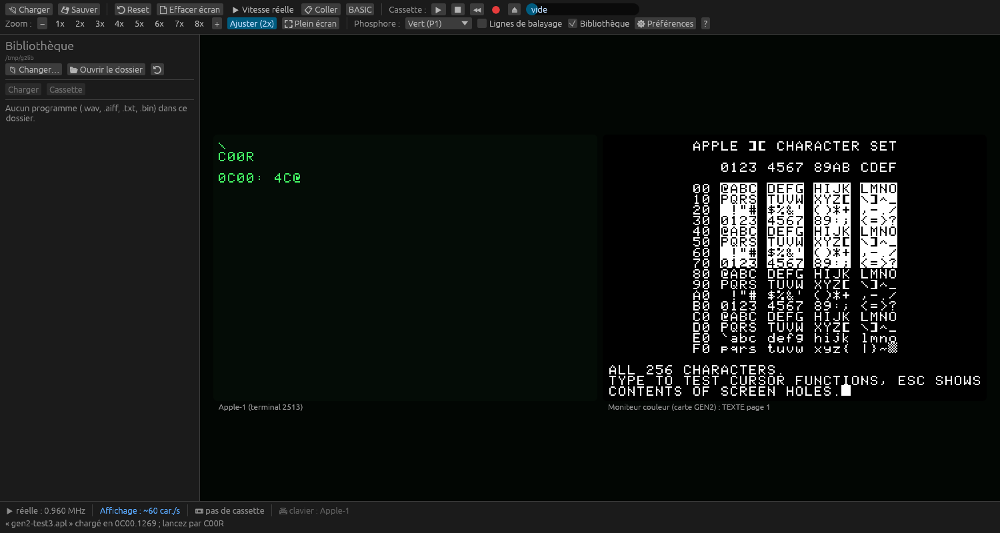

L'émulateur sait simuler la **carte graphique couleur « GEN2 » d'Uncle Bernie**
pour Apple-1 (2026). Elle est **désactivée par défaut**. Pour l'activer :

- dans la fenêtre, **⚙ Préférences**, puis cochez « Carte couleur Uncle Bernie
  GEN2 » (vous pouvez aussi choisir 60 ou 50 Hz) ; le réglage est retenu ;
- ou lancez `apple1-emu-gui --carte-couleur` (`--couleur-50hz` pour 50 Hz,
  `--sans-carte-couleur` pour la retirer) ;
- en terminal, `apple1-emu --carte-couleur` émule les registres et la mémoire,
  mais l'image couleur ne s'affiche que dans la fenêtre graphique.

**Deux écrans.** Sur la vraie machine, la carte a sa propre sortie vidéo
(« Port 2 ») pour un second moniteur, couleur. Le terminal de l'Apple-1 reste
sur sa sortie d'origine (« Port 1 ») et continue à fonctionner normalement.
La fenêtre montre donc les deux écrans, côte à côte ou l'un sous l'autre
selon la forme de la fenêtre. Le zoom « Ajuster » tient compte des deux. La
légende sous l'écran couleur indique le mode courant.

**Programmes d'essai** (dans `exemples/`, et dans la bibliothèque si vous la
créez à neuf) :

| Fichier | Lancement | Contenu |
|---|---|---|
| `gen2-barres.txt` | `C00R` | démo écrite pour l'émulateur : les 16 couleurs LORES en barres, plus une ligne de texte en mode MIXED |
| `gen2-test1.apl` | `24BR` | TEST1 d'Uncle Bernie : test de la RAM de la carte, avec des rayures HIRES qui alternent |
| `gen2-test2.apl` | `280R` | TEST2 : diagonale LORES puis mode MIXED et « machine à écrire » (une touche pour commencer, ESC pour sortir) |
| `gen2-test3.apl` | `C00R` | TEST3 : les 256 codes de caractères, puis l'éditeur plein écran |
| `gen2-test4.apl` | `280R` | TEST4 : mesure du drapeau HST0, puis une fenêtre de 4 lignes de texte qui défile finement sur du LORES |

Les quatre tests sont ceux du message « Early test software suite » d'Uncle
Bernie (fichier `A1_Graphics_Card_Tests_1to4.zip`). Son mode d'emploi est
dans `GEN2_TESTS_HOWTO`. Ces fichiers sont les siens : leurs conditions de
redistribution ne sont pas précisées. Ils sont fournis ici pour votre usage
personnel.

Le format `.apl` est un vidage du moniteur Woz (lignes `: xx` de suite
comprises). L'émulateur le lit comme un `.txt`.

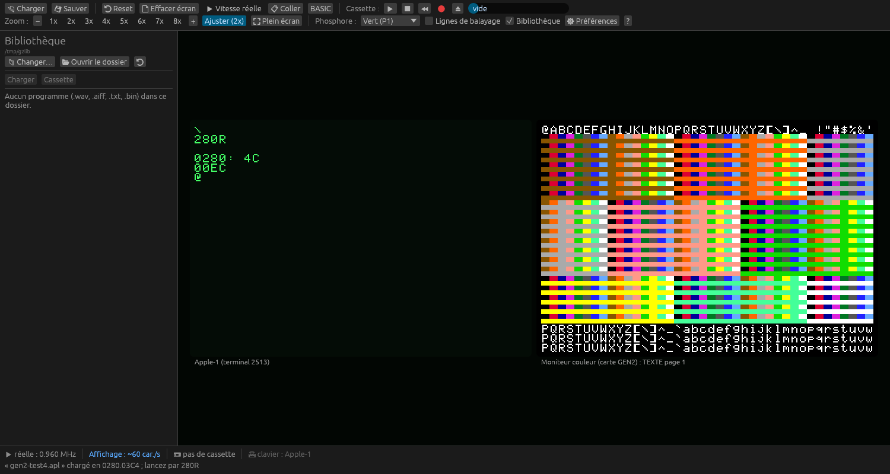

### Ce qui est émulé

La carte est présentée par son auteur dans le fil Applefritter « Uncle
Bernie's GEN2 color graphics card for the Apple-1 ». Ce qui suit décrit le
comportement de l'émulateur.

- **Commutateurs $C250-$C257**, recopie 1:1 des $C050-$C057 de l'Apple II :
  - `$C250` graphique, `$C251` texte ;
  - `$C252` / `$C253` MIXED non / oui ;
  - `$C254` / `$C255` page 1 / page 2 ;
  - `$C256` / `$C257` LORES / HIRES.
- **Accès.** Les commutateurs réagissent **uniquement en lecture**. Une
  écriture est sans effet.
- **Décodage** `SEL = $Cxxx · /A11 · A9 · A4` : la carte répond aussi sur
  ses miroirs (`$C258`, `$C3F1`, `$C6D4`…). Elle laisse libres `$C0xx` et
  `$C1xx` pour l'ACI.
- **Bit 7 lu = HST0** :
  - 1 pendant le retour ligne et le retour trame ;
  - 0 pendant la partie visible et pendant les 3 cycles de la salve de
    couleur.
- **Bits 0 à 6 lus** : bus flottant, renvoyé au hasard.
- **Balayage.** 65 cycles par ligne, 262 lignes (60 Hz) ou 312 lignes
  (50 Hz, option à souder). Les 4 cycles de rafraîchissement sur 65 sont
  pris en compte.
  - TEST4 trouve bien HST0 : il affiche une durée de trame de retour
    (`00EC`) au lieu de « HST0 ? ».
  - Sans la carte, il affiche « HST0 ? », comme prévu.
- **Écran couleur.**
  - Modes et mémoire de l'Apple II : TEXTE 40 × 24 (`$0400` / `$0800`),
    LORES 40 × 48 en 16 couleurs, HIRES 280 × 192 en 6 couleurs (`$2000` /
    `$4000`), MIXED (les 4 dernières lignes en texte).
  - Mêmes données, même image et mêmes couleurs que sur un Apple II.
- **Ordre des couleurs LORES** (celui de l'Apple II) :

  | 0 | 1 | 2 | 3 | 4 | 5 | 6 | 7 |
  |---|---|---|---|---|---|---|---|
  | noir | magenta | bleu foncé | violet | vert foncé | gris | bleu moyen | bleu clair |

  | 8 | 9 | 10 | 11 | 12 | 13 | 14 | 15 |
  |---|---|---|---|---|---|---|---|
  | marron | orange | gris | rose | vert clair | jaune | aigue-marine | blanc |

- **HIRES.** Couleurs d'artefact NTSC :
  - bit 7 à 0 : violet sur les colonnes paires, vert sur les impaires ;
  - bit 7 à 1 : bleu et orange ;
  - deux points voisins donnent du blanc.

  TEST1 montre des rayures magenta et vert séparées par de fines lignes
  blanches.
- **Caractères.**
  - Codes `$00-$3F` en inverse, `$40-$7F` clignotants, `$80-$FF` normaux.
  - Les 6 bits bas suivent le codage du 2513.
  - `$E0-$FE` sont les minuscules, et `$FF` est un damier.
- **Mémoire.** La carte est aussi l'extension mémoire : avec elle, la RAM
  couvre `$0000-$BFFF` (plus `$E000-$EFFF`).
- **RESET** ne touche pas aux commutateurs. À la mise sous tension,
  l'émulateur démarre en HIRES, page 1, avec un contenu aléatoire en
  `$2000-$3FFF`.
- **Écrans partagés.** Les changements de mode sont notés avec la ligne de
  balayage où ils arrivent. Un partage d'écran synchronisé sur HST0
  s'affiche donc correctement (TEST4).

### Ce qui est approché ou absent

- **Teintes exactes.** Elles dépendent du NTSC, du moniteur et du
  condensateur ajustable de la carte. Des valeurs proches de l'Apple IIgs
  sont utilisées. L'ordre des couleurs est celui de l'Apple II.
- **Dessin des caractères** : les glyphes de la carte fournis par Uncle
  Bernie (licence MIT, voir `NOTICE`), en deux variantes d'accolades.
- **Vitesse de clignotement** : 1,5 Hz.
- **Modèle HIRES simplifié** à 280 points : le décalage d'un demi-point
  quand le bit 7 est à 1 est ignoré.
- **Changements en cours de ligne** : ils comptent à partir de la ligne
  suivante.
- **Écritures en mémoire pendant le balayage** : non reproduites. L'image
  est dessinée avec la mémoire au moment de l'affichage.
- **Phase entre les deux balayages** : elle est libre, et non reproduite.
  Le terminal et la carte ne sont pas synchronisés.
- **Mémoire au démarrage.** Seule la page HIRES principale est remplie au
  hasard ; le reste est à zéro, ce qui donne en mode texte un écran de `@`
  en inverse tant que le programme ne l'a pas rempli.
- **Carte GEN1 de 2023** : elle utilisait `$C050-$C057`. Elle n'est pas
  émulée.

## 1. Linux : installation rapide

Le binaire `dist/apple1-emu-linux-x86_64` est **statique** (musl). Il
fonctionne sur la plupart des distributions Linux x86_64 sans rien installer.

```sh
# récupérez le binaire (dossier dist/ ou archive apple1-emu.tar.gz), puis :
chmod +x apple1-emu-linux-x86_64
./apple1-emu-linux-x86_64                 # lance l'émulateur dans le terminal
./apple1-emu-linux-x86_64 --help          # toutes les options
```

L'interface graphique `dist/apple1-emu-gui-linux-x86_64` n'est pas statique
(elle charge les bibliothèques X11/Wayland et OpenGL du système), mais elle
est compilée pour glibc 2.30 et fonctionne donc sur la plupart des distributions Linux récentes. Elle
utilise des bibliothèques toujours présentes sur un bureau Linux : `libX11`,
`libXcursor`, `libXi`, `libxkbcommon`, `libEGL`/`libGL` (Mesa) et, sous
Wayland, `libwayland-client`/`libwayland-egl`.

Lancez la version terminal dans un terminal d'au moins 42 colonnes × 28 lignes. Le terminal
habituel (gnome-terminal, xfce4-terminal…) convient. Vous pouvez copier le
binaire dans `~/.local/bin/apple1-emu` pour l'avoir dans le PATH.

### Compiler depuis les sources (rustup)

```sh
sudo apt install build-essential curl          # compilateur C / éditeur de liens
curl --proto '=https' --tlsv1.2 -sSf https://sh.rustup.rs | sh
source "$HOME/.cargo/env"
cd apple1-emu
cargo build --release                          # -> target/release/apple1-emu et apple1-emu-gui
cargo test --release                           # tous les tests (voir §7)
# binaire statique portable :
rustup target add x86_64-unknown-linux-musl
cargo build --release --target x86_64-unknown-linux-musl
```

N'utilisez pas le paquet `rustc` d'apt : il est trop ancien. Prenez rustup.

## 2. Utilisation de l'émulateur

```sh
apple1-emu                                  # 8 Ko + E000, ACI, vitesse réelle
apple1-emu --fast                           # démarrer en mode rapide
apple1-emu --load samples/hello.txt --run 300
apple1-emu --tape samples/hello.wav         # cassette insérée dans le lecteur virtuel
apple1-emu --tape samples/multi.aiff        # AIFF accepté aussi
apple1-emu --basic ~/apple1/integer_basic.bin   # votre copie de l'Integer BASIC
apple1-emu --ram 32 --no-e000               # 32 Ko, pas de RAM en E000
apple1-emu --cursor-hz 1.7                  # curseur plus lent (C7 hors tolérance)
apple1-emu --aci-rom ma_prom_512.bin --aci-page 1   # autre image de PROM (§9)
```

**Curseur.** Le `@` clignote comme celui du NE555 D13 monté en astable
(R10 = R11 = 10 kΩ, C7 = 22 µF) : **2,18 Hz**, visible 305 ms puis éteint
152 ms (visible 2/3 du temps). `--cursor-hz` change la fréquence en gardant
ce rapport ; `--cursor-duty` change la part visible (0 à 1). La valeur de
1,7 Hz mesurée sur une carte (voir `INTERFACES.md`) s'explique par la
tolérance du condensateur chimique C7 : `--cursor-hz 1.7` la reproduit.

Au démarrage, le Woz Monitor affiche `\`. Exemples : `FF00.FF3F` (examen
mémoire), `300: A9 C1 20 EF FF 4C 1F FF` (dépôt), `300R` (exécution).

### Touches

| Touche | Action |
|---|---|
| lettres, chiffres | clavier Apple-1 (les minuscules sont converties en majuscules) |
| Entrée | RETURN (CR) |
| Retour arrière | `_` (effacement du Woz Monitor) |
| Échap | ESC (annule la ligne dans le Woz Monitor) |
| **Ctrl+R** | bouton **RESET** |
| **Ctrl+L** | bouton **CLEAR SCREEN** |
| F1 | aide |
| F2 | ligne de commande de l'émulateur (voir ci-dessous) |
| F3 | vitesse réelle ⇄ rapide (réelle par défaut) |
| F4 | limite d'affichage 60 car./s oui ⇄ non |
| F5 / F6 | cassette : lecture depuis le début / stop |
| F10 ou Ctrl+Q | quitter |
| coller (Ctrl+Maj+V) | le texte est tapé au clavier de l'Apple-1 (vidages hex Woz par exemple) |

### Commandes (F2)

| Commande | Effet |
|---|---|
| `charger FICHIER[@ADR]` | charge directement en mémoire un `.txt` (vidage Woz), un `.bin` (`@ADR` obligatoire), un `.wav` ou un `.aif`/`.aiff` |
| `sauver FICHIER DEBUT.FIN [DEBUT.FIN…]` | sauve la mémoire ; `.wav` = cassette ACI en WAV, `.aif`/`.aiff` = cassette ACI en AIFF (profil smartphone, §4), `.txt` = vidage hex, `.bin` = binaire. Les plages peuvent être recopiées telles quelles depuis la ligne ACI : `sauver st.aiff 004A.00FFR 0300.0FFFR` |
| `cassette FICHIER` | insère une cassette `.wav` ou `.aif` ; elle démarre seule à la première lecture de l'ACI |
| `lecture`, `stop`, `rembobiner`, `ejecter` | contrôle du lecteur |
| `enregistrer FICHIER.wav` ou `.aif` | arme l'enregistreur ; tapez ensuite `C100R` puis `0300.03FFW` ; le fichier est écrit 1,5 s après la fin, ou au `stop` |
| `basic FICHIER` | charge votre Integer BASIC en `$E000` (puis `E000R`) |
| `taper FICHIER` | tape un fichier texte au clavier |
| `reset`, `effacer`, `rapide`, `reel`, `debit`, `aide`, `quitter` | — |

La cassette suit le temps **émulé**. Un chargement par l'ACI fonctionne donc
aussi en mode rapide, et il est alors bien plus court que les 10 s d'en-tête.

## 3. Export / import WAV et AIFF en ligne de commande

Le format de sortie est choisi par l'**extension** : `.aif` / `.aiff` donne
un AIFF, tout le reste un WAV. `export` et `import` sont des synonymes de
`export-wav` et `import-wav`.

```sh
# programme -> cassette
apple1-emu export samples/hello.txt -o hello.aiff             # AIFF, profil smartphone
apple1-emu export samples/hello.txt -o hello.wav              # WAV 44,1 kHz mono
apple1-emu export prog.bin@300 -o prog.wav --rate 48000 --bits 16
apple1-emu export startrek.txt --range "004A.00FFR 0300.0FFFR" -o startrek.aiff
# cassette -> programme
apple1-emu import enregistrement.wav -o prog.txt              # vidage Woz
apple1-emu import enregistrement.aiff --addr 300 -o prog.bin
apple1-emu info enregistrement.aiff                           # diagnostic
apple1-emu info startrek.aiff --aci-input stock               # simule l'entrée de l'ACI (§4)
apple1-emu convert prog.txt prog.aiff                         # hex <-> bin <-> wav <-> aiff
apple1-emu basic jeu.bas -o jeu.wav --ram 8                  # listing Integer BASIC tokenisé -> cassette (v7.0)
apple1-emu asm jeu.s -o jeu.wav                               # source 6502 (syntaxe ca65) assemblée -> cassette (v7.1)
```

- **Export.** Le signal est **produit par la vraie ROM ACI** exécutée dans
  le 6502 émulé, qui analyse elle-même la ligne `DEBUT.FINW …`. Les temps de
  bits sont donc exactement ceux d'un Apple-1 qui ferait `W`, y compris
  l'écart entre deux plages. Les adresses sont inscrites dans le fichier
  (chunk `LIST/INFO/ICMT` en WAV, `ANNO` en AIFF, « `APPLE1 ACI 0300.031E` »),
  que les lecteurs audio ignorent. La commande exacte à taper sur l'Apple-1
  est affichée.

  | Paramètre | WAV (défaut) | AIFF (défaut, profil smartphone) | Option |
  |---|---|---|---|
  | fréquence | 44 100 Hz | 48 000 Hz | `--rate` |
  | résolution | 16 bits | 16 bits | `--bits 8\|16` |
  | canaux | 1 (mono) | 2, **identiques** | `--channels 1\|2` |
  | amplitude | 0,8 | 0,89 (−1 dBFS) | `--amplitude` |
  | silence avant / après | 0,5 s | 1,0 s | `--silence S` |

  Les raisons de ces choix sont données au §4.
- **Plages.** `--range` accepte une plage (`0300.03FF`) ou toute une ligne
  ACI recopiée telle quelle (`"004A.00FFR 0300.0FFFR"`), et peut être répété.
  Chaque plage devient un enregistrement avec son propre en-tête de 10 s,
  exactement comme `004A.00FFW 0300.0FFFW` sur la vraie machine.
- **Import.** Les formats acceptés sont le WAV et l'AIFF / AIFF-C (`NONE`,
  `sowt`, flottant), en PCM 8, 16, 24 ou 32 bits ou flottant, en mono ou
  stéréo (le canal le plus fort est choisi), à n'importe quelle fréquence
  (22 050, 44 100, 48 000 Hz…). Le décodage traverse :
  - un filtre passe-haut et un passe-bas ;
  - un seuil adaptatif à hystérésis et un antiparasite ;
  - une mesure de la vitesse de bande sur les bits eux-mêmes.

  Il tolère le bruit, les faibles niveaux, l'inversion de polarité, une
  vitesse de ±10 % et plusieurs enregistrements dans un même fichier. Sans
  adresse inscrite (fichier d'un autre outil ou d'un vrai Apple-1),
  précisez-la avec `--addr ADR` ou `FICHIER.wav@ADR` (une seule plage).
- **Compatibilité.** Les WAV de l'outil indépendant **c2t** (Egan Ford,
  `c2t -1`) sont décodés et chargés par la ROM ACI émulée. C'est vérifié par
  les tests.

### Photo → art ASCII (v7.7)

```sh
# l'art seul, à l'écran
apple1-emu ascii photo.jpg
# réglages : recadrage, image, caractères
apple1-emu ascii woz.jpg --zoom 1.3 --cx 0.45 --cy 0.32 --contrast 1.3 --gamma 0.45 --rows 23 -o woz.txt
# programme BASIC, source 6502 (ca65), ou directement une cassette
apple1-emu ascii woz.jpg -o woz.bas
apple1-emu ascii woz.jpg -o woz.s
apple1-emu ascii woz.jpg -o woz.wav             # 6502, lancé par 300R
apple1-emu ascii woz.jpg -o woz.wav --format basic
```

Options : `--cols`, `--rows`, `--zoom`, `--cx`, `--cy`, `--brightness`,
`--contrast`, `--gamma`, `--invert`, `--dither`, `--no-auto-level`,
`--ramp simple|full|slideshow|LISTE`, `--title`. Un `.txt` d'art ASCII peut
aussi servir d'entrée.

## 4. Jouer le fichier dans un véritable Apple-1

### 4.1 Le montage smartphone de Wirehead (référence)

Le montage d'origine est décrit par Wirehead dans son fil Applefritter
« French-ie, Newb-ie, Apple One-ie... » (messages #47 et #48 du 3 février 2024) :
le téléphone de l'époque était un **Samsung Galaxy S7 Edge** (« Galaxy Edge 7 »
dans le message), avec une fiche jack 4 points (TRRS) récupérée sur un vieux
casque et deux morceaux de câble stéréo (schéma ci-dessous). Aujourd'hui,
d'après `note_lecteur_smartphone.txt`, la lecture des fichiers **AIFF** se fait
depuis un **Xiaomi Redmi Note 7** (lecteur intégré de Solid Explorer), et le
message #52 indique que VLC a réglé les difficultés de lecture AIFF sous Android.

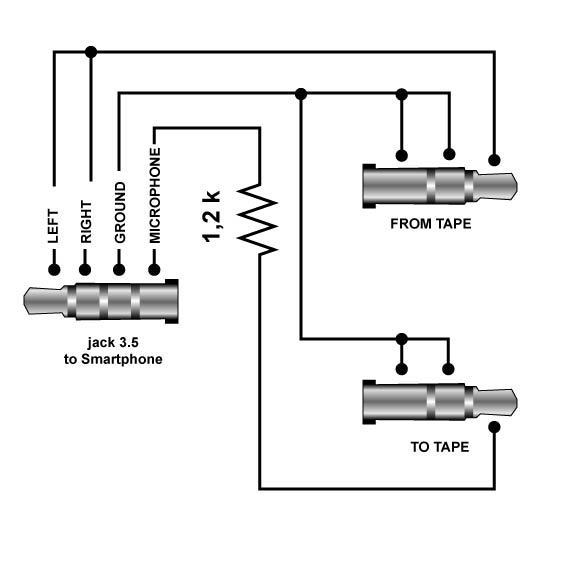

*Schéma de câblage publié par Wirehead sur Applefritter.*

| Contact de la fiche | Relié à | Rôle |
|---|---|---|
| gauche **et** droite (reliés ensemble) | « FROM TAPE » de l'ACI | lecture vers l'Apple-1 |
| micro, **via une résistance de 1,2 kΩ en série** | « TO TAPE » de l'ACI | enregistrement depuis l'Apple-1 |
| masse | masse de l'ACI | commune |

Rôle de la 1,2 kΩ, d'après le message #47 : c'est un problème d'impédance.
Sans elle, le Galaxy ne **reconnaissait pas l'insertion** du jack ; avec
environ 1,2 kΩ en série sur la sortie micro, il détecte bien un casque avec
micro. Explication technique probable (supposition) : vue du téléphone, la
sortie TO TAPE est un pont de 100 Ω vers la masse, qu'Android prend pour un
bouton de casque enfoncé plutôt que pour un micro.

Autres constats du message #48 : le téléphone **baisse automatiquement le
volume** à chaque débranchement/rebranchement du jack, et il faut être **au
volume maximum** pour que la LED rouge de l'ACI s'allume. L'enregistrement
depuis l'Apple-1 se faisait avec l'application « Enregistreur de voix facile »
(Easy Voice Recorder). L'émulateur ne dépend pas de ces choix.

Le câble relie gauche et droite ensemble : c'est sans danger **parce que**
les deux canaux portent exactement le même signal (§4.2). Avec un fichier dont les canaux
diffèrent, les deux amplificateurs du téléphone se « battraient » à travers
la liaison.

### 4.2 Paramètres AIFF choisis, et pourquoi

- **AIFF 16 bits PCM, non compressé.** C'est le format que Mike Willegal
  utilise sur iPod (guide Mimeo de l'ACI). L'AIFF ne passe par aucun codec
  avec perte (un MP3 ou un AAC arrondirait les fronts et décalerait les
  bits).
- **48 000 Hz.** C'est la fréquence native de la sortie audio d'Android :
  le téléphone n'a pas à rééchantillonner (un rééchantillonnage
  44,1 → 48 kHz ajoute des oscillations autour des fronts). La période la
  plus courte (bit « 0 », 248 µs) dure alors environ 12 échantillons.
- **Deux canaux strictement identiques.** Votre câble relie gauche et droite
  ensemble sur FROM TAPE. Un fichier mono peut être joué sur un seul canal
  par certains lecteurs, et deux canaux différents ou en opposition de phase
  s'annuleraient. Avec deux canaux identiques, les deux sorties poussent
  dans le même sens.
- **Signal carré, amplitude 0,89 (−1 dBFS).** L'entrée de l'ACI d'origine
  passe par un condensateur de 0,01 µF vers le comparateur LM311 polarisé à
  2,5 V par 10k/10k (5 kΩ) : c'est un passe-haut à environ 3,2 kHz. Le
  comparateur voit donc surtout les **fronts** du signal ; un carré à fronts
  raides est ce qui lui convient le mieux, alors qu'une sinusoïde filtrée de
  1 à 2 kHz serait atténuée d'un facteur 2 à 3. Les fronts sont rendus avec
  une précision inférieure à l'échantillon (filtre « boîte »). Le −1 dBFS
  laisse de la marge pour le dépassement du filtre de reconstruction du
  convertisseur (≈ 9 %), sans écrêtage.
- **Pas de composante continue.** Les deux demi-périodes de l'en-tête sont
  identiques (592 cycles chacune) et le silence vaut exactement 0.
- **1 s de silence au début et à la fin.** Le téléphone met un moment à
  « réveiller » sa sortie et coupe parfois le début d'un son ; la seconde de
  silence protège l'en-tête de 10 s, qui reste de toute façon bien plus long
  que nécessaire.

### 4.3 Procédure, pas à pas

1. **Préparez le fichier** sur le PC : `apple1-emu export prog.txt -o
   prog.aiff`, puis copiez-le sur le téléphone. Notez la commande affichée,
   par exemple `C100R` puis `0300.031ER`.
2. **Réglez le téléphone.**
   - **Volume au maximum**, comme dans votre essai Applefritter. Si Android
     affiche l'avertissement « volume élevé », acceptez-le, sinon le volume
     reste bridé.
   - **Désactivez tous les effets** : Mi Sound / Dolby / égaliseur /
     « amélioration audio » pour le casque.
   - Mode avion ou « Ne pas déranger », pour qu'aucune notification ne se
     mélange au signal. Pas de Bluetooth : le son doit sortir par la prise.
   - Lisez le fichier avec un lecteur simple. Sur Applefritter, vous aviez
     eu des difficultés avec l'AIFF sous Android, résolues avec **VLC**.
3. **Sur l'Apple-1**, tapez `C100R`. Le moniteur répond `C100: A9*`, et le `*`
   est l'invite de l'ACI.
4. Tapez la ligne affichée par l'export, par exemple `0300.031ER`, mais
   **n'appuyez pas encore sur RETURN**.
5. Lancez la lecture, puis appuyez sur **RETURN pendant l'en-tête**.
   - Le manuel de l'ACI demande d'appuyer dans les 5 s qui suivent le
     démarrage de la bande. L'en-tête dure environ 10 s, plus la seconde de
     silence du début.
   - La ROM attend environ 3,5 s, puis guette le bit de départ.
6. À la fin, l'ACI revient au moniteur (`\`). Lancez le programme avec `300R`.
   Pour l'exemple fourni, il affiche `HELLO WORLD!`.

**La LED de l'ACI.** Le manuel de 1976 demande un niveau tel que la LED soit
« juste pleinement allumée ». Le guide de Mike Willegal précise que cette
LED ne s'allume qu'à environ 1,2 V, ce qui est plus que ce dont le
comparateur a besoin : **ne vous fiez pas à la LED**. Une LED éteinte ne
veut pas dire que le signal est trop faible.

**Quel niveau faut-il ?** La commande `info --aci-input` simule l'entrée de
la carte (condensateur, polarisation 5 kΩ, hystérésis du LM311) pour
plusieurs tensions crête :

```sh
apple1-emu info prog.aiff --aci-input stock            # carte de 1976, 0,01 µF
apple1-emu info prog.aiff --aci-input mimeo            # 0,1 µF (conseil du guide Mimeo)
apple1-emu info prog.aiff --aci-input gen2             # ACI Gen2 d'Uncle Bernie
```

Avec le modèle « stock », nos fichiers sont lus dès **environ 0,25 V crête**
à la prise. Une sortie casque de smartphone au maximum fournit en général
de 0,5 à 1 V crête, d'où l'intérêt du volume maximal. Ces chiffres viennent
d'un modèle simplifié du schéma : l'hystérésis (≈ ±0,22 V) est calculée à
partir des résistances 3k/47k, et la tension de votre téléphone (Galaxy S7 Edge ou Redmi Note 7) n'a pas
été mesurée.

### 4.4 Exemple de référence : Star Trek (plusieurs plages)

Le Star Trek en Integer BASIC de votre essai se charge ainsi :

```
C100R
004A.00FFR 0300.0FFFR        (RETURN pendant l'en-tête du premier enregistrement)
E2B3R                    (une fois revenu au \)
```

- `004A.00FF` est la page zéro de l'Integer BASIC (pointeurs du programme et
  des variables) ; `0300.0FFF` contient le programme. Ce sont deux
  enregistrements successifs, chacun avec son en-tête de 10 s.
- `E2B3R` est l'**entrée à chaud** de l'Integer BASIC : elle garde le
  programme chargé, alors que `E000R` (démarrage à froid) l'effacerait. Le
  BASIC doit donc **déjà être en `$E000`**, chargé depuis sa propre cassette
  (`E000.EFFFR`) ; il faut le cavalier « W → E » de la carte mère (RAM en
  `$E000`). L'émulateur ne fournit **pas** l'Integer BASIC : chargez votre
  copie avec `--basic` ou la commande `basic`, puis `charger startrek.aiff`
  ou `cassette startrek.aiff`.
- **Cassettes sans adresses** (par exemple celles d'archive.org
  « Apple1Cassettes » : `BASIC.wav`, `Hamurabi.wav`, `StarTrek.wav`…). Dans
  l'interface graphique, chaque enregistrement va dans **sa** plage des
  paramètres ⚙, dans l'ordre (`004A.00FF 0300.0FFF` : le premier en `$004A`, le
  second en `$0300`). Sans paramètres, l'émulateur devine : un
  enregistrement de 4096 octets commençant par `JMP` est l'Integer BASIC
  (`E000.EFFF`, sans lancement) ; deux enregistrements dont le premier fait
  182 octets (`$4A-$FF`) sont un programme BASIC, placé d'après les
  pointeurs LOMEM/HIMEM (`$4A`, `$4C`) qu'il contient (`Hamurabi.wav` :
  LOMEM `$0300`, HIMEM `$1000`, d'où `0300.0FFF`). La liste indique
  « (devinées) » ; vérifiez avec ⚙. Les programmes en langage machine sans
  adresses ne sont pas devinés : indiquez leur plage dans ⚙.
- Pour créer un tel fichier depuis l'émulateur :
  `sauver startrek.aiff 004A.00FFR 0300.0FFFR` (F2), ou
  `apple1-emu export startrek.txt --range "004A.00FFR 0300.0FFFR" -o startrek.aiff`.

**Attention aux zéros de `004A.00FF` : ils sont obligatoires.** L'analyseur de
la ROM ACI n'efface pas son accumulateur hexadécimal au point (routine SEP
en `$C166`, « Doesn't clear HEX1!!! » dans le listing). Les chiffres de la
fin s'ajoutent derrière ceux du début : `4A.FF` signifierait
`$004A-$4AFF` ! `0300.0FFF` fonctionne, car les trois chiffres font sortir le
3 de `0300`. L'émulateur affiche toujours la forme correcte
(`004A.00FFR 0300.0FFFR`), et reproduit ce comportement puisqu'il exécute la
vraie ROM.

L'exemple `samples/multi.txt` / `multi.aiff` / `multi.wav` a la même
disposition (page zéro + `$0300`) : `C100R`, `004A.005CR 0300.030ER`, puis
`300R` affiche `MULTI-PLAGES OK !`.

### 4.5 Depuis un PC, et enregistrement depuis l'Apple-1

- **PC.** Sortie casque ou ligne vers FROM TAPE, effets audio désactivés.
  Un WAV ou un AIFF conviennent tous les deux.
- **Jamais de MP3 ni d'AAC** : un format sans perte (WAV, AIFF ; FLAC si le
  lecteur le décode).
- **Enregistrer depuis l'Apple-1.** TO TAPE ne fournit qu'environ 50 mV
  crête à crête (diviseur 10k/100 Ω après la bascule 74LS74) : c'est un
  niveau micro.
  Sur le téléphone, utilisez une application d'enregistrement qui coupe le
  gain automatique et la réduction de bruit (mode « brut » ou « non
  traité », WAV non compressé) et regardez la forme d'onde (Audacity) :
  ni écrêtage ni saut de niveau pendant l'en-tête. L'import de l'émulateur
  tolère un gain quelconque et un décalage continu ; le saut de niveau en
  cours d'en-tête est sans effet s'il ne coupe pas de demi-période. Enregistrez par l'entrée micro (sur le téléphone, par le
  contact micro et la 1,2 kΩ ; sur PC, Audacity en 44,1 ou 48 kHz), tapez
  `C100R` puis `0300.03FFW` et RETURN, arrêtez quelques secondes après le
  retour du `\`, puis `apple1-emu import fichier.aiff --addr 300 -o
  prog.txt`. Pour plusieurs plages, indiquez-les comme à la lecture :
  `apple1-emu import startrek.aiff --range "004A.00FFR 0300.0FFFR" -o
  startrek.txt` (`--addr` placerait les enregistrements bout à bout).

## 5. Format cassette ACI et paramètres de temps

L'export exécute la routine `WRITE` de la ROM ACI (`$C170`). Chaque accès à
`$C000-$C0FF` fait basculer la bascule de sortie. Voici les temps mesurés
dans l'émulateur :

| Élément | Cycles 6502 | Durée (modèle par défaut) |
|---|---:|---:|
| demi-période d'en-tête (« 1 » long) | 592 | ≈ 618 µs (≈ 809 Hz) |
| durée de l'en-tête | — | ≈ 10,1 s (≈ 16 400 demi-périodes) |
| bit de départ, 1re / 2e demi-période | 180 / 238 | ≈ 186 / 248 µs |
| bit « 0 » (demi-période) | 238 | ≈ 248 µs (≈ 2,0 kHz) |
| bit « 1 » (demi-période) | 473 | ≈ 494 µs (≈ 1,0 kHz) |

- Les octets sont envoyés bit de poids fort en premier, sans parité ni somme
  de contrôle.
- La durée exacte de l'en-tête dépend de la position du `W` dans la ligne
  tapée, car X sert de compteur. L'export place toute la ligne
  (`004A.00FFW 0300.0FFFW`) dans le tampon d'entrée et la fait analyser par la
  ROM : le résultat est identique, au cycle près, à une saisie au clavier
  (vérifié par les tests, une et deux plages).
- **Conversion cycles → secondes.** Les secondes viennent de 1,022727 MHz
  (14,31818 MHz / 14). Le 6502 est en plus suspendu 4 cycles sur 65 pour le
  rafraîchissement de la DRAM, soit 0,9598 MHz effectifs.
  - Avec ce modèle, on obtient presque exactement les « 2 kHz = 0, 1 kHz = 1 »
    et les « 10 secondes d'en-tête » du manuel, ce qui le confirme.
  - `--no-refresh` exporte sans ce modèle : les bits sont alors environ 6 %
    plus courts.
  - Le lecteur ACI tolère largement les deux, puisque son seuil est d'environ
    740 µs par période complète (476 contre 946 µs).
- **Lecture (ROM `$C18D`).** Une boucle de 12 cycles mesure chaque
  demi-période en lisant `$C081`. Le niveau de l'entrée bande agit sur la ligne
  A0 de la PROM : en `$C080-$C0FF`, A0' = A0 ET NON(entrée). Une même
  instruction lit donc `$D0` ou `$FA` selon le niveau, comme dans l'émulateur.

### Ce que disent les documents de l'ACI (`/workspace/apple1/hardware/aci/`)

Comparaison entre vos documents et le modèle de l'émulateur :

| Point | Documents | Émulateur |
|---|---|---|
| Contenu de la ROM | listing de l'annexe D du guide Mimeo | identique octet pour octet (vérifié) |
| PROM | deux 82S129 (ou 6301) de 256 × 4 bits, une par quartet, en A3/A4 | 256 octets, visibles en `$C000` et `$C100` |
| Entrée bande | A0 de la PROM modifié par le comparateur quand A7 = 1 (portes 74LS02/74LS10) | A0' = A0 ET NON(entrée) en `$C080-$C0FF` |
| Bascule de sortie | 74LS74 (A2), basculée par chaque accès à `$C0xx` | idem |
| En-tête | commentaire du listing : « 565/455 µs, ~1 kHz » asymétrique | le **code** donne deux demi-périodes de 592 cycles (≈ 618 µs, ≈ 809 Hz) ; l'émulateur suit le code |
| Bits | manuel : 1 kHz = « 1 », 2 kHz = « 0 » ; le commentaire `BCC WRITE1 ; Write a '1' (2kHz)` du listing est faux | le code et l'émulateur suivent le manuel |
| Bit de départ | commentaire : 385 puis 455 µs | le code donne 180 puis 238 cycles (≈ 186 / 248 µs) |
| Fin de lecture | manuel : `\` ; la reproduction Mimeo montre `/` | la ROM saute à `ESCAPE` ($FF1A), qui affiche `\` |
| Analyse `S.E` | listing : HEX1 n'est pas effacé au `.` | reproduit (vraie ROM) ; l'export écrit `004A.00FF` |
| Plusieurs plages | manuel : un en-tête par plage ; relire avec les mêmes plages ; le manuel BASIC de 1976 colle les plages : `004A.00FFW800.FFFW` | idem ; `--range` et `sauver` acceptent les plages collées ou séparées |
| Comparateur | LM311, entrée par 0,01 µF, polarisation 2,5 V (10k/10k), réaction 3k/47k | idéal par défaut (la ROM ne regarde que les **changements** d'état, donc la polarité est sans effet) ; modèle analogique optionnel `info --aci-input` |
| Variantes | Mimeo : 0,1 µF plus fiable que 0,01 µF ; Gen2 : 100 nF appairé, 300k au lieu de 47k (moins d'hystérésis), 5,1 MΩ au lieu de 100k pour la LED, 180 Ω au lieu de 100 Ω pour plus de signal sur TO TAPE, point de polarisation à 2,45–2,55 V | modèles `mimeo` et `gen2` de `info --aci-input` |
| Niveau de lecture | manuel : LED « juste allumée » ; Willegal : LED à ≈ 1,2 V, trop haut, à ne pas utiliser ; Applefritter : volume max | voir §4.3 |
| Sortie TO TAPE | ≈ 50 mV crête à crête (niveau micro) | les fichiers enregistrés par l'émulateur sont à pleine échelle (capture numérique) |

Sources :
- vos documents ACI (`/workspace/apple1/hardware/aci/`) : manuel de 1976,
  schéma, guide Mimeo de Mike Willegal (EN/FR), ACI Gen2 d'Uncle Bernie ;
- le manuel de l'ACI Apple de 1976 (`/workspace/apple1/docs/apple1cassette.pdf`) ;
- l'analyse matérielle et le listing de la ROM ACI de San Bergmans
  (sbprojects.net) ;
- les listings Woz Monitor et ACI désassemblés par Jeff Tranter ;
- le dump POM1 (apple1.chez.com) ;
- c2t d'Egan Ford (github.com/datajerk/c2t), comme outil de vérification
  indépendant ;
- le pilote MAME `apple1.cpp` ;
- la discussion Applefritter sur les cycles de rafraîchissement
  (`web/ram-refresh-cycle-details.txt`) ;
- les notes matérielles `/workspace/apple1/hardware/INTERFACES.md`.

## 6. Détails d'émulation

- **Affichage.** `STA $D012` fait passer PB7 (DA) à 1, c'est-à-dire
  « occupé ».
  - Le caractère est pris lorsque le balayage atteint la position du curseur.
    L'image fait 65 × 262 périodes CHAR, soit 60,05 Hz ; la ligne de texte r
    commence à la ligne de balayage 8·r, et la colonne c à l'état H $C0+c.
  - PB7 revient ensuite à 0. On obtient au plus 1 caractère par image.
  - Le Woz Monitor attend avec `BIT DSP / BMI`.
- **Caractères.** Seul CR est interprété ; les autres codes de contrôle sont
  ignorés.
  - Les minuscules ($60-$7F) s'affichent comme les majuscules ($40-$5F), car
  le bit 5 n'est pas mémorisé quand le bit 6 est présent.
  - Retour à la ligne automatique à 40 colonnes, défilement en bas de l'écran.
- **Clavier.** Le bit 7 de CRA passe à 1 à chaque frappe et la lecture de
  `$D010` le remet à 0. PA7 est à 1, donc les codes valent $80 + ASCII.
- **Bus.** Les PIA sont visibles partout en `$D000-$DFFF` dès que A4 = 1
  (miroirs, comme MAME). Les zones non câblées lisent `$FF`.
- **RESET.** Remet à zéro le 6502 et le PIA, mais pas l'écran. CLEAR SCREEN
  efface l'écran.

## 7. Tests

```sh
cargo test --release
```

Les tests couvrent :
- l'art ASCII (v7.7) : rampe triée selon la police du 2513, conversion,
  tramage, `;` des lignes pleines, table compressée ; le programme 6502 et
  le programme BASIC (tapé dans le vrai Integer BASIC si
  `test-fixtures/BASIC.wav` est là) affichent exactement l'art, en 24 et en
  23 lignes ; le diaporama de Schmenk (si `$SLIDESHOW` ou `/tmp/sl`) est
  assemblé et affiche « WOZ » ;
- le 6502 : cycles, mode décimal, bug de `JMP ($xxFF)` ;
- le PIA, l'affichage, la cadence de 60 car./s ;
- les WAV, les AIFF / AIFF-C (8/16 bits, mono/stéréo, 22 à 96 kHz, nombre
  flottant 80 bits de la fréquence) et les vidages hexadécimaux ;
- le profil AIFF smartphone : 48 kHz, canaux identiques, crête 0,89, pas de
  composante continue, 1 s de silence ;
- la reconnaissance des cassettes : table valide (plages = tailles des
  enregistrements), reconnaissance par le contenu puis par le nom, réglages
  de l'utilisateur jamais remplacés, RAM ajoutée pour les gros programmes ;
  avec les cassettes d'archive.org copiées dans `test-fixtures/` (dossier
  ignoré par git, jamais livré ; tests ignorés sans elles), les 24 cassettes
  sont reconnues et **démarrent** avec leurs paramètres préréglés ;
- une disposition « Star Trek » **synthétique** (données pseudo-aléatoires en
  `$4A-$FF` et `$300-$FFF`, faute de vrai fichier Star Trek dans les dossiers
  partagés) : export AIFF, import en deux enregistrements, lecture par la ROM
  émulée avec `004A.00FFR 0300.0FFFR`, puis `E2B3R` vers un petit programme de
  substitution (pas le vrai BASIC) ;
- l'écriture par la ROM de `004A.00FFW 0300.0FFFW`, identique au cycle près à
  l'export ;
- l'entrée analogique simulée (0,01 µF, 0,1 µF, Gen2, avec et sans 1,2 kΩ en
  série, de 0,3 à 2 V crête) ;
- `samples/multi.aiff` lu par la ROM émulée, puis exécuté ;
- l'aller-retour export → import à 22/44/48 kHz en 8 et 16 bits, avec bruit,
  gain, décalage continu, polarité inversée, stéréo, vitesse ±10 %, filtrage
  et plusieurs segments ;
- la ROM ACI émulée lisant nos WAV/AIFF et ceux de c2t ;
- la ROM ACI écrivant, comparée à l'export et décodée ;
- les commandes de l'interface ;
- l'interface graphique : ROM 2513 (ligne 0 vide, bit 4 à gauche, cases de
  7 points), rendu du curseur, chargement / sauvegarde / cassette par les
  fonctions des boutons, bibliothèque (exemples, plages, durées, renommage,
  suppression, notes) ;
- les paramètres ⚙ des programmes : préremplissage d'après le fichier,
  vérification (plages à la manière de l'ACI, `4A.FF` refusé, adresse de
  lancement hors des plages, `.bin` trop long, plages d'un programme BASIC),
  reprise de `descriptions.json` dans `programs.json` ;
- les langues : table complète dans les 7 langues (mêmes `{0}`, `{1}` partout),
  chaque clé utilisée dans le code existe, correspondance dispositions de
  clavier / langues (`fr`, `us`, `de`, `ru`, `ch(fr)`, `br`…) et locales,
  ordre de détection (GNOME, `setxkbmap`, Cinnamon, `localectl`,
  `/etc/default/keyboard`, `LANG`) avec des sorties de commandes simulées ;
- le curseur (2,18 Hz, 2/3 visible) ;
- la carte couleur GEN2 :
  - décodage et miroirs, bascule en lecture seule, modèle HST0 ;
  - RAM `$0000-$BFFF`, adresses des lignes TEXTE et HIRES ;
  - partage d'écran ligne par ligne ;
  - rendu LORES, HIRES (couleurs d'artefact), TEXTE (inverse, clignotant,
    minuscules) ;
  - TEST2 et TEST4 d'Uncle Bernie exécutés sur la carte émulée (TEST4
    trouve HST0, et sans la carte il affiche « HST0 ? ») ;
  - la démo `gen2-barres.txt` ;
- la comparaison des ROM intégrées avec vos vidages de PROM (test ignoré si
  le dossier `hardware/roms/dumps/` est absent), le découpage en quartets,
  le croisement des lignes d'adresse 1/7 et le chargement d'une page de
  PROM 512 × 4 ;
- la ligne de plages collées du manuel BASIC (`004A.00FFW800.FFFW`) ;
- le BASIC depuis une cassette sans adresses (`E000`, 4096 octets, `JMP`
  vérifié), la recherche de `BASIC.wav` dans la bibliothèque, la
  disposition devinée d'un programme BASIC, et ▶ de bout en bout avec un
  BASIC de substitution (`JMP` en `$E000`, petit programme en `$E2B3` qui
  affiche HIMEM) et une cassette Hamurabi synthétique de 2 enregistrements ;
- **avec les vrais enregistrements** `BASIC.wav` et `Hamurabi.wav`
  d'archive.org, s'ils sont dans `test-fixtures/` (dossier ignoré par git :
  ils ne sont ni publiés ni fournis, droits d'auteur) : ▶ doit afficher
  « TRY YOUR HAND AT GOVERNING ANCIENT ». Sans ces fichiers, le test est
  ignoré.

**Test de Klaus Dormann.** `tests/dormann.rs` télécharge le binaire GPL
`6502_functional_test.bin` dans `target/dormann/`. Il n'est pas inclus dans
le projet. Vous pouvez aussi le récupérer avec `scripts/fetch_dormann.sh` ou
le fournir avec `DORMANN_BIN=/chemin`. Sans réseau, le test est ignoré avec
un message.

## 8. Limites

- **Art ASCII** : 40 × 24 caractères, c'est peu ; un portrait se reconnaît
  mieux recadré sur le visage (zoom 1,3 à 1,6). Les niveaux de gris viennent
  du nombre de points allumés de chaque caractère, pas de leur forme. Le
  programme BASIC est lent à taper (environ 2 s par ligne) ; le 6502 est
  instantané. Il n'y a pas de copie du diaporama de Schmenk : sans licence,
  il est seulement téléchargé depuis GitHub.

- **Rien n'a encore été vérifié sur un vrai Apple-1.**
  - Les temps de bits sont ceux de la vraie ROM, et les fichiers sont décodés
    par la ROM émulée ainsi que par c2t et notre décodeur.
  - Mais le niveau audio, le câble et l'état de la carte ACI (alignement du
    comparateur, LED) ne peuvent être réglés que par vous.
  - Si la lecture échoue, vérifiez d'abord que les effets audio du
    téléphone sont coupés et que le volume est au maximum, puis essayez VLC,
    `--rate 44100`, `--channels 1`, ou l'export `--no-refresh`.
- Le format AIFF a été vérifié par nos propres tests (écriture et relecture)
  et par la structure du fichier ; il n'a pas été joué sur votre Redmi
  Note 7.
- Aucun vrai fichier Star Trek n'était disponible : l'exemple multi-plages
  est testé sur des données synthétiques de même disposition.
- Les opcodes 6502 non documentés ne sont pas émulés (NOP approximatifs ;
  JAM arrête le CPU). Le logiciel de l'Apple-1 ne les utilise pas.
- Le rafraîchissement DRAM est un modèle moyen (+4 cycles tous les 61 cycles
  CPU). La phase exacte par rapport au balayage n'est pas reproduite.
- Le curseur clignote en temps réel du PC (le NE555 est indépendant de
  l'horloge du 6502), même en mode rapide ; sa phase de départ est
  arbitraire. Il n'y a ni neige à l'écran ni artefacts vidéo.
- L'impulsion /RDA → CB1 est arrondie : PB7 repasse à 0 une période CHAR
  (≈ 0,98 µs) après le passage du balayage, au lieu des 3,5 µs du 74123. Le
  logiciel ne peut pas voir la différence (la boucle d'attente du Woz
  Monitor fait au moins 7 µs). La perte de caractères d'un 74123 mal réglé
  est un défaut matériel non émulé.
- Les images de PROM de 512 octets (deux pages) ne sont pas fournies : seul
  le chargement d'une image que vous auriez est prévu (§9).
- Le comparateur de l'ACI est idéal pendant l'émulation. Le modèle
  analogique (`info --aci-input`) est simplifié : hystérésis calculée à
  partir du schéma, pas de bruit, pas de dérive du point de polarisation.
- Pas de son ni de sortie audio en direct : la cassette est toujours un
  fichier WAV ou AIFF.
- L'Integer BASIC (et toute ROM Apple autre que le Woz Monitor et la ROM ACI)
  n'est pas fourni. Pour ▶ sur un programme BASIC, la présence du BASIC en
  `$E000` est devinée (instruction `JMP` en `$E000` et code autour de
  `$E2B3`) : un autre contenu à ces adresses tromperait le test.
- Interface : la détection de la langue n'a été essayée que sous Xvfb
  (`setxkbmap` en `us` et en `ru`) et avec des sorties simulées de
  `gsettings` (GNOME, Cinnamon) et `localectl` ; pas encore sur un vrai
  bureau Cinnamon de Linux Mint. Les traductions autres que le français et
  l'anglais n'ont pas été relues par une personne dont c'est la langue. Les
  messages d'erreur venant du cœur de l'émulateur (décodage des fichiers)
  restent en français.

Licence : GNU GPL 3.0 (fichier `LICENSE`) pour ce code ; les éléments tiers
sous licence MIT (RDK G2 Basic, tests et glyphes GEN2 d'Uncle Bernie) sont
crédités dans `NOTICE`. Le Woz Monitor et la ROM ACI (256 octets
chacun, © Apple 1976) sont inclus pour l'émulation, comme dans les autres
émulateurs (MAME, POM1…).

## 9. ROM et PROM : vos vidages, programmation de vraies PROM

### Comparaison avec vos vidages (`hardware/roms/dumps/`)

Comparaison octet par octet avec les ROM intégrées à l'émulateur :

| Fichier | Comparé à | Résultat |
|---|---|---|
| `APPLE-A2.BIN` (quartet haut) + `APPLE-A1.BIN` (quartet bas) | Woz Monitor (`roms/wozmon.bin`) | **identique** (256 octets) |
| `emulateur_2001/apple1.rom` | Woz Monitor | **identique** |
| `APPLE-A3.BIN` (haut) + `APPLE-A4.BIN` (bas) | ROM ACI (`roms/aci.bin`) | **identique** |
| `ACI_C100_reconstitue_A3hi_A4lo.bin` | ROM ACI | **identique** |

Les quatre fichiers A1-A4 ont leurs 4 bits hauts à zéro (une valeur de 0 à
F par octet) et sont dans l'ordre logique des adresses. Le test
`tests/rom_dumps.rs` refait cette comparaison à chaque `cargo test`.

### Fichiers pour programmer de vraies PROM 256 × 4 (82S129, 3601, 6301)

```sh
apple1-emu prom split woz -o proms/     # PROM-A2.bin (D7-D4) et PROM-A1.bin (D3-D0)
apple1-emu prom split aci -o proms/     # PROM-A3.bin (D7-D4) et PROM-A4.bin (D3-D0)
apple1-emu prom join A2.bin A1.bin      # réassembler une lecture et la comparer
```

Les fichiers produits ont le même format que vos vidages (et leur sont
identiques octet pour octet). Votre programmateur doit écrire les 4 bits
bas de chaque octet.

**Erratum de Mike Willegal** (`wirehead_notes/erreurs_schemas_Apple_Willegal_FR.txt`) :
sur la vraie carte, la ligne d'adresse 7 arrive à la broche 15 de la PROM A2
et la ligne 1 à la broche 6, comme sur la PROM A1 (brochage normal de la
82S129 : A1 = broche 6, A7 = broche 15). Le schéma Apple de 1976 dessine
ces deux lignes **croisées** sur A2 (A1 vers 15, A7 vers 6 ; lisible sur
`hardware/docs/schema_processeur_1976.jpg`, à confirmer sur un meilleur
scan). Conséquences :
- sur une carte d'origine, ou une réplique conforme à la carte, les images
  ordinaires conviennent (`prom split woz`) ;
- sur une carte dessinée **d'après le schéma** (lignes 1 et 7 croisées sur
  A2), la PROM A2 doit contenir une image aux adresses permutées :
  `apple1-emu prom split woz --swap-a1-a7` produit `PROM-A2_A1-A7-croisees.bin`
  (A1 est inchangée). Le plus simple reste de corriger le circuit
  imprimé ;
- pour relire une A2 sur une telle carte : `prom join --swap-a1-a7`.

Cela ne concerne que la programmation de vraies PROM : l'émulateur
travaille sur les octets logiques.

### Images de PROM de 512 octets

L'émulateur accepte aussi une image de 512 octets pour le moniteur ou pour
l'ACI, et utilise l'une de ses deux pages de 256 octets :

```sh
apple1-emu --monitor-rom A2A1_512.bin --monitor-page 1   # page 1 du moniteur
apple1-emu --aci-rom A3A4_512.bin --aci-page 1           # page 1 de l'ACI
```

Un fichier de 256 octets est aussi accepté (ROM modifiée, par exemple).
L'image ACI est visible en `$C000` et `$C100`, avec le même effet de
l'entrée cassette sur A0.

## 10. Notes du manuel BASIC de 1976

- **Manuel BASIC de 1976** (`docs/Apple_BASIC_Users_Manual_1976_*`) :
  `C100R`, puis `E000.EFFFR` (BASIC en « environ 30 secondes » ; un export
  de 4 Ko par l'émulateur dure 34 s, en-tête de 10 s compris) ; entrée
  `E000R` (programme effacé) ou `E2B3R` (programme conservé) ; programmes
  BASIC sauvés par `004A.00FFW800.FFFW`. Cette forme **confirme**
  l'écriture `004A.00FF` de l'émulateur. Attention : la version restaurée
  (texte) imprime `C00R` ; le scan d'origine porte bien `C1ØØR`.
- **Mémoire de V. Moya del Barrio (2001)** : techniques générales
  d'émulation (interprétation, recompilation, synchronisation). L'émulateur
  suit la méthode la plus simple et la plus exacte qu'il décrit pour un
  petit processeur : un interpréteur au cycle près, les périphériques
  étant synchronisés sur le compteur de cycles.
