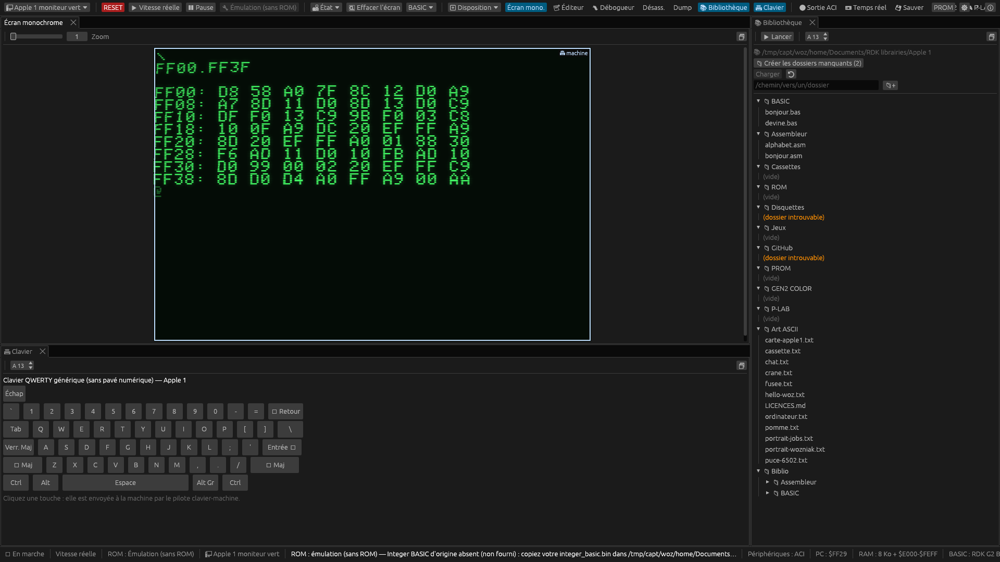
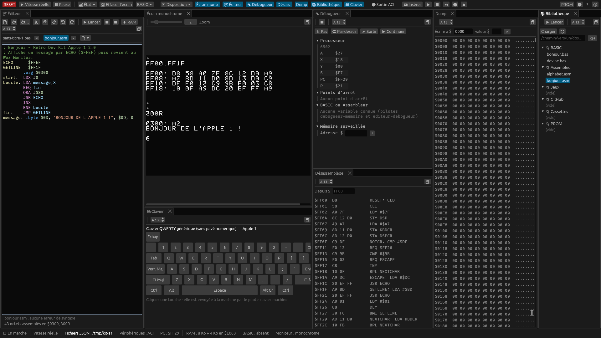

# Retro Dev Kit Apple 1 — version 2.0 (Linux)

La 2.0 reconstruit le kit Apple 1 sur **RDK-Interface-Commune 0.1.4**, comme le ZX Spectrum 0.2.x. Demande de Wirehead du 17/11/2026.



## Ce qui change

- Programme `retro-dev-kit-apple1` (paquet `crates/apple1-rdk`) : l'interface commune (fenêtres, barre d'icônes, éditeur, moniteur, Dump, débogueur, désassemblage, bibliothèque, assistant, préférences, barre d'état) avec l'Apple 1.
- La machine est **celle de la v1.0** (`crates/apple1-core`, inchangé) ; seule la liaison par les pilotes est nouvelle. Le manifeste est [`manifest-apple1.md`](../manifest-apple1.md).
- `crates/apple1-rdk` est un **espace de travail à part** (exclu de celui de la v1.0) : la v1.0 et sa construction Windows ne dépendent pas du dépôt privé de l'interface commune.
- Interface commune épinglée sur le commit `add001d33416986ec2bcc2c68242ead806abb9d1` (fusion de la 0.1.4, étiquette `v0.1.4`).
- Moniteur **monochrome** seul ; clavier dessiné **QWERTY générique sans pavé numérique**.
- **Linux seulement.** Les fichiers Windows de la v1.0 sont gardés tels quels, sans travail 2.0.

## Ce qui ne change pas

- La **v1.0** reste téléchargeable à la même adresse : <https://github.com/Old-Wirehead/rdk-apple1/releases/tag/v1.0> (étiquette et archive intouchées). Son code (`apple1-gui`, `apple1-emu`, `apple1-mcp`) reste dans le dépôt et se construit toujours.
- Les manuels et leurs traductions ne sont pas modifiés.
- ROM : seulement Woz Monitor, ACI et 2513, comme en v1.0. Le BASIC d'origine n'est pas fourni : l'utilisateur pose sa copie `integer_basic.bin` dans le dossier du kit ou dans `~/apple1/` (ou la désigne par `RDK_APPLE1_BASIC`).

## Construire et lancer

```sh
cd crates/apple1-rdk          # espace de travail à part, son propre Cargo.lock
cargo build --release
cargo test
cd ../..
packaging/linux-2.0/construire-paquet.sh   # dist/retro-dev-kit-apple1-2.0-linux.zip
cd dist/retro-dev-kit-apple1-2.0-linux && ./run.sh
```

## Pilotes faits

Voir le tableau de `crates/apple1-rdk/src/lib.rs` et la rubrique 17 du manifeste : `clavier-machine`, `video-numerique` (monochrome), `dump-memoire`, `debogueur-memoire` (variables du BASIC), `debogueur-processeur` (6502), `desassembleur-memoire`, `editeur-machine`, `editeur-memoire`, `biblio-memoire`, `cassette-machine`, `syntaxe-basic`, `syntaxe-asm`, `machine-etat`, programmateur de PROM (image + commande minipro), écrans 1 et 2 de l'assistant.



## Laissé pour plus tard

- Carte couleur GEN2, carte P-LAB, art ASCII, programmes reconnus et paramètres de chargement de la v1.0.
- Programmateur de PROM complet (pilotage de minipro, lecture, vérification) : la 2.0 écrit seulement l'image.
- Les boutons cassette de l'interface commune (Insérer, Lecture, Enregistrer…) n'appellent pas encore `cassette-machine` (0.1.4) : en attendant, la bibliothèque lit les WAV et le bouton ⏺ Sortie ACI enregistre.
- Version Windows de la 2.0 ; effets CRT ; aide propre à la machine (`aide/machine/`).

Rusty Sr IA
