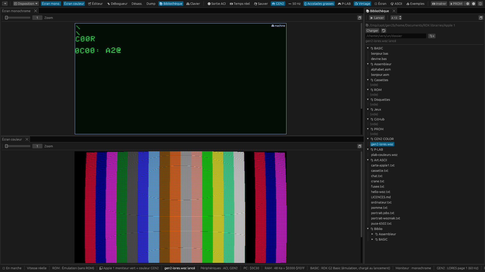
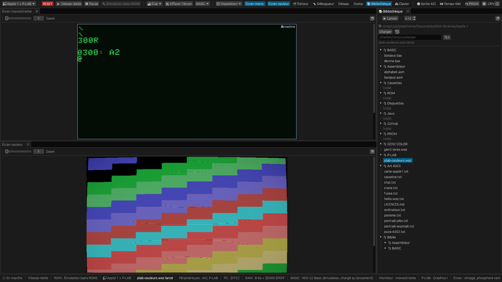
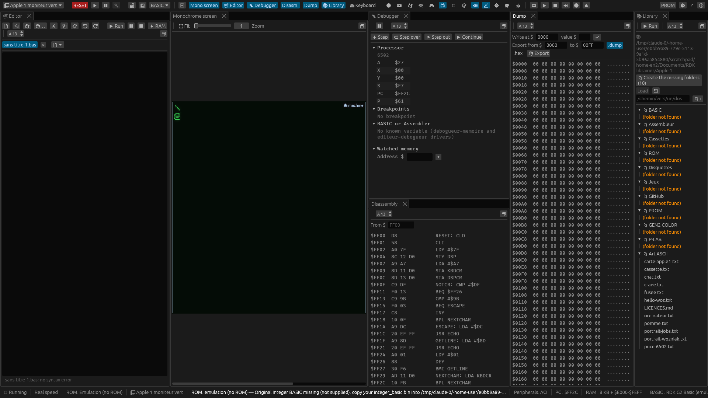

# Retro Dev Kit Apple 1 — version 2.0 (Linux)

La 2.0 reconstruit le kit Apple 1 sur **RDK-Interface-Commune 0.1.9**, comme le ZX Spectrum 0.2.x, et reprend les fonctions de la v1.0. Demandes de Wirehead du 17/11/2026.


## Ce qui change

- Programme `retro-dev-kit-apple1` (paquet `crates/apple1-rdk`) : l'interface commune (fenêtres, barre d'icônes, éditeur, moniteurs, Dump, débogueur, désassemblage, bibliothèque, assistant, préférences, barre d'état) avec l'Apple 1.
- La machine est **celle de la v1.0** (`crates/apple1-core`, inchangé) ; seule la liaison par les pilotes est nouvelle. Le manifeste est [`manifest-apple1.md`](../manifest-apple1.md).
- `crates/apple1-rdk` est un **espace de travail à part** (exclu de celui de la v1.0) : la v1.0 et sa construction Windows ne dépendent pas du dépôt privé de l'interface commune.
- Interface commune épinglée sur le commit `e098ff85bea5de4c39c3ac4dc3285b81cc55cdf1` (étiquette v0.1.9, fusion de la PR n° 21).
- **Linux seulement.** Les fichiers Windows de la v1.0 sont gardés tels quels, sans travail 2.0.

## Interface commune 0.1.5 et 0.1.6

- **Bibliothèque** : `~/Documents/RDK librairies/Apple 1` (créée seulement avec votre accord). Le bouton 📥 **Exemples** y copie les exemples du paquet et l'art ASCII de la v1.0, sans rien remplacer ; l'ancien dossier `Biblio/` du kit reste lu.
- **ROM** : Woz Monitor, ACI et 2513 sont intégrés. Seul le BASIC d'origine est cherché : votre copie `integer_basic.bin` (4096 octets, non fournie) dans le dossier `ROM` de la bibliothèque, ou désignée par `RDK_APPLE1_BASIC`. Elle est reconnue par sa signature ; **ROM réelle** = ce BASIC, **Émulation** = RDK G2 Basic, intégré (le défaut de la v1.0).
- **Formats** : `.woz` (dump du Woz Monitor, lecture et écriture), ancien `.txt` (et `.mon`, `.apl`) en lecture seule, `.dump` commun, **Intel `.hex`** (un ancien `.hex` au format Woz reste lu), cassettes `.wav`/`.aif(f)`, `.bin`, `.prg`, sources `.bas`, `.asm`, `.s`, photos (art ASCII).
- **Configurations** (liste de la barre d'icônes) : « Apple 1 moniteur vert » (défaut), « Apple 1 moniteur vert + couleur GEN2 », « Apple 1 + P-LAB ».
- **0.1.6** (PR n° 9, ajout fait pour la 2.0) : la machine déclare le **phosphore** du moniteur monochrome ; la partie commune teinte l'image en vert, blanc ou ambre au lieu de la griser.

## Repris de la v1.0

- **Carte couleur GEN2** (LORES, HIRES, TEXTE, MIXED, 50/60 Hz, accolades) et **carte P-LAB** (TMS9918A, NMI, CodeTank) sur le **moniteur couleur** ; le terminal reste sur le moniteur vert.
- **Moniteur vert, blanc ou ambre** et **écran vintage** (lignes de balayage, rémanence, halo, points adoucis, tube bombé, scintillement, masque RVB) : boutons 📺 Vintage et 🎚 Écran.
- **Programmateur d'EPROM** (bouton PROM) : minipro (XGecu TL866II+, T48, T56), lire, écrire, vérifier, puce, plage de mémoire ou fichier ; fichiers en **Intel HEX** dans `PROM/`.
- **🎨 Photo → ASCII** : photo ou dessin `.txt` → art de 40 × 24 caractères → programme BASIC ou 6502 lancé, enregistré, mis en cassette ou copié ; dossier `Art ASCII` et ses exemples.
- **Programmes reconnus** (empreinte SHA-256 des cassettes de la v1.0) : adresse de lancement et notes.
- **💾 Sauver** des plages de la mémoire (`.woz`, `.wav`, `.aiff`, Intel `.hex`, `.dump`, `.bin`, `.prg`), **📼 chargement par la cassette en temps réel** (bouton Temps réel), **⏺ Sortie ACI**, coller (Ctrl+V) dans l'Apple 1, RAM étendue automatiquement pour un programme haut.
- Clavier dessiné **QWERTY générique sans pavé numérique**, ouvert au démarrage ; moniteur monochrome (vert) par défaut.





## Ce qui ne change pas

- La **v1.0** reste téléchargeable à la même adresse : <https://github.com/Old-Wirehead/rdk-apple1/releases/tag/v1.0> (étiquette et archive intouchées). Son code (`apple1-gui`, `apple1-emu`, `apple1-mcp`) reste dans le dépôt et se construit toujours.
- Les manuels et leurs traductions ne sont pas modifiés.
- ROM livrées : seulement Woz Monitor, ACI et 2513, comme en v1.0. Jamais le BASIC d'origine, ni images CodeTank, ni cassettes du commerce, ni documents tiers.

## Construire et lancer

```sh
cd crates/apple1-rdk          # espace de travail à part, son propre Cargo.lock
cargo build --release
cargo test
cd ../..
packaging/linux-2.0/construire-paquet.sh   # dist/retro-dev-kit-apple1-2.0-linux.zip
cd dist/retro-dev-kit-apple1-2.0-linux && ./run.sh
```

## Interface commune 0.1.7 et 0.1.8

- **7 langues** : français, anglais, allemand, russe, espagnol, italien, portugais, comme la v1.0. Choix dans ⚙ Préférences → Interface → Langue ou sur le premier écran de l'assistant (défaut : langue du système). Toute l'interface suit : partie commune, boutons et fenêtres de l'Apple 1, messages ; les textes repris de la v1.0 gardent ses traductions.
- **Zoom « ⛶ Ajuster »** des moniteurs : l'image remplit le panneau, proportions gardées (corrigé en 0.1.8).
- **📸 État** : Enregistrer l'état… / Charger un état… (fichiers `.a1state` de la v1.0, dans `États/` de la bibliothèque).
- 0.1.8 : la barre d'icônes passe en icônes seules quand elle ne tient pas dans la fenêtre.

## Repris de la v1.0 en plus

Le code de la v1.0 est lu dans ses sources (`crates/apple1-gui`, intouché) par `build.rs`, comme l'écran GEN2 et la table des cassettes :

- **🔊 Son** de la cassette (ALSA, ouvert au lancement, sans lien de compilation ; coupé en vitesse accélérée) et **📈 oscilloscope** (signal sous la tête, réglage du volume).
- **⚙ Réglages du programme** : plages, adresse de chargement d'un `.bin`, adresse et commande de lancement, BASIC nécessaire, notes ; `programs.json` dans le dossier du programme (même fichier que la v1.0). Appliqués par Charger, ▶ Play et le double-clic. Un `.bin` sans réglages se charge en `$0300`, comme en v1.0.
- **🐙 Projets GitHub** : ajouter un dépôt (`propriétaire/dépôt` ou adresse, sous-dossier possible), ⟳ Mettre à jour, ▶ Tester le dernier build (Release, sinon artefact Actions avec jeton, sinon source construit : ca65 / ld65 ou assembleur intégré, `apple1.toml`). Les fichiers vont dans `GitHub/` de la bibliothèque.



## Pas encore repris de la v1.0

- Les boutons cassette de l'interface commune (Insérer, Lecture…) : la bibliothèque, ⏺ Sortie ACI et 📼 Temps réel les remplacent.
- Pages d'aide et manuels traduits : la 2.0 n'a encore que les pages d'aide communes, en français.
- Version Windows de la 2.0.

Rusty Sr IA
Claude (compléments du 17/11/2026)
